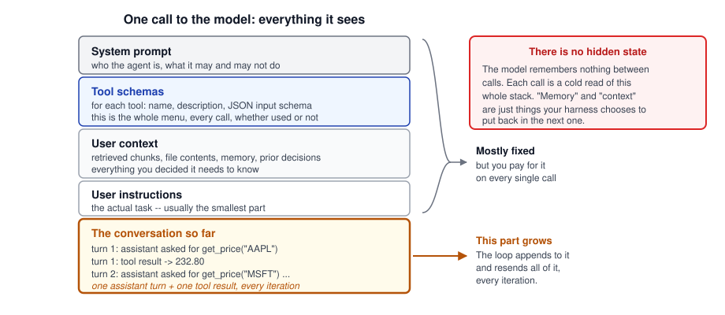
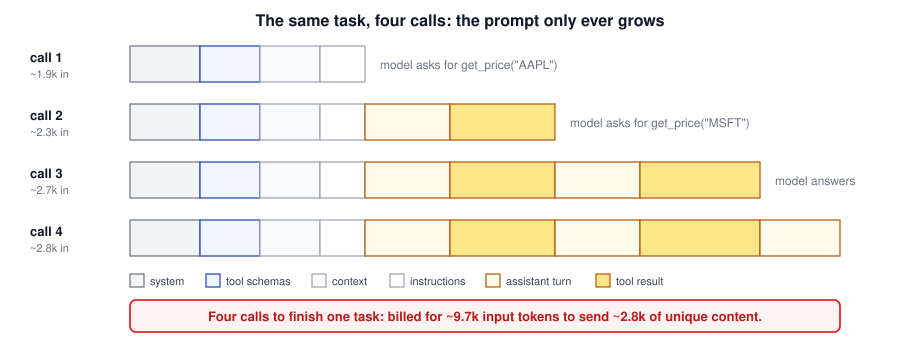
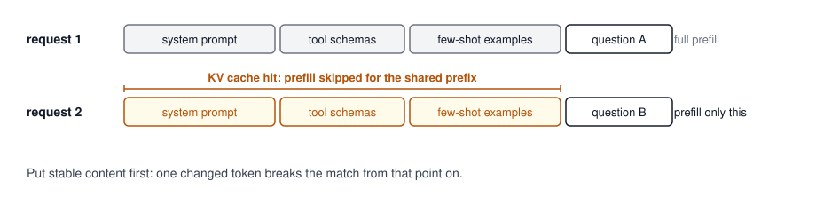
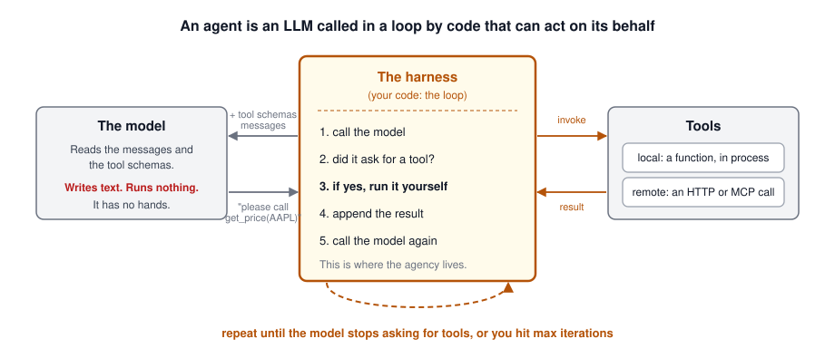
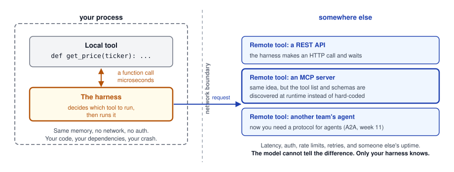
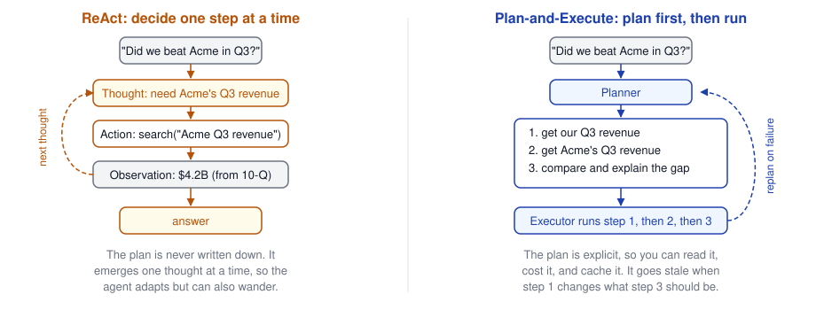
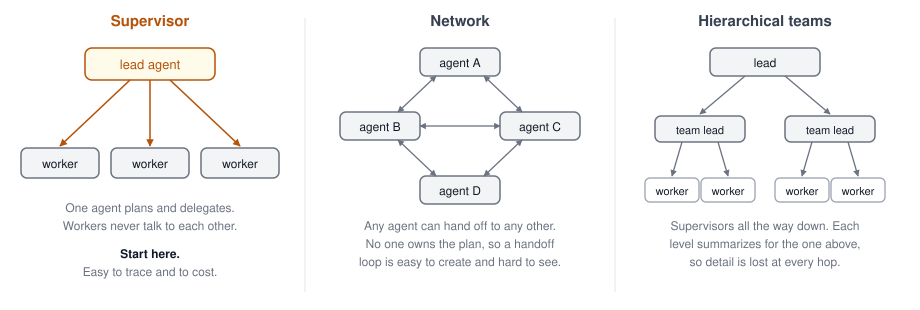

## Agenda {.smaller}

- Taking an agent apart: an LLM, a loop, and code that can act
- The anatomy of the prompt, why it grows every turn, and how prefix caching pays for that
- **The harness**: the thing that actually calls your tools
- Tools, local and remote -- and where MCP fits
- **Agent architectures**: what the model decides, what the harness decides, and four kinds of loop
- Multi-agent patterns, and how agents fail
- Frameworks, and whether you need one
- **Backup**, if we get there: context engineering, and agent memory

# The Agent, Taken Apart

## Last Week We Drew the Loop. Today We Write It.

- Week 4 ended with agentic RAG: the model decides what to retrieve, asks for it, reads the result, and asks again
- We drew that as a diagram and moved on. The diagram hides the interesting part
- Today we open it up: **what exactly is sent, what exactly comes back, and whose code does the work**

::: {.fragment}
::: {.idea-callout}
By the end of this section you will be able to write a working agent in about 30 lines, with no framework. Everything after that is a refinement of those 30 lines.
:::
:::

## Agents: 100 to 300 {.smaller}

:::: {.columns}

::: {.column width="33%"}
**100 level**

An agent is an LLM in a loop. Give the model a task and a list of tools. It replies "call this tool with these arguments." Your code runs the tool, hands back the result, and asks again. Repeat until it says it is done.
:::

::: {.column width="33%" .fragment}
**200 level**

The loop is yours to write, and it is about 30 lines. The model keeps no state, so every call resends the system prompt, the tool schemas, the context, and the entire conversation so far. You own tool execution, termination, and the token bill.
:::

::: {.column width="33%" .fragment}
**300 level**

Production agents add planning, memory across sessions, compaction before the window fills, sub-agents to isolate context, and hard limits on iterations and spend. Each layer exists because a failure mode demanded it; the rest of today walks them.
:::

::::

## What the Model Actually Sees

{height=430 fig-align="center"}

## Four Parts, One Flat Prompt {.smaller}

Every call to the model carries the same four things, plus the history:

| Part | What it holds | Who writes it |
|------|---------------|---------------|
| **System prompt** | The agent's role, rules, and refusals | You, once |
| **Tool schemas** | Name, description, and JSON input schema per tool | You, once |
| **User context** | Retrieved chunks, file contents, memory, prior decisions | Your harness, per call |
| **User instructions** | The task itself | The user |
| **Conversation so far** | Every assistant turn and every tool result | The loop, append-only |

::: {.fragment}
::: {.def-callout}
The model holds no state between calls. Each call is a cold read of this whole stack. "Memory" is only what your harness decides to put back in the next one.
:::
:::

## Pause: Anything Strange Here? {.smaller}

You have now seen everything the model receives on one call. Before we write the loop:

::: {.idea-callout}
The model remembers nothing between calls, and this loop will run 5, 20, maybe 50 times. What is wasteful about that, and what would you do about it?
:::

::: {.fragment}
**The waste**: every pass resends the whole conversation. On pass 20 you pay to send everything that passes 1 through 19 already sent, and the model re-reads all of it from scratch. The system prompt and the tool schemas cross the wire 20 times, byte for byte identical.
:::

::: {.fragment}
**The fix**: stop paying to recompute what has not changed. Cache the unchanged prefix of the prompt -- which you met in week 2 under a different name.
:::

## Every Call Resends Everything

{height=420 fig-align="center"}

## You Met the Fix in Week 2 {.smaller}

- **The KV cache**: during prefill the model computes a key and a value vector for every prompt token, at every layer. Those vectors depend only on the token and the tokens before it, so for an unchanged prefix they come out identical every single time
- **Prefix caching** keeps them alive between requests. The next request that starts with the same tokens skips prefill for that span, and only the new tail pays

{height=180 fig-align="center"}

::: {.fragment}
::: {.idea-callout}
The agent loop is the ideal workload for this. The conversation is append-only: the prefix never changes, you only add to the end. Every pass is a cache hit on everything that came before it.
:::
:::

## Prompt Caching in Practice {.smaller}

Hosted APIs sell prefix caching as **prompt caching**. On the Claude API you mark a breakpoint:

```python
TOOLS = [
    {"name": "get_price", "description": "...", "input_schema": {...},
     "cache_control": {"type": "ephemeral"}},   # cache the tools, and all before them
]
```

| Token type | Price, relative to normal input |
|------------|--------------------------------|
| Cache write, 5-minute TTL | 1.25x |
| Cache write, 1-hour TTL | 2x |
| **Cache read** | **0.1x**, and less on some models |

You pay a little more the first time, then a tenth of the price on every pass after it.

## Caching Rules That Bite {.smaller}

- The prefix builds in exactly one order: **tools, then system, then messages**. A change at any level invalidates that level and everything after it
- So rewriting a tool description mid-task throws away the whole cache, on every remaining pass
- A hit refreshes the TTL for free. A fast loop stays warm; a loop waiting on a human goes cold and pays again
- Cache hits need the prefix to match **100%**, token for token. Unstable JSON key ordering breaks this silently
- Short prompts are not cached at all, with no error. Check the `usage` field rather than assuming

::: {.fragment}
::: {.def-callout}
Summarizing old turns to reclaim room is called **compaction**, and this is its hidden cost: rewriting history changes the prefix, so the next call pays full price for all of it. Compaction is in the backup section; week 9 does the economics.
:::
:::

## What the Model Actually Emits

Ask it a question it cannot answer alone, and it does **not** call anything:

```json
{
  "role": "assistant",
  "stop_reason": "tool_use",
  "content": [
    {"type": "text", "text": "I need both share prices."},
    {"type": "tool_use",
     "id": "toolu_01A09q90qw",
     "name": "get_price",
     "input": {"ticker": "AAPL"}}
  ]
}
```

- That is **generated text** that happens to match a schema you supplied
- `stop_reason: "tool_use"` means: *I stopped because I want you to do something*
- No network call was made. No function ran. The model has no hands

## So You Run It, and Hand the Result Back

Your code executes `get_price("AAPL")`, then appends the answer to the conversation:

```json
{
  "role": "user",
  "content": [
    {"type": "tool_result",
     "tool_use_id": "toolu_01A09q90qw",
     "content": "232.80"}
  ]
}
```

- The result goes back as a **user message**. There is no privileged side channel
- `tool_use_id` is how the model matches the answer to its request
- Then you call the model again, with this longer conversation, and it continues

## The Harness Does the Calling

{height=420 fig-align="center"}

## What Do We Call This Thing? {.smaller}

The layer has no settled name. The three you will meet in print:

| Term | Where it comes from |
|------|---------------------|
| **Agent loop** | SDK documentation. The [OpenAI Agents SDK](https://openai.github.io/openai-agents-python/running_agents/) has a section by that name: "the runner then runs a loop" |
| **Scaffolding** | Evals and safety research. [METR](https://metr.org/blog/2024-08-06-update-on-evaluations/): "with our simple baseline scaffolding, agent performance asymptotes" |
| **Harness** | Benchmark tooling, where the harness runs the thing under test and records why it stopped ([`swebench.harness.run_evaluation`](https://www.swebench.com/SWE-bench/guides/evaluation/)) |

::: {.fragment}
Two words that do **not** mean this:

- **Orchestrator** -- in [Anthropic's](https://www.anthropic.com/engineering/building-effective-agents) vocabulary the orchestrator is *a model* that decomposes a task and delegates to workers, not the code running the loop
- **Runtime** -- that is the compute the agent runs on: a container, a VM, a serverless sandbox. A platform concern, and week 10's topic
:::

::: {.fragment}
::: {.idea-callout}
"Building Effective Agents" never names this layer at all. It just says agents are "LLMs using tools based on environmental feedback in a loop." This deck says *harness*, because the word is honest about the job: it straps a text predictor to a set of real actions and holds it there while it works.
:::
:::

## The Whole Agent, in 30 Lines {.smaller}

```python
import anthropic

client = anthropic.Anthropic()
MAX_ITERATIONS = 10

TOOLS = [{
    "name": "get_price",
    "description": "Current share price for a ticker symbol, in USD.",
    "input_schema": {
        "type": "object",
        "properties": {"ticker": {"type": "string"}},
        "required": ["ticker"],
    },
}]

def get_price(ticker: str) -> str:               # the tool: ordinary Python
    return {"AAPL": "232.80", "MSFT": "418.10"}[ticker]

messages = [{"role": "user", "content": "Does Apple cost more per share than Microsoft?"}]

for _ in range(MAX_ITERATIONS):
    reply = client.messages.create(
        model="claude-opus-5", max_tokens=1024, tools=TOOLS, messages=messages,
    )
    messages.append({"role": "assistant", "content": reply.content})

    if reply.stop_reason != "tool_use":          # the model answered: stop
        break

    results = []
    for block in reply.content:
        if block.type == "tool_use":
            results.append({"type": "tool_result",
                            "tool_use_id": block.id,
                            "content": get_price(**block.input)})   # you run it
    messages.append({"role": "user", "content": results})
```

## Reading the Loop {.smaller}

Four passes through that `for` statement answer the question:

| Pass | The model says | Your code does |
|------|----------------|----------------|
| 1 | `tool_use: get_price("AAPL")` | runs it, appends `232.80` |
| 2 | `tool_use: get_price("MSFT")` | runs it, appends `418.10` |
| 3 | `"Microsoft costs more per share..."` | sees `stop_reason != "tool_use"`, breaks |

- The model never looped. **It answered three separate questions**, each one longer than the last
- The loop, the state, and every side effect belong to your 30 lines
- Swap `claude-opus-5` for any model with tool use and the shape does not change

## When Does It Stop? {.smaller}

Termination is the harness's job, and there are three honest reasons to stop:

1. **The model stopped asking.** `stop_reason` comes back as `end_turn`: it has an answer
2. **You hit `MAX_ITERATIONS`.** A hard ceiling on passes through the loop
3. **You ran out of budget.** Tokens spent, wall-clock time, or dollars

::: {.fragment}
::: {.hot-callout}
Never ship a loop without reason 2. A model that keeps retrying a failing tool will happily burn your entire budget, and it will do it in under a minute. `while True` is not a design.
:::
:::

## What This Buys Us

- **"Agentic" describes the loop, not the model.** The same model is a chatbot in one program and an agent in another; the difference is whether code acts on what it emits
- **Everything interesting is a design decision you own**: which tools, how they are described, what goes in context, when to stop, what to remember
- **Nothing is hidden.** The entire state of an agent is that `messages` list. In principle you can print it and read exactly what the model saw

::: {.fragment}
::: {.idea-callout}
The rest of this lecture is the list of decisions hiding in those 30 lines, in the order they start to hurt.
:::
:::

## In Practice, Nobody Is Reading print() {.smaller}

"Print the `messages` list" works on your laptop, for one run. Production agents do not run on your laptop:

- They run in cloud compute -- a container, a function, a microVM -- that is torn down before you think to ask it a question
- Hundreds of runs happen at once, each with its own loop and its own way of going wrong
- You *could* open a shell into a sandbox and read `stdout`. That is not a debugging strategy

::: {.fragment}
So the harness **emits telemetry** as it loops. The standard shape for that is OpenTelemetry's [GenAI semantic conventions](https://github.com/open-telemetry/semantic-conventions-genai): agreed span and attribute names (`gen_ai.*`) for model calls, tool executions, and MCP, so the data lands in any backend that speaks OTel.
:::

::: {.fragment}
::: {.def-callout}
One agent run becomes a **trace**: a tree of spans, one per model call and tool execution, carrying token counts, latency, and arguments. Agent frameworks emit this for you, which is one of the better reasons to use one. Week 7 is the whole topic.
:::
:::

# Tools

## A Tool Is a Schema Plus a Function

Two halves, in two different places:

- **The schema** lives in the prompt. Name, description, and a JSON schema for the arguments. This is the only thing the model ever sees
- **The function** lives in your harness. The model never sees its code, its language, or where it runs

::: {.fragment}
Consequences worth sitting with:

- The model selects tools by reading **prose**, so the description is doing the work
- You can change the implementation freely as long as the schema holds
- You can lie in the description, and the model will believe you
:::

## Local Tools and Remote Tools

{height=400 fig-align="center"}

## Local: a Function in Your Process {.smaller}

```python
def get_price(ticker: str) -> str:
    return yfinance.Ticker(ticker).fast_info["lastPrice"]
```

- The harness calls it the way it calls anything else. Microseconds, no network, no auth
- Good for: computation, file access, parsing, database queries, anything already in your codebase
- You own the failure. A tool that raises takes your loop down with it unless you catch it
- You also own the blast radius: this code runs with your process's permissions

::: {.def-callout}
A "code interpreter" tool is the extreme case of a local tool: the argument *is* the code. Sandbox it, because the model writes it.
:::

## Remote: a Call Over the Wire {.smaller}

```python
def get_price(ticker: str) -> str:
    r = httpx.get(f"https://api.example.com/quote/{ticker}", timeout=10)
    return r.json()["last"]
```

- Same shape from the model's point of view. Different engineering problem entirely
- You now inherit: latency, authentication, rate limits, partial failures, and someone else's uptime
- Set a timeout. Without one, a hung dependency becomes a hung agent
- Retries belong in the tool, not in the loop. The model should not be your retry policy

## MCP: Tools You Did Not Write {.smaller}

Every tool so far is one you wrote yourself. Here is the hole that MCP slots into:

- Without MCP, the tool list is **hard-coded** in your harness: you wrote every schema
- With MCP, the harness **discovers** tools at runtime: it asks the server what it offers and forwards those schemas to the model
- One integration gives you every tool that server exposes, written by someone else

```python
# the harness fetches schemas instead of declaring them
tools = await session.list_tools()
reply = client.messages.create(model=..., tools=to_schemas(tools), messages=messages)
```

::: {.fragment}
The loop is unchanged. Only the source of the tool list moved. That is the whole point of a protocol.
:::

::: {.fragment}
::: {.idea-callout}
Next week is MCP in full: you build servers of your own and plug them into this loop.
:::
:::

## Tool Descriptions Are Prompts {.smaller}

The model picks tools by reading descriptions, so write them for a new hire, not for a type checker.

:::: {.columns}

::: {.column width="50%"}
**Weak**

```json
{"name": "search",
 "description": "Searches."}
```

The model cannot tell what it searches, when to prefer it, or what it returns.
:::

::: {.column width="50%"}
**Better**

```json
{"name": "search_internal_docs",
 "description": "Full-text search over
  our engineering wiki. Use for
  internal process and architecture
  questions. Returns up to 5 excerpts
  with page URLs. Does not cover
  customer data or code."}
```
:::

::::

- Say **what it is for, when to use it, what it returns, and what it does not cover**
- Anthropic's research agents saw a **40% drop in task completion time** after a model rewrote its own tool descriptions
- Fewer, well-described tools beat a large ambiguous toolbox: every extra schema is both tokens and a chance to choose wrong

## You Do Not Hand-Write That JSON {.smaller}

In Python the schema is **derived from the function you already wrote**:

```python
from strands import tool

@tool
def search_internal_docs(query: str, max_results: int = 5) -> list[str]:
    """Full-text search over our engineering wiki.

    Use for internal process and architecture questions. Does not cover
    customer data or source code.

    Args:
        query: Natural-language search query.
        max_results: How many excerpts to return, at most 10.
    """
```

| The schema field | Comes from |
|------------------|------------|
| `name` | the function name |
| `description` | the docstring |
| `input_schema` | parameter names, type hints, and defaults |

## Your Docstring Is the Prompt {.smaller}

Strands, LangChain, the OpenAI Agents SDK, and the Claude Agent SDK all do some version of that derivation. Which has a consequence worth stating plainly:

::: {.idea-callout}
Nothing new to invent. The information the model needs is already in a well-written Python function. But the docstring you wrote for the next developer is now also the prompt the model reads, and a lazy docstring is a lazy prompt.
:::

::: {.fragment}
So the ordinary rules earn their keep twice:

- **Name things for a reader.** `search_internal_docs` beats `search`; `max_results` beats `n`
- **Write the docstring in full**: what it does, when to use it, what it returns, what it does not cover
- **Type-hint every parameter.** The hints become the model's contract, and a missing one becomes a guess
- **Say the units and the limits** in the text. The type `int` does not tell the model that 10 is the cap
:::

::: {.fragment}
You will see this in the lab: you write the function, and the tool definition falls out of it.
:::

## Tool Errors Are Messages, Not Exceptions {.smaller}

When a tool fails, the model is the one that has to recover. So tell it.

```python
try:
    content = get_price(**block.input)
except Exception as exc:                     # noqa: BLE001 -- the model handles it
    content = f"Error: {exc}. Check the ticker symbol and try again."
    is_error = True
```

- Return the error **as the tool result**, with `is_error` set where the API supports it
- A useful error message lets the model fix its own arguments on the next pass
- A raised exception ends the task. A returned error continues it

::: {.hot-callout}
Watch for the opposite failure: a model that retries the same broken call forever. Errors go back to the model, but `MAX_ITERATIONS` is what saves you.
:::

# Agent Architectures

## The Loop Is Greedy {.smaller}

The 30-line harness decides one step at a time, with no lookahead:

- It picks the action that looks best **right now**, given what it has read so far
- A wrong turn on pass 2 is discovered on pass 9, after seven passes of wasted budget
- Nothing in the loop writes down an intent, so nothing can check progress against one

::: {.fragment}
The field spent 2022 to 2024 answering this with **prompt patterns**: ReAct, plan-and-execute, reflection. You should know them. You should also know that most of them are no longer things you write.
:::

## Mostly, the Model Decides Now {.smaller}

Ask a 2026 agent builder how their agent plans and the answer is usually: it just does. You supply the system prompt, the tools, the context, and the memory, and the model works out the rest.

::: {.fragment}
That is not a shortcut. It is the explicit advice of the people who build these systems. Anthropic names the alternative as a **failure mode**:

> "engineers hardcoding complex, brittle logic in their prompts to elicit exact agentic behavior" ... "creates fragility and increases maintenance complexity over time"
:::

::: {.fragment}
> "As model capabilities improve, agentic design will trend towards letting intelligent models act intelligently." ... "smarter models require less prescriptive engineering, allowing agents to operate with more autonomy."
>
> -- [Anthropic, Effective context engineering for AI agents](https://www.anthropic.com/engineering/effective-context-engineering-for-ai-agents)
:::

## So Is ReAct Obsolete? {.smaller}

Three different things got called "ReAct". They did not share a fate.

| | Status in 2026 |
|--|---------------|
| **The prompt format** -- literally writing `Thought:` / `Action:` / `Observation:` into the prompt and parsing it back out of raw text | **Gone.** Native tool calling replaced string parsing, and reasoning models do the thought step internally |
| **The control flow** -- reason, act, observe, repeat | **Universal.** It is the loop you wrote on slide 17. Every harness runs it |
| **The explicit plan** -- commit to steps up front | **Alive, but moved.** It is a *tool* the model calls now, not a prompt scaffold |

::: {.fragment}
::: {.idea-callout}
ReAct was not defeated. It was absorbed. The idea is so thoroughly standard that nobody names it any more -- which is the most successful outcome a paper can have.
:::
:::

## The Receipts {.smaller}

The vocabulary moved, and you can watch it happen in the docs:

- **LangChain** shipped `create_react_agent` for years. The current docs call the factory `create_agent`, and the word "ReAct" does not appear on the agents page at all. Their definition now: *"An agent is a model calling tools in a loop until a given task is complete"*, and **"Agent = Model + Harness"**
- **The Claude Agent SDK** describes an agent as one that *"completes a task by **planning its own steps** and calling tools"* -- the planning is the model's, not the scaffold's
- **The documented loop** is four lines: receive prompt, evaluate and respond, execute tools, repeat -- with no mention of a reasoning format anywhere

::: {.fragment}
Both independently landed on the same word for the thing around the model. That word is **harness**.
:::

## Still Worth Knowing: ReAct {.smaller}

The paper that named the loop everyone now runs ([Yao et al., 2022](https://arxiv.org/abs/2210.03629)):

- Chain-of-thought reasons but cannot act. Tool use acts but does not reason. **ReAct alternates them**
- Each pass emits a **thought** before its **action**, then reads an **observation**
- The thought is what lets the model track a plan, notice a dead end, and handle a surprise

```
Thought: I need Acme's Q3 revenue before I can compare.
Action:  search("Acme Q3 2026 revenue")
Observation: $4.2B, from their 10-Q.
Thought: Now I need ours.
Action:  sql("select revenue from results where quarter='Q3'")
```

- Reported gains over imitation and RL baselines: **+34% on ALFWorld, +10% on WebShop**

::: {.hot-callout}
Do not write that format today. You get the thought as a thinking block and the action as a native tool call, both for free. Hand-writing the scaffold now fights the model instead of helping it.
:::

## ReAct and Plan-and-Execute

{height=400 fig-align="center"}

## Choosing Between Them {.smaller}

| | ReAct | Plan-and-execute |
|--|-------|------------------|
| **Plan** | Implicit, one step at a time | Explicit, written down first |
| **Adapts to surprises** | Immediately | Only when it replans |
| **Inspectable before running** | No | Yes -- you can read and cost the plan |
| **Model calls** | One per step | One to plan, then one per step |
| **Fails by** | Wandering, repeating itself | Following a plan that went stale |

::: {.fragment}
This trade-off survived the pattern that named it. You still choose between letting the agent find its way and making it commit to steps you can read first. What changed is **how you express the choice**: not a prompt template, but a to-do tool the model writes to, or a plan mode that withholds edits until you approve.
:::

## Reflection: Grade the Work, Then Redo It {.smaller}

[Reflexion (Shinn et al., 2023)](https://arxiv.org/abs/2303.11366) adds a critique step and keeps it:

- After an attempt, the agent writes a **verbal critique** of its own output, in plain language
- That critique goes into an episodic memory buffer and into the next attempt's context
- No weights change. The improvement is entirely in what the next prompt says

::: {.fragment}
- Headline result: **91% pass@1 on HumanEval**, against 80% for the prior GPT-4 state of the art
- Works when you have a real signal to reflect on: a failing test, a compiler error, a validator
- Works poorly as pure self-assessment. A model asked "was that good?" tends to say yes
:::

::: {.fragment}
::: {.def-callout}
Reflection earns its cost when the grader is cheap and objective. Point it at a test suite, not at a vibe.
:::
:::

## Architecture Did Not Disappear. It Moved. {.smaller}

The design decisions are still yours. They are just not in the prompt any more -- they are **features of the harness**:

| Decision | How you express it now |
|----------|------------------------|
| Should it plan explicitly? | Give it a to-do tool and let it track its own tasks |
| How much should it reason? | An effort or thinking-budget setting, per agent |
| When must it stop? | `max_turns`, a dollar budget, an evaluator's verdict |
| What may it touch? | Permission modes and allow/deny rules per tool |
| Who sees what? | Subagents with their own windows and their own tool lists |
| What survives a long run? | Automatic compaction, plus memory files |
| What do you do when it misbehaves? | Hooks that intercept a tool call before it runs |

::: {.fragment}
That table is the agent architecture of 2026. None of it is a prompt pattern.
:::

## Four Kinds of Loop {.smaller}

A more useful taxonomy than the prompt patterns, because it is about **who holds the judgment**:

| Loop | What starts it | What stops it |
|------|----------------|---------------|
| **Turn-based** | A person prompts it | The model decides it is done. *You* are the verifier |
| **Goal-based** | A person prompts it, with success criteria | An **evaluator model** checks the criteria, or max turns |
| **Time-based** | A schedule or interval | You cancel it, or the work runs out |
| **Proactive** | An event, with no human present | Each task hits its goal; the routine runs until turned off |

::: {.fragment}
Read down that table and watch what you hand over: first the check, then the stop condition, then the trigger, then the prompt itself. **Each row removes a human from the loop**, which is why each row needs more verification than the one above it.
:::

> Source: [Anthropic -- Loop engineering](https://claude.com/blog/getting-started-with-loops)

## Why Goal-Based Beats Self-Assessment {.smaller}

The weakness of a turn-based loop is the one we hit on the reflection slide: the model decides when it is finished.

- A model asked "is this good enough?" is strongly inclined to say yes, and ends the loop early
- Give it an explicit, measurable exit criterion and that judgment leaves the model: tests passing, a score threshold, a count
- An **evaluator** checks the criterion and sends the work back if it fails

::: {.fragment}
::: {.def-callout}
This is Reflexion's idea, promoted from a prompting trick to a property of the loop. Same insight, better place for it: never let completion rest on the worker's own sense of being done.
:::
:::

## The Right Altitude {.smaller}

"Let the model decide" is not the same as "say nothing." Anthropic frames it as a **Goldilocks zone between two failure modes**:

:::: {.columns}

::: {.column width="50%"}
**Too low**

Hardcoded, brittle prompt logic trying to force an exact sequence. Fragile, and expensive to maintain.
:::

::: {.column width="50%"}
**Too high**

Vague, high-level guidance. The agent misuses tools, chases dead ends, and burns context finding out.
:::

::::

::: {.fragment}
The target: specific enough to guide behaviour, loose enough to let the model use its own judgment. Which means the engineering effort moves to the things the model reads -- **good tools, good descriptions, the right context** -- and away from choreographing its steps.
:::

::: {.fragment}
::: {.idea-callout}
"Do the simplest thing that works." Start with the plain loop and a reasoning model. Add structure only where you can measure that it pays.
:::
:::

## Do You Even Need a Loop? {.smaller}

Before any of this, the cheapest architecture decision there is:

- **A workflow**: LLM calls and tools wired through **predefined code paths**. You decide the sequence
- **An agent**: the model **directs its own process** and decides the sequence at runtime

::: {.fragment}
Workflows are cheaper, faster, and far easier to debug, because you can read the control flow. Reach for an agent when you genuinely cannot predict the steps.
:::

::: {.fragment}
::: {.idea-callout}
Escalate in order: one API call, then a workflow, then an agent. Most production systems that call themselves agents are a workflow with one agentic step in the middle, and they are better for it.
:::
:::

> Source: [Anthropic -- Building Effective Agents](https://www.anthropic.com/engineering/building-effective-agents)

## The Pattern Vocabulary {.smaller}

Six shapes worth recognising by name. You rarely hand-code them now, but you need to spot one and know what it costs.

| Shape | What it does | Cost |
|-------|--------------|------|
| **Prompt chaining** | A fixed sequence, each step eating the last one's output, with gates between | Low |
| **Routing**, or classify-and-act | Classify the input, then hand it to a specialist | Low |
| **Parallelization**, or fan-out-and-synthesize | Split independent subtasks, run them at once, merge the results | Medium |
| **Voting**, or generate-and-filter | Run the same task several times and aggregate for confidence | Medium |
| **Orchestrator-workers** | A lead decomposes the task *at runtime* and delegates, then synthesizes | High |
| **Evaluator-optimizer**, or adversarial verification | One model generates, another critiques, repeat until the criteria pass | High |

- The top two need **no loop at all**. The bottom two are real agents
- Two more in the dynamic-workflow vocabulary: **tournament** and **loop-until-done**

## When the Model Writes the Harness {.smaller}

The end point of this trend: Claude Code can now generate a **workflow tailored to the task in front of it** rather than running steps someone hardcoded.

> "A static harness runs the same steps for every question; a dynamic workflow is shaped to the one in front of it."

::: {.fragment}
It composes these from a known vocabulary -- classify-and-act, fan-out-and-synthesize, adversarial verification, generate-and-filter, tournament, loop-until-done.
:::

::: {.fragment}
::: {.hot-callout}
Which is the real reason to learn the patterns. You are no longer hand-coding them, but you still have to recognise one, know when it is worth the tokens, and nudge the model toward it. The same post warns they "may end up using significantly more tokens" and that "parallelism and specialization have to earn their coordination cost."
:::
:::

> Source: [Anthropic -- A harness for every task](https://claude.com/blog/a-harness-for-every-task-dynamic-workflows-in-claude-code)

# More Than One Agent

## When One Agent Is Not Enough {.smaller}

The four reasons the Agent SDK documents, which are also the only four honest ones:

- **Context isolation.** A sub-agent explores dozens of files and none of it lands in the parent's window
- **Parallelization.** Independent subtasks finish in the time of the slowest one, not the sum of all
- **Specialized instructions.** A migration specialist can carry SQL rollback knowledge that would be noise in the main prompt
- **Tool restrictions.** A doc reviewer gets `Read` and `Grep` and therefore *cannot* modify anything

::: {.fragment}
::: {.hot-callout}
The dishonest reason: it sounds impressive. Most multi-agent systems would work better as one agent with better tools, or as a workflow. "Parallelism and specialization have to earn their coordination cost."
:::
:::

## Three Topologies

{height=380 fig-align="center"}

The supervisor shape won. It is what every major SDK ships as its default primitive, because it is the only one of the three you can reliably trace and budget.

## Sub-Agents Are a Harness Feature Now {.smaller}

You do not build the topology. You **declare the agents** and the harness runs them:

```python
agents={
    "code-reviewer": AgentDefinition(
        description="Expert code review specialist. Use for security and quality reviews.",
        prompt="You are a code review specialist...",   # its system prompt
        tools=["Read", "Grep", "Glob"],                 # read-only: it cannot edit
        model="sonnet",                                 # cheaper model for this role
    ),
}
```

- Other fields: `effort`, `skills`, `memory`, `maxTurns`, `permissionMode`, `disallowedTools`
- **Claude decides when to call it**, by matching the task against `description`
- Which means the lesson from slide 28 applies again: that description is a prompt, and a vague one gets your sub-agent ignored

## What a Sub-Agent Actually Inherits {.smaller}

| It receives | It does **not** receive |
|-------------|------------------------|
| Its own system prompt, plus the prompt string the parent passed | The parent's conversation history or tool results |
| Project `CLAUDE.md` / `AGENTS.md` | The parent's system prompt |
| Tool definitions, or just the subset in `tools` | Preloaded skill content, unless listed in `skills` |

::: {.fragment}
::: {.hot-callout}
"The only content you pass from parent to sub-agent is the Agent tool's prompt string." So every file path, error message, and decision the sub-agent needs has to be *in that string*. A brief that says "fix the failing test" sends it hunting for something the parent already knew.
:::
:::

::: {.fragment}
Coming back the other way: **only the final message returns to the parent.** Every intermediate tool call stays inside the sub-agent. That asymmetry is the whole mechanism.
:::

## So the Real Argument Is Budget {.smaller}

Not capability. Workers can each burn tens of thousands of tokens while the lead's context grows by one paragraph.

::: {.fragment}
Anthropic's research system puts numbers on it: a lead agent with sub-agents beat a single agent by **90.2%** on their internal research eval, and running 3-5 sub-agents in parallel **cut research time by up to 90%** on complex queries.
:::

::: {.fragment}
::: {.idea-callout}
Isolate exploration, which is token-hungry, from decision-making, which needs a clean view. A sub-agent is a way to spend 50,000 tokens and report back 200.
:::
:::

## What Multi-Agent Costs {.smaller}

From the same write-up, and worth quoting before you design one:

- Agents use about **4x the tokens** of a chat interaction. Multi-agent systems use about **15x**
- On one benchmark, **token spend alone explained 80% of the performance variance**. These systems largely work because they spend enough tokens to solve the problem
- So: multi-agent is justified only where **the task is valuable enough to pay for it**

::: {.fragment}
| Good fit | Poor fit |
|----------|----------|
| Heavy parallelization | Work needing tightly shared context |
| Information exceeding one window | Tight dependencies between steps |
| Many complex tools | Most coding tasks |
:::

> Source: [Anthropic -- How we built our multi-agent research system](https://www.anthropic.com/engineering/multi-agent-research-system)

## One Prompt Can Become a Tree {.smaller}

Claude decides when to spawn, and how many. **Sub-agents can spawn sub-agents.** So bound it in three dimensions:

| Limit | Default | What happens at the limit |
|-------|---------|---------------------------|
| **Depth** of nesting | 3 layers | The bottom layer does the work itself instead of delegating |
| **Concurrency** | 20 at once | Refuses to spawn: `Concurrent subagent limit reached` |
| **Spend** (`max_budget_usd`) | No limit | Refuses to spawn, stops background sub-agents, ends with `error_max_budget_usd` |

- The spend cap counts **the whole tree**, because every sub-agent makes its own API calls
- For cost accounting, `usage` covers only the main loop. You need `model_usage` for the tree
- Newer, more capable models delegate more eagerly, which makes these limits matter more, not less

::: {.fragment}
::: {.def-callout}
Sub-agents suit a few delegated tasks per turn. For runs coordinating dozens or hundreds of agents, orchestration moves out of the conversation entirely and into a script the runtime executes.
:::
:::

## Agents Talking to Agents {.smaller}

Sub-agents inside one process are function calls. Agents across an organization are not.

- Once the other agent belongs to another team, you are back at the **remote tool** problem, with a harder version: the other side has its own loop, its own state, and its own idea of when it is done
- **A2A** is the open protocol for that: agents collaborate without sharing memory, prompts, or tool implementations
- Contributed by Google, now hosted by the Linux Foundation; SDKs in Python, Go, JavaScript, Java, and .NET

::: {.def-callout}
MCP connects an agent to tools and data. A2A connects an agent to other agents. Week 11 takes A2A apart the way today took the loop apart.
:::

# When Agents Fail

## New Failure Modes {.smaller}

A pipeline fails loudly on one input. A loop fails in ways that cost money.

| Failure | What it looks like |
|---------|--------------------|
| **No termination** | The model retries a broken tool until the budget is gone |
| **Thrashing** | Two tools keep undoing each other; progress stalls, tokens do not |
| **Compounding error** | A wrong fact on pass 2 is treated as established truth by pass 9 |
| **Silent context loss** | Compaction drops the constraint the task depended on |
| **Runaway cost** | One task costs 200x what the average task costs |
| **Unsafe action** | The model deletes the thing. The tool let it |

## Guardrails for the Loop {.smaller}

Most of these are a few lines in the harness, and all of them are cheaper than the incident:

- **Cap iterations.** Always. `MAX_ITERATIONS` is the single highest-value line in the loop
- **Cap spend and time.** Track tokens per task and stop at a ceiling; set a wall-clock deadline
- **Detect repetition.** The same tool with the same arguments three times is a stuck agent, not a persistent one
- **Gate destructive tools.** Require human approval for writes, deletes, payments, and sends
- **Make tools idempotent** where you can, so a retry is safe
- **Log every pass.** The `messages` list is the trace; keep it (week 7)

::: {.fragment}
::: {.def-callout}
Evaluating whether the agent took a *sensible path*, not just whether it got the right answer, is trajectory evaluation. That is week 7.
:::
:::

# Frameworks

## The Landscape {.smaller}

| Framework | Provider | Approach | License |
|-----------|----------|----------|---------|
| **LangGraph** | LangChain | Graph of nodes and edges, explicit state | MIT |
| **Strands Agents** | AWS | Model-driven, minimal code | Apache 2.0 |
| **CrewAI** | CrewAI | Role-based agent crews | MIT |
| **Claude Agent SDK** | Anthropic | Built on Claude Code; subagents and hooks | MIT |
| **Agents SDK** | OpenAI | Minimal primitives, handoffs, guardrails | MIT |
| **Agent Development Kit** | Google | Code-first, Gemini-optimized, A2A native | Apache 2.0 |

- All of them wrap the same loop you just wrote
- What you are buying: state management, streaming, retries, tracing, multi-agent primitives, and deployment glue

## Three Styles, Same Loop {.smaller}

:::: {.columns}

::: {.column width="50%"}
**Graph** -- you draw the state machine

```python
from langgraph.graph import StateGraph

graph = StateGraph(AgentState)
graph.add_node("agent", call_model)
graph.add_node("tools", tool_node)
graph.add_edge("agent", "tools")
```

**Model-driven** -- you declare tools, the model drives

```python
from strands import Agent, tool

@tool
def word_count(text: str) -> int:
    """Count words in text."""
    return len(text.split())

agent = Agent(tools=[word_count])
agent("How many words here?")
```
:::

::: {.column width="50%"}
**Role-based** -- you cast a team

```python
from crewai import Agent, Crew, Task

researcher = Agent(
    role="Research Analyst",
    goal="Find and summarize sources",
    backstory="Cites everything.",
)
task = Task(
    description="Research serving engines",
    expected_output="A sourced summary",
    agent=researcher,
)
crew = Crew(agents=[researcher], tasks=[task])
crew.kickoff()
```
:::

::::

## Do You Need One? {.smaller}

- **Not at first.** Write the 30-line loop. You will understand your problem better, and you will be able to debug anything you build later
- **Reach for a framework when** you need durable state, human-in-the-loop pauses, streaming to a UI, retries and tracing, or multi-agent orchestration you do not want to hand-roll
- **Watch the cost**: a framework decides your prompt layout and your context strategy, and those are the decisions that drive quality and spend

::: {.fragment}
::: {.idea-callout}
Frameworks are worth it when they absorb engineering you would otherwise write. They are a trap when they hide the one thing you need to tune.
:::
:::

- Deployment, runtimes, and governance are a platform concern -- week 10

## Hands-on Lab {.smaller}

### Part 1 -- [agents](https://github.com/gu-dsan6725/agents)

Build tool-using agents in two frameworks and compare them.

- Custom tools with the **AWS Strands Agents SDK**
- A **LangGraph** agent wired to an MCP server (Context7) for library documentation Q&A
- Runs on a free **Groq** API key; no AWS account needed

### Part 2 -- [agents-part-2](https://github.com/gu-dsan6725/agents-part-2)

Memory, session state, and multi-agent collaboration.

- Requires a [Tavily](https://tavily.com/) key for search and a Slack bot token
- Deliverables: `problem1_task1.txt`, `problem1_task2.txt`, `generated_code.py`, and the generated `titanic.*` files

::: {.hot-callout}
Before you open either notebook: write the 30-line loop from this deck yourself, with one tool of your own. Everything in the labs is that loop with more scaffolding.
:::

## References {.smaller .scrollable}

**The loop and tool use**

- [Anthropic -- Building Effective Agents](https://www.anthropic.com/engineering/building-effective-agents)
- [Anthropic -- Tool use with Claude](https://docs.claude.com/en/docs/agents-and-tools/tool-use/overview)
- [Model Context Protocol](https://modelcontextprotocol.io/)

**Planning and reflection**

- [ReAct: Synergizing Reasoning and Acting in Language Models (arXiv:2210.03629)](https://arxiv.org/abs/2210.03629)
- [Reflexion: Language Agents with Verbal Reinforcement Learning (arXiv:2303.11366)](https://arxiv.org/abs/2303.11366)

**Context and memory**

- [Anthropic -- Effective context engineering for AI agents](https://www.anthropic.com/engineering/effective-context-engineering-for-ai-agents)
- [LangMem](https://github.com/langchain-ai/langmem)

**Multi-agent**

- [Anthropic -- How we built our multi-agent research system](https://www.anthropic.com/engineering/multi-agent-research-system)
- [LangGraph multi-agent tutorials](https://langchain-ai.github.io/langgraph/tutorials/#multi-agent-systems)
- [A2A Protocol](https://github.com/a2aproject/A2A)

**Frameworks**

- [LangGraph](https://www.langchain.com/langgraph) · [Strands Agents](https://strandsagents.com/) · [CrewAI](https://docs.crewai.com/)
- [Claude Agent SDK](https://github.com/anthropics/claude-agent-sdk-python) · [OpenAI Agents SDK](https://openai.github.io/openai-agents-python/) · [Google ADK](https://github.com/google/adk-python)

# Backup: Context Engineering

Material we are unlikely to reach in class. Read it before you build anything
that runs for more than a handful of passes -- every item here is a bill you
will otherwise pay in tokens or in a silent wrong answer.

## Caching Cuts the Price, Not the Size {.smaller}

A cache hit is cheap, but the tokens are still there and the window still has a ceiling. Input tokens per task grow with the square of the step count, and a 20-step agent can carry more resent history than new work.

### Overflow

You run out of window. The call fails, or the provider truncates, and the agent forgets the first half of its own task.

### Degradation, or "context rot"

Worse, because it is quiet. The call still succeeds, but attention spreads over 150,000 tokens and the model starts missing instructions it followed at turn three.

::: {.fragment}
::: {.hot-callout}
A bigger window moves both problems further out. It does not remove them, and it makes them more expensive when they arrive. Managing context is not a workaround for small windows; it is how you build agents that run a long time.
:::
:::

## From Prompt Engineering to Context Engineering {.smaller}

- **Prompt engineering**: getting the wording of one instruction right
- **Context engineering**: curating **everything** the model sees on **every** pass of the loop
  - system prompt, tool schemas, history, retrieved documents, memory, tool results
- Prompt engineering was a one-time authoring problem. Context engineering is a per-call budgeting problem, and the loop makes that decision dozens of times per task

::: {.fragment}
::: {.idea-callout}
The goal is the smallest set of high-signal tokens that still gets the task done. Not the most context you can afford -- the least you can get away with.
:::
:::

> Source: [Anthropic -- Effective context engineering for AI agents](https://www.anthropic.com/engineering/effective-context-engineering-for-ai-agents)

## Budget the Window Like Memory {.smaller}

| Component | Typical share | Notes |
|-----------|---------------|-------|
| System prompt | Small, fixed | Every pass pays for it; keep it lean and cacheable |
| Tool definitions | Grows with tool count | Prune unused tools; too many degrades selection |
| Conversation history | Grows every pass | The main thing to manage |
| Retrieved context and files | Bursty | Trim to what is needed *now* |
| Output headroom | Reserve it | Long generations need room too |

- Measure tokens per component, not just the total. Observability tooling makes this visible (week 7)
- Long context is not free even when it fits: cost and latency both scale with input tokens

## Compaction: Summarize Before You Hit the Wall {.smaller}

When history approaches the budget, compress it:

- **Compaction**: replace older turns with a model-written summary that preserves decisions, constraints, and open questions. Coding agents do this automatically near the limit
- **Selective pruning**: drop verbose tool outputs once they have been acted on. Keep the conclusion, not the raw dump
- **Rolling summaries**: summarize every N turns rather than one large rewrite at the end

:::: {.columns}

::: {.column width="50%"}
**Must survive**

Goals, decisions made, files and entities touched, unresolved errors
:::

::: {.column width="50%"}
**Can go**

Raw logs, superseded drafts, dead-end explorations, full file contents
:::

::::

::: {.fragment}
Summaries lose detail, so keep **pointers**: file paths, IDs, and queries that let the agent re-fetch what it dropped.
:::

## Retrieval Beats Stuffing {.smaller}

### Stuffing

Load everything that might be relevant up front. Simple, and fine for a small corpus and a short task. On a long task it wastes budget and dilutes attention.

### Just-in-time retrieval

Hold lightweight **references** -- paths, IDs, queries -- and fetch content at the moment of use, through the tools you already built.

::: {.fragment}
- This is the agentic RAG argument from week 4, arriving again from the cost side
- It mirrors how people work: you keep bookmarks, not memorized libraries
- **The hybrid wins**: a small always-present core of instructions and key facts, plus tools for everything else
:::

## Write It Down Outside the Window {.smaller}

The window is scratch space. Files are memory.

- **Agent memory files**: `AGENTS.md` or `CLAUDE.md` -- durable project conventions, loaded at session start. This repo's `AGENTS.md` is exactly this pattern
- **Scratchpads and to-do files**: the agent writes its plan and progress to disk and re-reads them after compaction. Notes survive a context reset; context does not
- **Structured memory stores**: semantic, episodic, and procedural records fetched on demand (next section)

```
memory/
  plan.md        # current goal, steps, status
  decisions.md   # choices made and why
  learnings.md   # gotchas discovered along the way
```

::: {.idea-callout}
Write down what future-you will need, in a place future-you will look.
:::

## Context Engineering: the Short List {.smaller}

1. **Start minimal.** Add context only when its absence demonstrably hurts
2. **Budget per component.** Know where the tokens go
3. **Compact at 70-80% utilization**, not at the wall
4. **Prefer references over payloads.** Retrieve just in time
5. **Order for caching.** Stable content first, volatile content last
6. **Isolate exploration.** Give token-hungry sub-tasks their own window
7. **Curate tools.** Fewer and sharper beats more and vaguer
8. **Persist to files.** Plans and notes outlive any window


# Backup: Memory

## Two Clocks {.smaller}

- **Short-term memory is the context window.** It dies when the task does, and spending it well is what the context-engineering backup covers
- **Long-term memory is a store you write to and read from.** It survives the session, which means it needs curation, retrieval, and a deletion policy

::: {.fragment}
The loop gives memory nowhere to hide: if a fact is not in the next prompt, the model does not know it. So "giving an agent memory" always reduces to two questions:

- **Write path**: what gets saved, and who decides?
- **Read path**: what comes back into context, and when?
:::

## Three Kinds of Long-Term Memory {.smaller}

| Type | Stores | Example |
|------|--------|---------|
| **Semantic** | Facts about the user or domain | "Their deployment target is EKS" |
| **Episodic** | Past events and what worked | "Last time, restarting the pod fixed it" |
| **Procedural** | Learned rules and preferences | "Always answer this user in Spanish" |

- **Written** either by the agent through an explicit tool call, or **extracted** in the background from finished conversations
- **Read** by querying the store and injecting the hits into context, which is retrieval with a different shelf life

::: {.fragment}
::: {.def-callout}
Memory is RAG whose corpus the agent writes. Same embeddings, same index, same top-k. What changes is that bad memories compound: a wrong fact saved today poisons every session after it.
:::
:::

## Memory in Practice {.smaller}

- **Decide what is worth keeping.** Saving everything recreates the context problem one layer down, with worse retrieval
- **Prefer explicit writes for anything load-bearing.** Background extraction is convenient and quietly saves things you would not have
- **Give memories provenance and a timestamp.** "Their target is EKS" was true in March
- **Make them editable and deletable.** Users will ask, and regulators may
- **Scope them.** Per-user, per-project, per-session: a leak across scopes is a privacy incident

::: {.fragment}
::: {.hot-callout}
Memory is the one agent feature where a bug persists after the bug is fixed. A corrupted store keeps serving bad facts until someone clears it.
:::
:::

