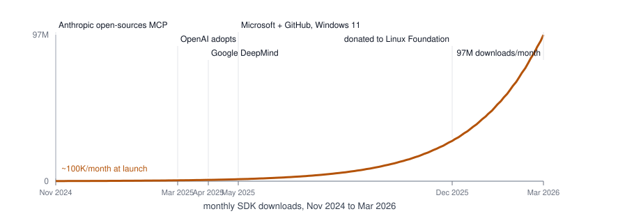
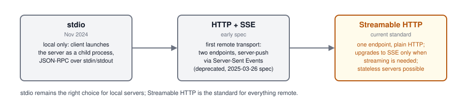
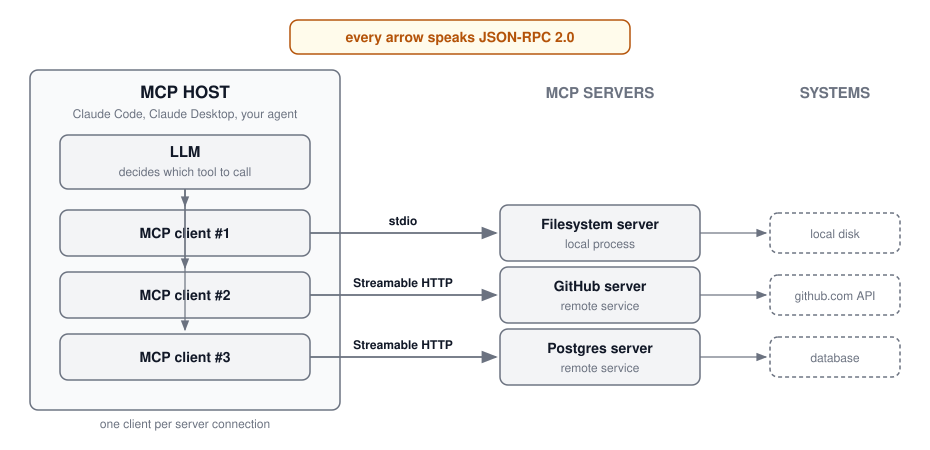
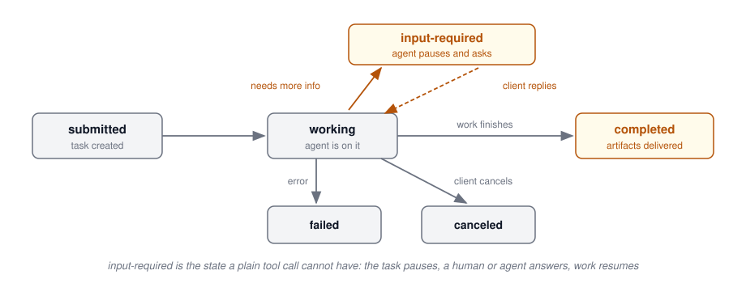
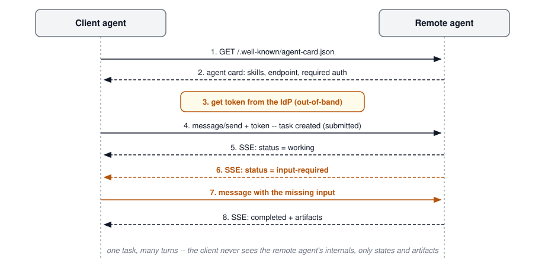
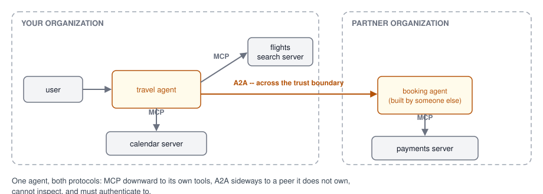
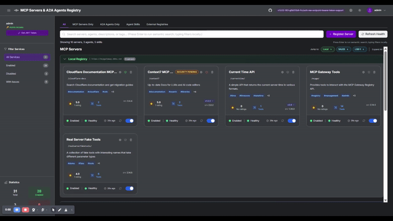

## Agenda {.smaller}

- Why APIs were not enough: the case for a protocol
- MCP: history, the hockey stick, and how transports evolved
- MCP architecture and core primitives
- Building, deploying, and securing MCP servers
- MCP at scale: gateways and registries
- A2A: when agents need to talk to each other
- Agent cards, tasks, and discovery
- MCP and A2A in one architecture; the trust boundary between agents
- Running a fleet: registries, gateways, and the Agentic AI Foundation
- Hands-on lab

# Part 1: Model Context Protocol

## Why Were APIs Not Enough? {.smaller}

Every tool an agent might use already had an API. So why invent a protocol?

- **APIs are written for developers.** A human reads the docs, writes the glue
  code, handles auth, parses the response -- once per integration. A model
  cannot read your docs page at runtime
- **No discovery.** An agent connecting to a new system has no standard way to
  ask "what can you do?" -- every API describes itself differently, or not at all
- **No uniform calling convention.** Each integration invents its own
  tool-schema, argument format, and error shape
- **The arithmetic is the killer**: N models x M tools = N x M bespoke
  adapters, each hand-written and each drifting out of date
- MCP replaces that with M + N: every tool exposes one MCP server, every model
  speaks one MCP client -- **write once, connect everywhere**

::: {.fragment}
This exact problem had already been solved once. Editors x programming
languages had the same N x M explosion until the **Language Server Protocol**
collapsed it to N + M. MCP borrowed the design deliberately -- JSON-RPC,
capability negotiation, and all.
:::

## How MCP Took Off {.smaller}

Anthropic open-sourced MCP on **November 25, 2024** -- an internal project made
public, with roughly 100K SDK downloads in its first month. Then the industry
moved:

{height=290 fig-align="center"}

By March 2026: **97 million monthly SDK downloads** (970x in 18 months), 86K
stars on the servers repo, and roughly 16,000 `mcp-server` repositories on
GitHub. The protocol is now stewarded by the Linux Foundation's Agentic AI
Foundation -- nobody's product, everybody's standard.

## Transports: stdio to SSE to Streamable HTTP {.smaller}

How client and server actually talk evolved three times in eighteen months:

{height=190 fig-align="center"}

- **stdio** shipped first and still runs most local servers -- your Claude Code
  MCP servers speak it
- **HTTP + SSE** made remote servers possible but needed two endpoints and a
  long-lived connection; the 2025-03-26 spec revision deprecated it
- **Streamable HTTP** is the current standard: a single endpoint, ordinary
  HTTP requests, SSE streaming only when a response needs it -- which lets
  remote servers scale statelessly

## The Spec Moves Fast: Five Revisions in Twenty Months {.smaller}

| Version | What it brought |
|---------|-----------------|
| **2024-11-05** | The original: JSON-RPC 2.0, tools/resources/prompts, stdio and HTTP+SSE |
| **2025-03-26** | OAuth 2.1 authorization, **Streamable HTTP** replaces SSE, tool annotations, audio content |
| **2025-06-18** | **Elicitation**, structured tool output, resource links; servers become OAuth Resource Servers (RFC 8707); JSON-RPC batching removed |
| **2025-11-25** | The fourth revision, under Linux Foundation stewardship |
| **2026-07-28** | **Current.** MCP goes stateless: the `initialize` handshake and session pinning are gone; `Mcp-Method` and `Mcp-Name` headers; server-initiated requests become Multi Round-Trip Requests |

- Date-based versions, negotiated per connection -- and the ecosystem really does speak several revisions at once, so servers support old clients for a long time
- The direction of travel is clear: toward **stateless, horizontally scalable** remote servers

Source: [MCP specification](https://modelcontextprotocol.io/specification/), [version timeline](https://hidekazu-konishi.com/entry/mcp_specification_version_timeline.html), [the 2026-07-28 revision](https://dev.to/jarvisbitztech/mcp-in-2026-what-changed-in-the-2026-07-28-specification-and-how-to-design-production-integrations-16c4)

## Under the Hood, It Is Just JSON-RPC {.smaller}

Strip away the ecosystem and MCP is **JSON-RPC 2.0 over HTTP** (or stdin).
Request, response, method names, params. That is all it is.

The power is not in the wire format -- it is in **who writes the connector**:

- **Before MCP**: agent developers wrote a custom connector for every system
  they wanted to reach. The integration burden sat with the consumer
- **After MCP**: the burden shifted to the people who want their software to
  work with agents -- and that is everyone. SaaS providers, ISVs, databases,
  dev tools: practically anybody offering an API now also offers it as an MCP
  server
- **Why they line up to do it**: they can read the same chart you just saw.
  Going forward, the number one consumer of their API will not be a developer
  reading docs -- it will be an agent. No MCP server means invisible to agents

::: {.idea-callout}
A protocol wins when the integration work moves to the side with the stronger
incentive. The tool vendors want to be reachable; now they do the wiring.
:::

## The Wire Protocol: Three Methods Do Most of the Work {.smaller}

The classic lifecycle every deployed server speaks (spec 2025-06-18 and earlier):

1. **`initialize`** -- the handshake: client and server exchange protocol versions and capabilities ("I support tools and prompts; do you support sampling?")
2. **`tools/list`** -- discovery: the server returns its tools with names, descriptions, and JSON Schema inputs -- this is what replaces reading the docs
3. **`tools/call`** -- invocation: name plus arguments in, typed result (or error) out

The same pattern repeats for the other primitives: `resources/list` / `resources/read`, `prompts/list` / `prompts/get`, plus one-way `notifications/*` (progress, list-changed). The next slide shows what two of these look like on the wire.

::: {.idea-callout}
The 2026-07-28 revision retires `initialize` entirely: each request becomes self-describing via headers, so a fleet of stateless servers can answer without session affinity. Same three jobs -- handshake, discover, invoke -- new wire shape.
:::

## On the Wire: `tools/list` and `tools/call` {.smaller}

Excerpts, trimmed to the fields that matter:

:::: {.columns}
::: {.column width="48%"}
**`tools/list` response** -- the server describes itself:

```json
{
  "tools": [{
    "name": "get_weather",
    "description": "Current weather
                    for a city",
    "inputSchema": {
      "type": "object",
      "properties": {
        "city": {"type": "string"}
      },
      "required": ["city"]
    }
  }]
}
```
:::
::: {.column width="4%"}
:::
::: {.column width="48%"}
**`tools/call` request, then result**:

```json
{
  "method": "tools/call",
  "params": {
    "name": "get_weather",
    "arguments": {"city": "Washington"}
  }
}
```

```json
{
  "result": {
    "content": [{
      "type": "text",
      "text": "Sunny, 72F" }],
    "isError": false
  }
}
```
:::
::::

The `inputSchema` is the contract: it is what the LLM reads instead of your docs page.

## What is MCP, Formally? {.smaller}

With the history behind us, the one-paragraph definition: the **Model Context
Protocol** is an open standard for connecting AI applications to external
tools and data. Anthropic released it in November 2024; the Linux Foundation
stewards it today.

- The analogy the ecosystem settled on: **USB-C for AI** -- one connector,
  any device on either end
- Claude, OpenAI, Google, Microsoft, AWS, and every major IDE and agent
  framework ship MCP client support
- What that buys you as a builder: **write a server once** and it works
  unchanged in Claude Desktop, your IDE, and your production agent

## The Architecture: Hosts, Clients, Servers {.smaller}

{height=360 fig-align="center"}

- The **host** is the AI application; it runs one **MCP client** per server connection
- A **server** is a lightweight program exposing one system's capabilities -- local servers speak **stdio**, remote ones **Streamable HTTP**
- The LLM never touches a server directly: the client carries JSON-RPC both ways

---

## Server Primitives: Tools, Resources, Prompts {.smaller}

A server can expose three kinds of capability. Tools get all the attention; the other two come almost free:

### Tools (Server → Client)
- **Executable functions** the AI can invoke to perform actions
- **Can have side effects**: write files, call APIs, modify databases
- Example: `create_issue(title, body)`, `send_email(to, subject, message)`

### Resources (Server → Client)
- **Read-only data sources** accessible to the AI (like GET endpoints) -- context without side effects
- URI-based addressing: `file:///path`, `db://table/id`, `config://settings`

### Prompts (Server → Client)
- **Pre-defined templates** for common interaction patterns, with placeholders for dynamic content
- Example: `code_review`, `summarize_document`, `generate_tests`

---

## Advanced Primitives: Sampling, Elicitation, Notifications {.smaller}

### Sampling (Client ← Server)
- **Reverse flow**: the server asks the client's LLM for a completion mid-call
- Concrete example: a database server retrieves 400 rows, asks the client's model to summarize them, and returns the summary -- the server never needs its own LLM or API key
- Server sends sampling request → Client runs LLM → Returns result to server

### Elicitation (Client ← Server)
- The server asks the **user** for missing input, through the client (standardized in spec 2025-06-18)
- Concrete example: a deploy tool realizes the environment is ambiguous and asks "staging or production?" before acting
- Enables interactive workflows without hardcoding parameters

### Notifications (Server → Client)
- **One-way messages** from server to client (no response expected)
- Progress updates for long-running operations, log messages, status changes
- Example: `progress: 50%`, `log: Processing file 3 of 10`

---

## MCP Primitive Summary

| Primitive | Direction | Purpose | Side Effects |
|-----------|-----------|---------|--------------|
| **Tools** | Server → Client | Execute actions | Yes |
| **Resources** | Server → Client | Provide data | No (read-only) |
| **Prompts** | Server → Client | Template interactions | No |
| **Sampling** | Client ← Server | Request LLM completion | No |
| **Elicitation** | Client ← Server | Request user input | No |
| **Notifications** | Server → Client | Send updates/logs | No |

Read the direction column: two of the six flow the other way. MCP is bidirectional -- servers can ask things of clients too.

---

## MCP and Agentic RAG Together

MCP makes agentic RAG **practical** -- every knowledge source becomes a standard tool:

- Vector store search → an MCP **tool** (`search_docs(query)`)
- SQL database → an MCP server exposing `query_database`
- Web search → an MCP server (e.g., a search-provider server)
- File system, tickets, wikis → existing off-the-shelf MCP servers

The agent's router/planner simply **selects among MCP tools** -- no custom integration code per source, and the same servers work in Claude Desktop, your IDE, and your production agent.

---

## MCP Server Types

Where a server runs decides its transport:

### Local MCP Servers

- Run on the same machine as the client
- Use **stdio** transport (standard input/output)
- Fast, low-latency communication
- Examples: filesystem access, local databases, git operations

### Remote MCP Servers

- Deployed as cloud services
- Use **Streamable HTTP** transport (SSE deprecated in March 2025)
- Enable shared access across users
- Examples: API wrappers, SaaS integrations, enterprise tools

---

## Building MCP Servers

The Python SDK's **FastMCP** turns a typed function into a server. The
decorator builds the JSON Schema from your type hints and the description
from your docstring:

```python
from mcp.server.fastmcp import FastMCP

mcp = FastMCP("my-mcp-server")

@mcp.tool()
def get_weather(city: str) -> str:
    """Get current weather for a city."""
    return f"Weather in {city}: Sunny, 72F"

if __name__ == "__main__":
    mcp.run()
```

Eleven lines is a complete, working server. Everything from the wire slide --
`tools/list`, the `inputSchema`, `tools/call` dispatch -- is generated for you.

---

## Where the Servers Live

- [modelcontextprotocol/servers](https://github.com/modelcontextprotocol/servers) -- the official repository: Anthropic-maintained reference servers plus the long community listing. 86K stars and counting; this is the hockey stick up close
- [awesome-mcp-servers](https://github.com/punkpeye/awesome-mcp-servers) -- the community-curated index, organized by category
- The [MCP Registry](https://github.com/modelcontextprotocol/registry) -- the official open catalog and API for discovering servers programmatically

## MCP Server Examples

What people actually wrap behind a server:

- **SaaS APIs**: Slack, GitHub, Jira -- the REST API you already have, re-described for agents
- **Databases**: PostgreSQL, SQLite, DuckDB -- the agent writes the query, the server runs it
- **The local machine**: sandboxed filesystem access, git operations, build systems
- **The web**: search (Brave, Exa) and browser automation (Playwright, Puppeteer)
- **Your business logic**: the domain tools nobody else can write for you

All but the last row exist off the shelf. Check the registries on the previous slide before writing your own.

---

## MCP in Claude Code

You have been using MCP since Week 1: every MCP server in Claude Code is this protocol, usually over stdio:

```json
{
  "mcpServers": {
    "filesystem": {
      "command": "npx",
      "args": ["-y", "@modelcontextprotocol/server-filesystem", "/path"]
    },
    "github": {
      "command": "npx",
      "args": ["-y", "@modelcontextprotocol/server-github"],
      "env": {
        "GITHUB_TOKEN": "your-token"
      }
    }
  }
}
```

Configure in `~/.claude.json` (user scope) or project-level `.mcp.json` (project scope)

---

## Deployment Patterns

The lifecycle most teams follow -- start local, promote to remote, end up hybrid:

### Local development

- Servers run as subprocesses over stdio; config lives in local settings files; iteration is instant

### Production

- Remote servers as microservices behind Streamable HTTP, with a registry for discovery, real auth, rate limits, and monitoring

### Hybrid

- Sensitive operations stay local, shared resources go remote, and a **gateway** routes and controls access -- the pattern this lecture closes with

---

## MCP Auth: The Part You Must Think About {.smaller}

We will not cover OAuth in detail -- but if you build your own MCP server, two questions are yours to answer before anyone connects:

- **Authentication (who is calling?)** The spec's answer since 2025-03-26 is OAuth 2.1; since 2025-06-18 your server is formally an OAuth Resource Server. For internal tools, an API key on a gateway is a legitimate starting point
- **Authorization (what may they do?)** Two patterns carry most of the weight:
  - **3LO (three-legged OAuth)**: the end user consents, and the client gets a token scoped to that user -- your server acts *as the user*
  - **OBO (on-behalf-of)**: the agent exchanges the user's token for a downstream token, so identity flows through to the APIs your server calls -- no shared service account with god-mode access
- The question behind both: when an agent calls your tool, **whose permissions apply** -- the user's, the agent's, or the server's? If you cannot answer, the answer is "the server's," and that is usually wrong

## Security Considerations {.smaller}

The checklist before any server faces traffic:

### Authentication

- **API Keys**: Simple but less secure
- **OAuth 2.0**: The spec's standard for remote servers (authorization code flow with PKCE)
- **mTLS**: For service-to-service auth

### Authorization

- Tool-level permissions
- Resource access controls
- Audit logging

### Best Practices

- Never expose MCP servers to public internet without auth
- Use environment variables for secrets
- Beware **tool poisoning / prompt injection** via untrusted server descriptions -- vet third-party servers
- Implement rate limiting
- Log all tool invocations for audit

---

## Hands-on Lab

### Building an Agentic RAG Workflow with MCP

*Practical exercise and demonstration*

1. **Setup**: Install MCP Python SDK
2. **Define Tools**: Expose a document-search tool and a SQL-query tool as MCP servers
3. **Add Resources**: Expose data sources
4. **Test Locally**: Use MCP Inspector or Claude Desktop
5. **Go Agentic**: Let the agent route between the two sources, grade retrievals, and retry with reformulated queries

```bash
# Install MCP SDK
uv add mcp

# Run MCP Inspector for testing
npx @modelcontextprotocol/inspector
```

---

## The Boundary Blurs: Agent as a Tool {.smaller}

Nothing in MCP says a tool must be deterministic. Wrap an entire agent behind a tool interface and the caller never knows:

- `research_topic(query)` looks like any other tool -- behind it, an agent runs a dozen searches, reads, and synthesizes before returning
- Claude Code subagents work exactly this way: the orchestrator calls what looks like a function; a full agent loop answers
- **When agent-as-a-tool is right**: the delegation is opaque and request-response -- ask, wait, get an answer
- **When you want A2A instead**: the work is long-running, multi-turn, or negotiated -- the caller needs status updates, intermediate results, or a conversation
- Rule of thumb: if the caller never needs to interrupt or redirect the worker, it is a tool, no matter how smart it is inside

## Tools, Skills, Tasks: Three Ways to Package Capability {.smaller}

Three words that sound interchangeable and are not:

| | What it is | Protocol | Example |
|---|-----------|----------|---------|
| **Tool** | A callable function with a typed schema | MCP | `get_weather(city)` |
| **Skill** | Packaged procedural knowledge an agent loads when relevant: instructions, scripts, references in a folder (`SKILL.md`) | [Agent Skills](https://agentskills.io) | The writing skill this course's own repo carries |
| **Task** | A delegated unit of work between agents, with lifecycle and status | A2A | "Book my Tokyo trip" -- submitted, working, input-required, completed |

- Tools extend what an agent **can do**; skills extend what it **knows how to do**; tasks are work it **hands to someone else**
- A capable agent uses all three: loads a skill, calls tools, delegates tasks

# Part 2: Agent-to-Agent (A2A)

## The Problem: Agent Silos {.smaller}

Enterprises are deploying agents on different frameworks -- LangGraph, CrewAI,
Strands Agents, Google ADK, Semantic Kernel -- and each has its own message
format, memory model, and tool interface. Two agents from two vendors cannot
talk to each other.

This is the tool-integration problem again, one level up. What interoperability has to deliver:

- **Cross-vendor workflows**: a procurement agent from vendor A delegates to a logistics agent from vendor B
- **Organizational boundaries**: agents in different departments, or different companies, cooperate over plain HTTP
- **Opaque collaboration**: they work together **without sharing internal memory, proprietary logic, or tool implementations**
- **No lock-in**: swap an agent implementation without rewriting every peer that calls it

Same N x M arithmetic that motivated MCP -- so the fix looks familiar.

---

## Where A2A Came From {.smaller}

- MCP solved agent-to-tool. Nothing solved **agent-to-agent**: enterprises were building fleets of agents in different frameworks -- a sales agent on one stack, an HR agent on another -- with no standard way for them to find or talk to each other
- Every cross-agent integration was bespoke glue again: the same N x M arithmetic that motivated MCP, one level up
- **Google announced A2A in April 2025** with 50+ launch partners (Salesforce, SAP, ServiceNow, Atlassian, PayPal, MongoDB, and more) -- positioned from day one as a **complement to MCP**, not a competitor
- **June 2025**: Google donated the spec, SDKs, and tooling to the **Linux Foundation** -- the same neutral-steward move MCP later made
- The bet: agents become services, and services need a protocol to interoperate across vendors

## What is A2A?

- **Agent2Agent (A2A)**: an open protocol for communication between AI agents
- Announced by Google (April 2025) with 50+ launch partners; now governed by the **Linux Foundation**
- Built on familiar web standards:
  - **HTTP(S)** as transport
  - **JSON-RPC 2.0** for requests
  - **Server-Sent Events (SSE)** for streaming updates
- SDKs available in Python, Go, JavaScript, Java, and .NET

Source: [A2A Protocol](https://a2a-protocol.org/)

---

## A2A Design Principles

Five commitments from the spec's own design notes:

- **Embrace agentic capabilities**: agents collaborate in natural, unstructured conversation, not only rigid function calls
- **Build on existing standards**: HTTP, SSE, JSON-RPC -- easy to adopt in existing stacks
- **Secure by default**: enterprise-grade auth, aligned with OpenAPI security schemes
- **Support long-running tasks**: from instant answers to multi-day workflows with humans in the loop
- **Modality agnostic**: text, files, forms, structured data, media

---

## Core Actors

Three roles, deliberately few:

| Actor | Role |
|-------|------|
| **User** | The human or automated principal that initiates a request |
| **Client agent** | Formulates and sends tasks on the user's behalf |
| **Remote agent (server)** | Receives tasks, acts on them, returns results |

- The remote agent is a "black box": the client sees its **advertised capabilities**, never its internals

---

## Agent Cards: Advertising Capabilities {.smaller}

Each A2A server publishes an **agent card** -- a JSON document at a well-known
path (`/.well-known/agent-card.json`) that answers "what can you do, and how
do I talk to you?":

```json
{
  "name": "Travel Booking Agent",
  "url": "https://agents.example.com/a2a/v1",
  "skills": [{
    "id": "book-trip",
    "description": "Books flights and hotels end to end",
    "examples": ["Book a Tokyo trip, May 4-11"]
  }],
  "securitySchemes": {"oauth2": {"type": "oauth2"}},
  "defaultInputModes": ["text/plain"],
  "capabilities": {"streaming": true}
}
```

The card is the agent's entire public surface: identity, skills with examples, endpoint, auth, and modalities. Everything else stays private.

---

## Discovery Patterns

Discovery answers one question: *which agent can do this, and how do I reach it?* Three patterns in practice:

- **Well-known URI**: fetch the agent card from a known domain
- **Curated registries**: enterprise catalogs of approved agents, like an internal app store
- **Direct configuration**: hard-coded or config-driven peers for closed systems

---

## Tasks: The Unit of Work {.smaller}

A **task** is the unit of A2A collaboration: created when a client sends a
message, identified by a unique ID, and tracked through a lifecycle:

{height=300 fig-align="center"}

- Long-running tasks report progress via **streaming (SSE)** or **push notifications** (webhooks)
- Output is delivered as **artifacts** -- files, structured data, or text produced by the remote agent

---

## Messages and Parts

Within a task, communication happens in turns:

- A **message** is one turn of communication within a task
- Each message contains one or more **parts**:

| Part type | Contents |
|-----------|----------|
| `TextPart` | Plain or formatted text |
| `FilePart` | File content (inline bytes or URI reference) |
| `DataPart` | Structured JSON (e.g., forms, machine-readable payloads) |

- Parts let agents negotiate **modality**: text chat, file exchange, structured forms

---

## A Typical A2A Interaction

{height=460 fig-align="center"}

## On the Wire: an A2A `message/send` {.smaller}

A2A is JSON-RPC too. The request carries a message; the response carries a task, not an answer:

:::: {.columns}
::: {.column width="52%"}
**Request** -- the client sends one turn:

```json
{
  "method": "message/send",
  "params": {
    "message": {
      "role": "user",
      "parts": [{
        "kind": "text",
        "text": "Book a Tokyo trip, May 4-11"
      }],
      "messageId": "9229e770"
    }
  }
}
```
:::
::: {.column width="4%"}
:::
::: {.column width="44%"}
**Response** -- a task in state `submitted`:

```json
{
  "result": {
    "id": "363422be-b0f9",
    "contextId": "c295ea44",
    "status": {
      "state": "submitted"
    },
    "kind": "task"
  }
}
```

The client now streams, polls, or waits for a push -- the answer arrives later as **artifacts**.
:::
::::

---

## A2A vs. MCP: Complementary, Not Competing

| | **MCP** | **A2A** |
|---|---------|---------|
| Connects | Agent ↔ **tools & resources** | Agent ↔ **other agents** |
| Peer is | Deterministic capability (function, API, data) | Autonomous, stateful, opaque agent |
| Interaction | Structured tool calls with typed schemas | Multi-turn, possibly long-running collaboration |
| Analogy | USB-C port for tools | The network protocol between devices |

- A production agent typically speaks **both**: MCP downward to its tools, A2A sideways to its peers

---

## MCP + A2A in One Architecture

{height=320 fig-align="center"}

- A2A for **delegation and collaboration**; MCP for **capability access**

---

## The Trust Boundary: How Agent 1 Gets to Call Agent 2 {.smaller}

The hard question in that diagram is the amber arrow. Agent 2 belongs to another organization -- how does Agent 1 earn the right to call it?

1. **Discovery**: Agent 1 fetches Agent 2's **agent card**, which declares not just capabilities but **required auth** (`securitySchemes`: OAuth 2, OIDC, API key, mTLS)
2. **Credentials come from outside the protocol**: A2A deliberately invents no new trust mechanism. The two organizations establish trust the boring way -- Org A registers as a client with Org B's identity provider, once, through humans and contracts
3. **At call time**: Agent 1's side obtains a token (OAuth client-credentials for machine-to-machine; token exchange when it acts for a specific user, so *the user's* identity flows through) and presents it over HTTPS
4. **Agent 2 still decides**: a valid token gets you authenticated, not authorized -- the receiving agent applies its own policy per task

::: {.idea-callout}
Trust is established out-of-band by identity providers and carried in-band as tokens. A2A chose twenty years of enterprise web security over anything novel -- which is precisely why enterprises adopted it.
:::

## Governance: Linux Foundation Stewardship

Google donated the A2A specification, SDKs, and tooling to the **Linux Foundation** in June 2025. Amazon, Microsoft, Cisco, Salesforce, SAP, and ServiceNow all contribute.

- No single vendor controls the protocol's evolution, so an enterprise can adopt it without betting on a competitor's roadmap
- The same playbook made Kubernetes the industry standard

---

## Multi-Agent Collaboration Patterns

Once agents can talk, who talks to whom? Four shapes recur:

- **Supervisor / orchestrator**: a lead agent decomposes work and delegates to specialists over A2A
- **Peer-to-peer (horizontal)**: equal specialists hand off laterally -- research agent → coding agent → review agent
- **Hierarchical (vertical)**: layers of managers and workers for complex, long-horizon workflows
- **Marketplace**: clients discover and select remote agents dynamically from a registry

---

## Pattern Trade-offs

No winner here -- pick per workflow:

| Pattern | Strengths | Risks |
|---------|-----------|-------|
| Supervisor | Clear accountability, easy tracing | Orchestrator becomes bottleneck |
| Peer-to-peer | Flexible, resilient | Harder to debug, emergent behavior |
| Hierarchical | Scales to large workflows | Latency compounds per layer |
| Marketplace | Maximum reuse | Trust and quality control |

---

## Security Considerations {.smaller}

Everything from the MCP security slide applies, plus the problems that only appear when the peer is itself an agent:

- **Authentication**: agent cards declare required schemes (OAuth 2, API keys, mTLS); never accept anonymous agents in production
- **Authorization**: least privilege per skill -- an agent that *can* book travel should not also read HR data
- **Identity and delegation**: who is the request *really* for? Propagate user identity; do not let agents act as super-users
- **Prompt injection across agents**: a malicious remote agent's output becomes *your* agent's input -- treat peer output as untrusted
- **Audit logging**: record every task, message, and artifact for compliance and forensics
- **Supply chain**: registries need vetting, versioning, and revocation -- an "agent store" has the same risks as a package registry

---

## Where A2A Is Heading

- Registry and discovery standardization across vendors
- Richer negotiation: dynamic capability and modality negotiation mid-task
- Convergence of the agent stack: **MCP** (tools) + **A2A** (agents) + agent runtimes
- Framework support today: Google ADK, LangGraph, CrewAI, Strands Agents, Semantic Kernel

---

## Hands-on Lab

### Building Interoperable Agents with A2A

*Lab repository: `gu-dsan6725/a2a-lab`*

1. **Setup**: install the A2A Python SDK
2. **Agent Card**: define and serve a card for a simple specialist agent
3. **Serve**: expose the agent over HTTP with task lifecycle support
4. **Client**: discover the card, send a task, stream status updates
5. **Compose**: connect two agents from *different* frameworks via A2A

---

# Running a Fleet: Registries, Gateways, Governance

## Challenges with Using MCP at Scale

One server on your laptop is easy. Fifty servers across an enterprise raises the questions APIs already taught us:

**Discovery & Configuration**:

- **Tool Discovery**: How do agents find available MCP servers?
- **Configuration Sprawl**: Managing server configs across environments
- **Dynamic Capabilities**: Tools that change over time

**Security & Governance**:

- **Authentication Complexity**: OAuth, API keys, tokens across services
- **Credential Management**: Secure storage and rotation
- **Multi-Tenant Access**: Isolating data between users/organizations
- **Governance & Compliance**: Audit trails, access controls, data policies

**Operations**:

- **Performance & Reliability**: Latency, uptime, error handling at scale

---

## The Fix: A Gateway and a Registry

The answer to every problem on that slide is centralized management:

- **Server registry**: discover and catalog available MCP servers
- **Health monitoring**: track server status and reliability
- **Access control**: manage who can use which servers
- **Analytics**: usage statistics and performance metrics

Agents get one governed front door instead of fifty direct connections.

---

## The Project Landscape {.smaller}

| Project | What it is |
|---------|------------|
| [MCP Registry](https://github.com/modelcontextprotocol/registry) | The official open catalog: publish and discover servers programmatically |
| [mcp-gateway-registry](https://github.com/agentic-community/mcp-gateway-registry) | Enterprise gateway + registry combined (next slide) |
| [agentgateway](https://github.com/agentgateway/agentgateway) | Data-plane proxy for agent traffic -- MCP and A2A aware |
| [ContextForge](https://github.com/IBM/mcp-context-forge) | IBM's gateway: federates MCP and REST services behind one endpoint |

One pattern across all of them: the same lesson APIs learned a decade ago -- once you have many services and many consumers, you need a front door, a catalog, and an audit log.

## Spotlight: mcp-gateway-registry {.smaller}

An open-source project from the [agentic-community](https://github.com/agentic-community/mcp-gateway-registry) organization that puts the whole week together:

- **One governed front door** for every MCP server an organization runs: agents and coding assistants authenticate once, discover tools dynamically, and every call is audited
- **Real auth, the kind from our trust-boundary slide**: OAuth with Keycloak or Entra integration -- three-legged for humans, machine-to-machine for agents
- **Dynamic discovery**: agents find new tools without redeployment -- the registry is itself exposed over MCP
- Transforms "scattered MCP server chaos into governed, auditable tool access" -- their words, and an accurate summary of this lecture's second half

::: {.idea-callout}
If you find it useful, [star the repo](https://github.com/agentic-community/mcp-gateway-registry) 🙂 -- stars are how more people find it, benefit from it, and contribute back to the work.
:::

## What It Looks Like Running {.smaller}

{height=420 fig-align="center"}

## AAIF: A Neutral Home for the Agentic Stack {.smaller}

The [Agentic AI Foundation](https://www.linuxfoundation.org/press/linux-foundation-announces-the-formation-of-the-agentic-ai-foundation) launched under the Linux Foundation on **December 9, 2025**, with founding contributions from Anthropic, Block, and OpenAI.

- **Anchor projects**: **MCP** (the protocol you learned today), **goose** (Block's open local-first agent), and **AGENTS.md** -- yes, the same file you wrote in the Week 1 lab is now a Linux Foundation standard
- **Platinum members**: AWS, Anthropic, Block, Bloomberg, Cloudflare, Google, Microsoft, OpenAI -- competitors funding shared rails
- **What it does**: neutral governance so no vendor controls the protocols; interoperability and security standards; the explicit goal is that the agent era runs on open standards instead of fragmenting into walled gardens
- Why it matters to you: the skills from this course -- MCP servers, AGENTS.md files, agent protocols -- are standards with institutional backing, not one vendor's API

## Key Takeaways {.smaller}

1. MCP exists because N models x M tools meant N x M hand-written connectors; a protocol turned that into M + N
2. Under the hood it is JSON-RPC -- the power is that the **integration burden moved to the tool vendors**, who now have the stronger incentive
3. MCP is bidirectional: tools, resources, and prompts flow one way; sampling and elicitation flow back
4. A2A does for **agent-to-agent** what MCP did for agent-to-tool: cards for discovery, tasks for collaboration, and agents stay opaque
5. Trust between agents is established out-of-band and carried as tokens -- twenty years of enterprise web security, reused
6. At fleet scale you need what APIs needed a decade ago: a gateway, a registry, and an audit log

---

## References {.smaller}

**Official MCP Resources:**

- [Model Context Protocol Documentation](https://modelcontextprotocol.io/)
- [MCP Specification Repository](https://github.com/modelcontextprotocol/modelcontextprotocol)
- [MCP Python SDK](https://github.com/modelcontextprotocol/python-sdk)
- [MCP TypeScript SDK](https://github.com/modelcontextprotocol/typescript-sdk)
- [Official MCP Servers Collection](https://github.com/modelcontextprotocol/servers)

**Additional Resources:**

- [Anthropic MCP Announcement](https://www.anthropic.com/news/model-context-protocol)
- [MCP Gateway Registry](https://github.com/agentic-community/mcp-gateway-registry)
- [Why MCP Deprecated SSE for Streamable HTTP](https://modelcontextprotocol.io/specification/2025-03-26/basic/transports)

## References

**Official A2A Resources:**

- [A2A Protocol Site & Specification](https://a2a-protocol.org/)
- [A2A GitHub Organization](https://github.com/a2aproject/A2A)
- [A2A Python SDK](https://github.com/a2aproject/a2a-python)
- [Google Announcement: A2A](https://developers.googleblog.com/en/a2a-a-new-era-of-agent-interoperability/)
- [Linux Foundation: A2A Project](https://www.linuxfoundation.org/press/linux-foundation-launches-the-agent2agent-protocol-project)

**Related:**

- [Model Context Protocol](https://modelcontextprotocol.io/)
- [Google Agent Development Kit (ADK)](https://google.github.io/adk-docs/)
