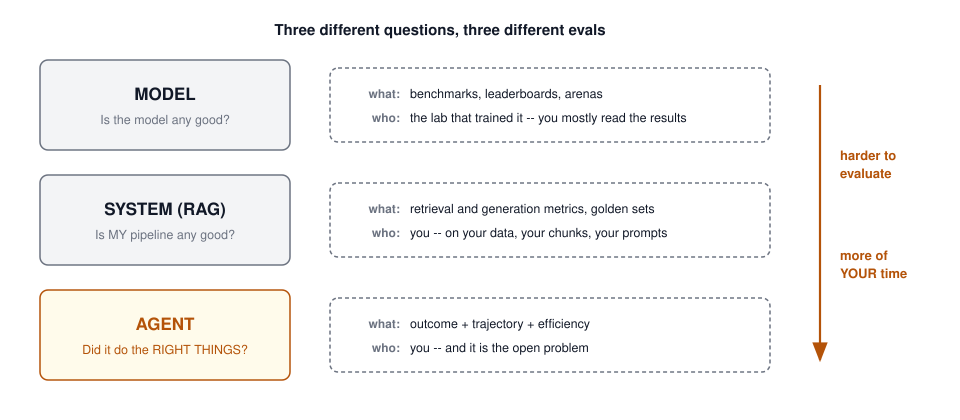
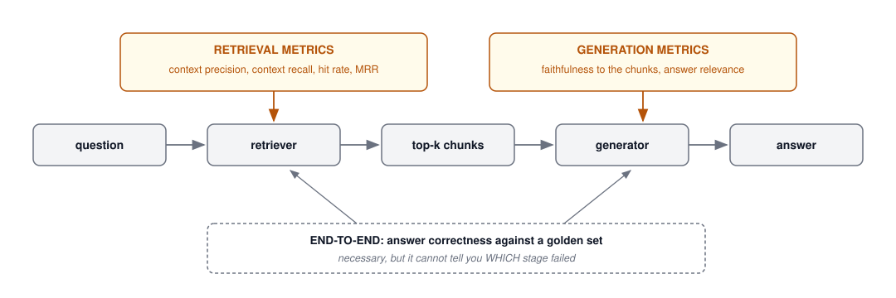
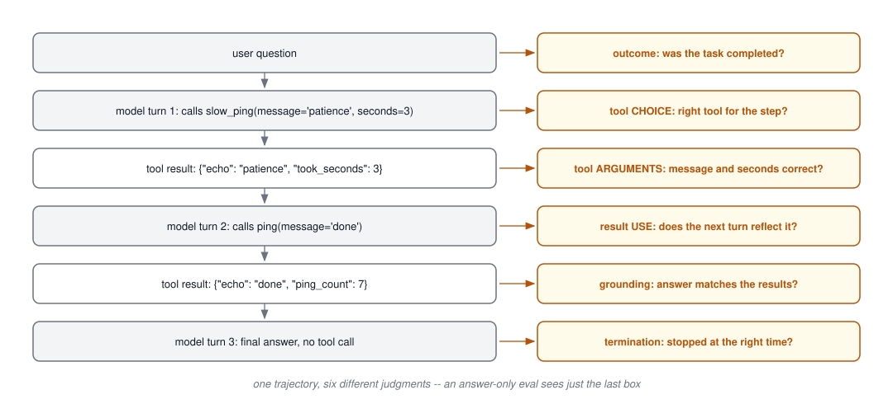
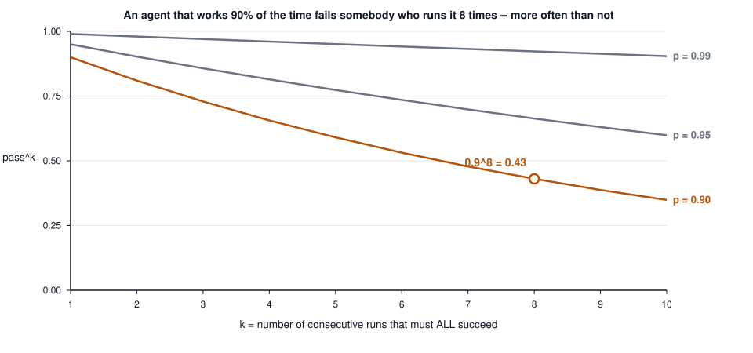
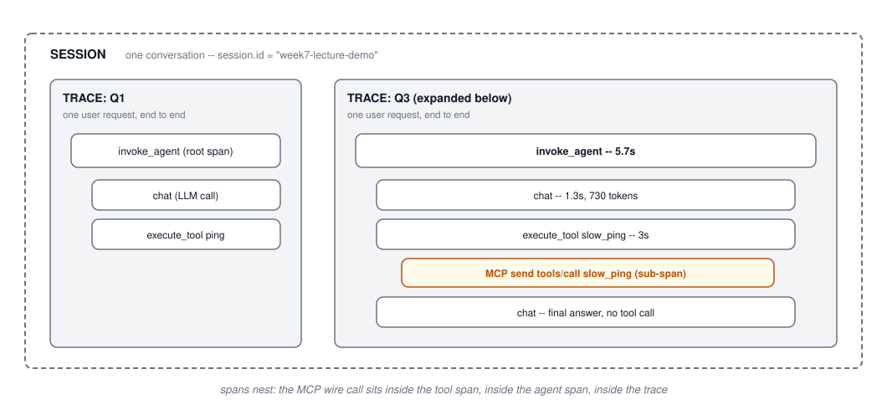
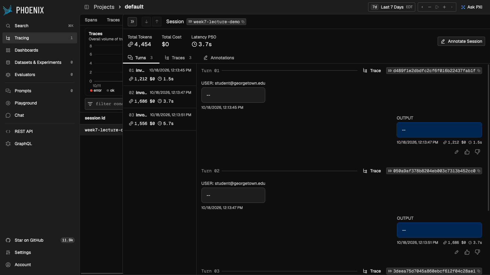
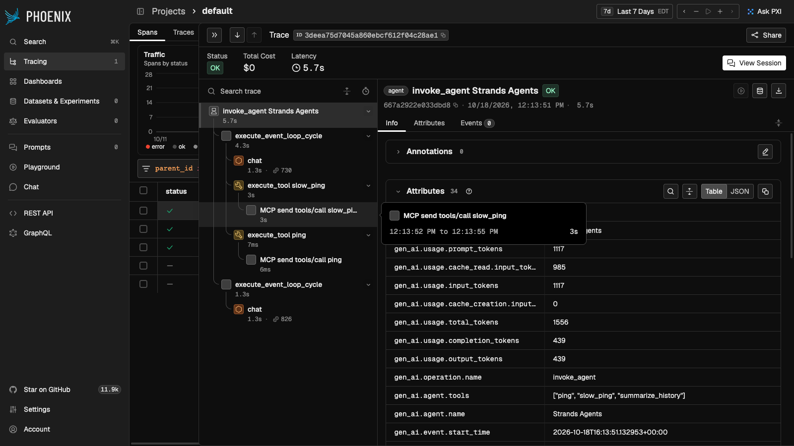
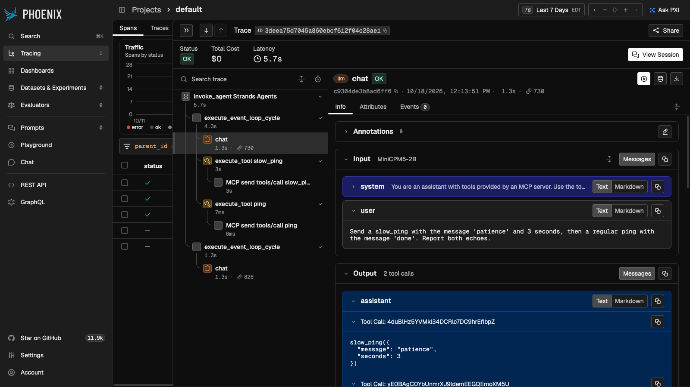

## Agenda {.smaller}

- The gap between a working demo and a shippable system
- The eval hierarchy: model evals, RAG evals, agent evals -- three different
  questions, in increasing order of difficulty
- LLM-as-a-judge: how it works, where it is biased, how to calibrate it
- RAG evals with numbers you can check by hand: context precision and recall,
  faithfulness, hit rate, MRR
- Agent evals, the deck's center: trajectories, failure taxonomies, matching,
  efficiency, benchmarks, and pass^k
- The turn: all evals feed on observability
- OTel GenAI semantic conventions, and a real instrumented agent on screen:
  session, traces, spans, sub-spans
- Hands-on lab

## The Demo Worked. Now What? {.smaller}

Both of these were working demos:

- Your week 3 RAG answered its first question beautifully -- then the
  break-it tasks showed it confidently answering from the wrong chunks
- In week 6, our 2B agent called every tool correctly, got perfect results
  back, and then reported the ping counts swapped

Nothing threw an exception. Nothing returned a 500. The output just was not
right, and only a person looking at it knew.

- **Non-determinism**: same input, different outputs -- assert-based QA breaks
- **Silent failures**: LLM apps degrade without errors, so nothing pages you
- **The gap between demo and production is evals plus observability** -- a way
  to measure quality, and a record of what happened to measure it on

# Part 1: Evals -- What to Measure

## Why Evaluate? {.smaller}

A concrete story. You swap MiniCPM5-2B for next quarter's better model. What
happens to the 12 graph-rag questions you shipped in week 4? To the SQL your
week 4 lab generates? To the agent traces from week 6?

Without evals, the honest answer is a shrug. With them, it is a number before
lunch.

- **Regression detection**: catch the damage when you swap models, edit a
  prompt, or bump a dependency -- the three changes you make every week
- **Comparison**: pick between models, prompts, and pipeline variants with
  evidence
- **Quality assurance and compliance**: show, not claim, that requirements
  are met
- Evals turn vibes into engineering. Every mature LLM team runs them on
  every change, the way other teams run unit tests

## Three Evals, Not One {.smaller}

{height=400 fig-align="center"}

This deck spends its time the way the arrow says: minutes on model evals,
more on RAG evals, and half the eval story on agents.

## Model Benchmarks, in Five Minutes {.smaller}

Evaluating the model itself is mostly someone else's job. You read the
results; you rarely reproduce them.

- **Static benchmarks** (MMLU and its descendants) are saturated: frontier
  models cluster near the top, and test questions leak into training data
  (contamination), which inflates scores
- **Arenas** ([LMArena](https://lmarena.ai/), formerly Chatbot Arena) rank
  models by blind pairwise human votes -- harder to game, but they measure
  "pleasing in chat," which is not your workload
- **Vendor-reported numbers** are run under vendor-chosen harnesses; treat
  them as upper bounds
- What model benchmarks cannot tell you: anything about **your** data, your
  retrieval, your tools, or your prompts

Week 9 (model selection and tokenomics) picks this thread back up. Today's
question is the other two layers: the system you built.

## What to Measure {.smaller}

The metric menu, before we compute any of them:

- **Correctness**: is the output right, against a reference?
- **Relevance**: does it answer the question that was asked?
- **Faithfulness / groundedness**: is every claim supported by the provided
  context? (An answer can be true and still unfaithful -- correct from
  memory, not from your documents)
- **Safety**: within policy
- **Consistency**: the same question tomorrow gets an equivalent answer
- **Latency and cost**: operational quality is part of quality -- a perfect
  answer in 90 seconds fails most products

Who does the grading? Exact-match code where outputs are structured (SQL
results, JSON), humans where stakes are high, and for open-ended text, the
next slide.

## LLM-as-a-Judge {.smaller}

The idea: a strong model scores outputs against a rubric, so you can grade
ten thousand answers without hiring ten graders.

- **Modes**: pointwise (score one answer), pairwise (A vs. B), and
  reference-based (compare against a gold answer)
- **It works better than it should**: GPT-4-class judges agree with human
  raters over **80%** of the time -- the same rate at which humans agree with
  each other
- **It carries biases you must design around**:
  - **Position bias**: in pairwise mode, judges favor the first answer shown
  - **Verbosity bias**: longer answers score higher at equal quality
  - **Self-enhancement**: models prefer their own writing style
- **Mitigations**: swap positions and average, score with a rubric instead of
  "which is better," and never let a model judge its own family blind

Source: [Zheng et al. 2023, "Judging LLM-as-a-Judge with MT-Bench and
Chatbot Arena"](https://arxiv.org/abs/2306.05685)

## A Judge Prompt That Works {.smaller}

Rubrics over vibes. The difference between a useless judge and a usable one
is about six lines:

```text
Score the ANSWER against the CONTEXT on faithfulness, 1-5.

5: every claim in the answer is supported by the context
3: claims are supported, but the answer adds unsupported detail
1: the answer contradicts the context or invents facts

First list each claim and whether the context supports it.
Then give the score as: SCORE: <n>
```

- **Reasoning before the score**: the claim list forces the judge to look
  before it grades, and gives you something to audit
- **Bounded scale with anchored points**: "1-5" alone drifts; descriptions
  per level do not
- **Pin the judge model version**: a judge that silently upgrades is a
  ruler that changes length

## Humans Calibrate the Judges {.smaller}

Human review does not scale, and you cannot skip it. The resolution:

1. Humans label a small set (50-100 outputs) with written annotation
   guidelines
2. Check **inter-annotator agreement** first -- if two humans do not agree
   with each other, no judge can match "the" human label
3. Run the judge on the same set and measure agreement with the humans
4. If agreement is high, let the judge grade the other ten thousand; if not,
   fix the rubric, not the judge

- Production gives you free (noisy) labels: thumbs up/down, edits users make
  to accepted answers, abandoned sessions
- The pattern for this course: **humans set the standard, judges scale it**

# Part 2: Your Model Is Fine. Is Your Pipeline?

## The Failure Modes You Already Met {.smaller}

Week 3's lab had you break a RAG on purpose. Every break you made is a
metric now:

| What you broke in week 3 | What measures it |
|--------------------------|------------------|
| Chunks too big, answer buried mid-chunk | context precision |
| The right chunk never retrieved | context recall, hit rate |
| Answer ignores the retrieved context | faithfulness |
| Answer cites context but misses the question | answer relevance |
| Everything individually fine, answer still wrong | end-to-end correctness |

The lesson that survives from that lab: **most RAG failures are retrieval
failures**. If retrieval misses, the best generator can only hallucinate
fluently. So measure the stages separately, and look at retrieval first.

## Separate the Stages {.smaller}

{height=330 fig-align="center"}

End-to-end correctness tells you *that* something broke. The stage metrics
tell you *where*. You need both, and when they disagree, trust the stages.

## Worked Example: Context Precision and Recall {.smaller}

Question: *"Which database engine does the sql-rag lab use, and how is it
deployed?"* The gold answer needs two facts: **DuckDB**, **embedded
in-process**. The retriever returns three chunks:

| Rank | Chunk says | Relevant? |
|------|------------|-----------|
| 1 | "the lab queries taxi data with DuckDB" | yes |
| 2 | "Qdrant runs in-memory for the week 3 lab" | no |
| 3 | "DuckDB is embedded; there is no database server" | yes |

- **Context precision** -- of what came back, how much belongs?
  $2 / 3 = 0.67$
- **Context recall** -- of the facts the gold answer needs, how many are in
  the retrieved set? DuckDB: found. Embedded: found. $2 / 2 = 1.0$

Recall 1.0 with precision 0.67 is a healthy pattern: everything needed is
present, plus some noise. The reverse -- high precision, low recall -- means
clean chunks that cannot answer the question. No generator recovers from
that.

## Worked Example: Faithfulness {.smaller}

Same pipeline, one generated answer. Decompose it into claims and check each
against the retrieved chunks:

| Claim from the answer | In the context? |
|-----------------------|-----------------|
| "sql-rag uses DuckDB" | yes |
| "DuckDB runs embedded, with no server" | yes |
| "queries run against taxi trip data" | yes |
| "DuckDB is the fastest analytical database" | **no -- invented** |

$$\text{faithfulness} = \frac{\text{supported claims}}{\text{all claims}} = \frac{3}{4} = 0.75$$

- The fourth claim may even be defensible -- but it is **not in the
  context**, and that is all faithfulness measures
- This is the RAGAS recipe: an LLM does the decomposition and the checking,
  which makes faithfulness a judge-based metric wearing a formula

## Worked Example: Hit Rate and MRR {.smaller}

Ranking metrics ask a cruder question: did the right chunk show up at all,
and how high? Three queries, top-5 retrieval, rank of the first relevant
chunk:

| Query | First relevant chunk at rank | Hit@5 | Reciprocal rank |
|-------|------------------------------|-------|-----------------|
| Q1 | 1 | 1 | 1/1 = 1.00 |
| Q2 | 3 | 1 | 1/3 = 0.33 |
| Q3 | not in top 5 | 0 | 0 |

- **Hit rate@5** = $2/3 = 0.67$ -- two queries of three had any chance
- **MRR** = $(1.00 + 0.33 + 0)/3 = 0.44$ -- and it rewards putting the right
  chunk first, where short context windows need it
- Cheap to compute, no LLM required -- which is why retrieval metrics run on
  every commit while judge-based metrics run nightly

## The Tools: RAGAS and Friends {.smaller}

You could hand-build all of the above (and in this lab's spirit, you now
could). In practice:

| Tool | What it gives you |
|------|-------------------|
| [RAGAS](https://docs.ragas.io/) | The RAG metric suite: faithfulness, context precision/recall, answer relevance |
| [DeepEval](https://github.com/confident-ai/deepeval) | pytest-style LLM tests: `assert_test(answer, metrics=[...])` in CI |
| [TruLens](https://www.trulens.org/) | The "RAG triad": context relevance, groundedness, answer relevance as feedback functions |
| [Phoenix (Arize)](https://arize.com/docs/phoenix) | Evals attached to traces -- and the observability tool we use later today |

- All of them are judge-based under the hood for the semantic metrics -- so
  everything from the judge slides (biases, calibration, pinned versions)
  applies
- Pick one and wire it into CI; which one matters far less than having a
  golden set to run it on

## The Golden Set You Already Built {.smaller}

The expensive part of RAG evals is not the framework. It is the labeled
questions. You have built two sets already without calling them that:

- **graph-rag** ships 12 questions annotated single-fact vs. multi-hop, with
  expected answers -- that is a golden set with difficulty labels
- **sql-rag** ships good/bad/ugly question tiers with expected result sets --
  that is a golden set with failure-mode labels

What makes a golden set work:

- **Start small and real**: 50-100 questions beats 5,000 synthetic ones;
  seed it from questions users actually asked
- **Include the ugly tier**: questions that *should* fail (out of scope,
  ambiguous) -- a pipeline that answers them confidently is failing
- **Version it like code**: the set changes only by commit, or your metrics
  are not comparable across runs
- Production traffic becomes new golden questions -- the loop we close in the
  observability act

# Part 3: The Answer Was Right. The Agent Still Failed.

## Trajectories, Not Answers {.smaller}

Everything so far graded one input against one output. An agent produces
neither -- it produces a **trajectory**: model turns, tool calls, tool
results, more turns, then an answer.

Two week-6 runs that make the point:

- An agent answers the ping-count question correctly -- after calling the
  tool nine times in a retry loop. The answer eval scores 1.0; it burned 40x
  the tokens and would melt a rate limit in production
- Our 2B agent called `slow_ping` and `ping` perfectly, got
  `took_seconds: 3` and `ping_count: 7` back, and reported the counts
  **swapped**. Every step correct; the synthesis wrong

An answer-only eval cannot tell these from a clean run. Agent evals score
three things:

1. **Outcome** -- did it accomplish the task?
2. **Trajectory** -- were the steps right?
3. **Efficiency** -- at what cost in steps, tokens, and time?

## Anatomy of a Trajectory {.smaller}

{height=440 fig-align="center"}

## A Real Trajectory, Annotated {.smaller}

The week 6 question: *"Send a slow_ping with 'patience' and 3 seconds, then
a regular ping with 'done'. Report both echoes."* An actual run:

| Step | What happened | Verdict |
|------|---------------|---------|
| turn 1 | calls `slow_ping(message="patience", seconds=3)` | right tool, right arguments |
| result | `{"echo": "patience", "took_seconds": 3}` | -- |
| turn 2 | calls `ping(message="done")` | right tool, right arguments |
| result | `{"echo": "done", "ping_count": 7}` | -- |
| turn 3 | "...'patience' (7 total pings so far). ...'done' (6 total...)" | **counts swapped** |

- Tool choice: 2/2. Arguments: 2/2. Termination: correct. **Grounding: failed**
  -- the final text contradicts the tool results sitting right above it
- This is why trajectory evals decompose the judgment: "the agent is 100%
  right until the last sentence" is an actionable finding; "answer wrong"
  is not

## The Failure Taxonomy {.smaller}

Name the failure and you can count it; count it and you can fix the biggest
one first. The recurring five, each with a sighting from our own labs:

| Failure | A real sighting |
|---------|-----------------|
| **Wrong tool** | asked to reverse a message, calls `ping` because `reverse_ping` is not offered -- then apologizes |
| **Bad arguments** | `seconds: 99` -- the tool rejects it; a good agent reads the error and retries inside bounds |
| **Premature stop** | answers question 2 after the first of two pings |
| **Loop** | retries a failing tool with identical arguments until MAX_ITERATIONS -- the week 5 lab's "highest-value line" |
| **Ungrounded synthesis** | the swapped ping counts from the previous slide |

- The taxonomy is the schema for your eval results table. "Pass rate 71%"
  starts no conversation; "half our failures are ungrounded synthesis"
  starts the right one

## Worked Example: Trajectory Matching {.smaller}

Reference trajectory for the two-tool question: `[slow_ping, ping]`. Three
actual runs, three match modes:

| Run | Tool calls made | Exact | In-order | Any-order |
|-----|-----------------|-------|----------|-----------|
| A | `slow_ping, ping` | 1 | 1 | 1 |
| B | `ping, slow_ping` | 0 | 0 | 1 |
| C | `slow_ping, ping, ping` | 0 | 1 | 1 |

- **Exact**: the reference, nothing more, in order -- strictest, brittle to
  harmless extras
- **In-order**: the reference appears as a subsequence -- forgives extras
  (run C), punishes reordering (run B)
- **Any-order**: the reference set is covered -- forgives everything except
  missing calls

One trace, three defensible scores. Pick the mode the task deserves: a
payment flow wants exact; a research agent barely cares about order. Say
which mode you used when you report the number.

## Outcome Evals: Did It Finish? {.smaller}

The other half of the score: forget the path, check the destination.

- **Binary task success**: the booking exists, the file compiles, the test
  passes -- gradeable by code, which makes it cheap and incorruptible
- **Rubric-based partial credit**: a judge scores the final state against
  criteria ("found the repo: 1pt; summarized the right doc: 2pts")
- **State-based checks**: inspect the world after, not the words -- did the
  database row appear? (τ²-bench grades this way: final world-state, not
  transcript)

When outcome-only is enough: cheap, reversible tasks where a retry costs
nothing. When it is not: the nine-call retry loop scored 1.0 on outcome --
pair outcome with efficiency or it will lie to you.

## Efficiency Is a Metric {.smaller}

Numbers from this week's instrumented session -- three questions against the
week 6 agent, measured, not estimated:

| Question | Loop passes | Tokens | Wall clock |
|----------|-------------|--------|------------|
| Q1 (one ping) | 2 | 1,212 | 1.5s |
| Q2 (two pings) | 3 | 1,686 | 3.7s |
| Q3 (slow_ping + ping) | 2 | 1,556 | 5.7s |

- You computed this yourself in week 5: the token CSV and the billed/final
  ratio -- every pass resends the whole conversation, so steps compound cost
- Efficiency evals set budgets: *this task class completes within N steps,
  M tokens, T seconds*. A budget violation is a failed eval even when the
  answer is right
- The same numbers are the first thing you will see in the observability
  act -- because they came from there

## Judging a Trace {.smaller}

LLM-as-a-judge returns, now over a whole trajectory. Two granularities:

**Whole-trace judgment** -- paste the trace, ask one question:

```text
Here is an agent's task and its full trajectory (tool calls,
results, final answer). Was each tool call justified by the
state at that point? Was the final answer supported by the
tool results? List any step that was unnecessary or wrong,
then: VERDICT: pass | fail
```

**Step-level judgment** -- one call per step: "given the conversation so far,
was THIS action reasonable?" Costlier, but it localizes the failure for you.

- Everything from Part 1 still binds: rubric, reasoning before verdict,
  pinned judge version, calibration against hand-labeled traces
- The judge reads the same trace your observability stack recorded -- the
  dependency we keep running into

## Unit-Test the Tools, Eval the Planner {.smaller}

An agent system is two kinds of software, and they are tested differently:

- **Tools are deterministic code.** `ping` has unit tests: input in, JSON
  out, error as a value for bad input. The week 6 tour proved every pingmcp
  tool without any model in the loop -- that was a tool test suite wearing a
  trench coat
- **The planner is the model.** Which tool it picks, with which arguments,
  when it stops -- not unit-testable, because the same input legitimately
  yields different valid plans. This is what trajectory evals are for

The boundary discipline that follows:

- A tool bug found by an agent eval is a test suite gap -- fix it at the
  tool level, where the fix is cheap and the test is deterministic
- Never burn eval budget discovering what a unit test would have caught for
  free

## The Benchmarks {.smaller}

Public agent benchmarks, and what each actually measures:

| Benchmark | The task | Worth knowing |
|-----------|----------|---------------|
| [SWE-bench Verified](https://www.swebench.com/) | 500 real GitHub issues; produce a patch that passes the repo's tests | graded by code, not judges; contamination is the ongoing fight |
| [GAIA](https://huggingface.co/datasets/gaia-benchmark/GAIA) | 466 multi-step web and file questions | humans score 92%; designed so retrieval alone fails |
| [OSWorld](https://os-world.github.io/) | 369 real desktop GUI tasks | humans score only 72% -- UIs confuse people too |
| [τ²-bench](https://github.com/sierra-research/tau2-bench) | customer-service agents with tools, policies, and a **simulated user** | grades final world-state; the home of pass^k |

- Same caveat as model benchmarks: they rank *agents on their tasks*, not
  your agent on yours. Their lasting contribution is **method**: simulated
  users, state-based grading, and the next slide's metric

## Worked Example: pass^k {.smaller}

τ²-bench's question: not "can the agent do it once?" but "does it do it
**every time**?" pass^k = probability all k independent runs succeed =
$p^k$.

{height=380 fig-align="center"}

The published version of this gap: GPT-4o scored 61% pass@1 on τ-bench
retail -- and 25% at pass^8. Capability and reliability are different
numbers. Production runs the same task every day; it lives on the right side
of the curve. Source: [τ-bench (Yao et al. 2024)](https://arxiv.org/abs/2406.12045)

## Replay: Traces as Regression Suites {.smaller}

Where do agent eval cases come from? Mostly: yesterday's production.

1. A trace fails in production (user thumbs-down, budget violation, judge
   flag)
2. That trace -- task, initial state, expected outcome -- becomes a case in
   the regression suite
3. Every model swap and prompt edit replays the suite; the judge and the
   matchers score the new trajectories
4. The suite only grows. Your agent cannot re-break what it broke in March
   without CI noticing

This is eval-driven development, and it is the agent-era version of the
test-driven loop you already know. It has one hard dependency: **complete,
replayable traces of every production run** -- which is the cue for the final
act.

# Part 4: All Evals Feed on Observability

## Three Pillars, Plus the One That Matters Here {.smaller}

Classic observability has three pillars. GenAI keeps them and adds a fourth
that does the real work:

- **Metrics**: counters and gauges -- request rate, error rate, token spend
  per hour
- **Logs**: discrete events with context -- "retrieval returned 0 chunks for
  query X"
- **Traces**: one request recorded as a tree of timed steps -- where the
  latency lives and what called what
- **Content**: the prompts, completions, tool calls, and tool results
  themselves -- because in an LLM system, *the payload is the behavior*

Every eval in this deck consumes the fourth pillar: the judge reads
completions, faithfulness reads retrieved chunks, trajectory matching reads
tool calls. No recorded content, no evals.

## The Signals Unique to GenAI {.smaller}

What your existing APM does not capture, and this stack must:

- **Token usage per call**: input, output, and cached tokens separately --
  the cost driver, and (as week 5 taught) the thing that compounds in loops
- **Time to first token vs. total time**: streaming UX lives on the first;
  batch cost lives on the second
- **The full message payload**: what the model actually saw -- you cannot
  debug a prompt you did not record
- **Tool calls and results as first-class steps**: the whole trajectory,
  endpoints included
- **Quality signals attached to traces**: user feedback and judge scores
  pinned to the exact run they describe, so "what changed?" has an answer

## The Vocabulary: Sessions, Traces, Spans {.smaller}

{height=430 fig-align="center"}

You have read one of these before: the week 6 wire log was a trace you
assembled by hand. This act is that log, structured, timed, and queryable.

## OTel GenAI Conventions: The Spans {.smaller}

OpenTelemetry's **GenAI semantic conventions** standardize how all of this
is named, so instrumentation written once works with any backend. Status:
**Development** -- usable today (you will see it running in three slides),
still evolving.

The operations it names, each becoming a span:

| `gen_ai.operation.name` | The span it produces |
|-------------------------|----------------------|
| `chat` | one model call -- span named `chat {model}`, e.g. `chat MiniCPM5-2B` |
| `execute_tool` | one tool execution -- `execute_tool {tool.name}` |
| `invoke_agent` | one whole agent run -- the parent of the above |
| `embeddings`, `retrieval` | the RAG half: embedding calls and retriever queries |

- There are conventions for **MCP operations** too (`MCP send tools/call`
  spans, `mcp.*` metrics) -- the week 6 wire, telemetry-shaped
- Source: [OTel GenAI semantic conventions](https://github.com/open-telemetry/semantic-conventions-genai)

## OTel GenAI Conventions: The Attributes {.smaller}

What hangs on those spans. The names below are the standard; in two slides
you see them in the wild:

| Attribute | Example from our run |
|-----------|----------------------|
| `gen_ai.provider.name` | `openai` (the API shape, not the vendor) |
| `gen_ai.request.model` | `MiniCPM5-2B` |
| `gen_ai.usage.input_tokens` | `1117` |
| `gen_ai.usage.output_tokens` | `439` |
| `gen_ai.response.finish_reasons` | `["tool_calls"]` |
| `gen_ai.tool.name` | `slow_ping` |
| `gen_ai.agent.name` | `Strands Agents` |
| `gen_ai.conversation.id` | the session identifier |

- Why a standard matters: it is the M+N argument a third time -- frameworks
  instrument once against the conventions, backends read them once, and you
  can switch either side without rewriting the other

## Content Capture Is Opt-In {.smaller}

The fourth pillar -- the messages themselves -- gets special handling in the
conventions, on purpose:

- `gen_ai.input.messages`, `gen_ai.output.messages`,
  `gen_ai.system_instructions`, and `gen_ai.tool.definitions` are defined
  but **opt-in**: instrumentation must not record them unless you enable it
- The reason is the week 6 data-security lesson wearing telemetry clothes:
  prompts carry user PII, retrieved documents, and secrets pasted into
  chats. A trace store with full content is a sensitive datastore and must
  be treated like one
- The tension to manage: evals need content (a judge cannot grade what was
  not recorded), privacy wants none. Production answers range from full
  capture on a locked-down store, to sampled capture, to redact-then-capture
- Decide deliberately. The default that works for a lab (capture everything,
  localhost) is the one that fails an audit in production

## Instrumenting Our Week 6 Agent {.smaller}

The entire diff between "no observability" and everything on the next three
slides -- a backend, an exporter, and a session id:

```bash
pip install arize-phoenix && phoenix serve     # local UI on :6006
```

```python
import os
os.environ["OTEL_EXPORTER_OTLP_TRACES_ENDPOINT"] = \
    "http://localhost:6006/v1/traces"

from strands.telemetry import StrandsTelemetry
StrandsTelemetry().setup_otlp_exporter()        # Strands speaks OTel natively

agent = Agent(
    model=model, tools=tools, system_prompt=SYSTEM_PROMPT,
    trace_attributes={"session.id": "week7-lecture-demo"},
)
```

- Not one line of the agent's logic changed. The framework was already
  instrumented against the conventions; we pointed it at a backend
- [Phoenix](https://arize.com/docs/phoenix) is open source and runs fully
  local -- same reasoning as DuckDB and embedded Qdrant: no account, no
  docker, no cloud

## One Session, Three Turns {.smaller}

{height=480 fig-align="center"}

The `session.id` we set groups the three questions into one conversation:
per-turn tokens (1,212 / 1,686 / 1,556 -- 4,454 total), latency per turn,
and each turn links to its full trace.

## One Trajectory as a Span Tree {.smaller}

{height=480 fig-align="center"}

Q3's trace: `invoke_agent` (5.7s) holds two event-loop cycles; the first
holds a `chat` span (1.3s, 730 tokens) and `execute_tool slow_ping` (3s) --
and nested inside the tool span, `MCP send tools/call slow_ping`: the week 6
wire call, now a sub-span. The right panel is the attribute table from two
slides ago, live.

## Inside One LLM Span {.smaller}

{height=480 fig-align="center"}

One `chat` span opened: the system prompt, the user question, and the
model's output -- two tool calls with their JSON arguments. This is the
fourth pillar, captured. Everything an eval needs to re-grade this run is
on this screen.

## The Tool Landscape {.smaller}

Phoenix is one of several; they all ingest OTel, which is the point of the
conventions:

| Tool | Shape |
|------|-------|
| [Phoenix](https://arize.com/docs/phoenix) | open source, local-first; traces + evals (what we used today) |
| [Langfuse](https://langfuse.com/) | open source, self-host or cloud; traces, evals, prompt management |
| [LangSmith](https://smith.langchain.com/) | LangChain's platform; datasets and replay are first-class |
| [W&B Weave](https://wandb.ai/site/weave/) | experiment-tracking lineage, extended to LLM apps |
| OTel + your existing APM | the conventions mean your Grafana/Datadog stack can carry GenAI spans too |

- Choose on three axes: self-host vs. cloud, eval features vs. pure
  tracing, and whether your framework emits OTel natively (Strands does;
  most majors now do)

## Production Closes the Loop {.smaller}

The last mile, where the two halves of this deck become one system:

- **Online evals**: sample live traffic, run the judges from Part 1 on it
  continuously -- quality becomes a dashboard line, not a quarterly audit
- **Drift detection**: input distributions shift (new user cohort, new
  document dump); the eval numbers move before the complaints arrive
- **Alerting on quality and cost**: a budget violation or a faithfulness dip
  pages someone, exactly like an error-rate spike
- **Traces become datasets**: flagged production traces graduate into the
  golden set and the replay suite -- the arrows from Part 2 and Part 3, now
  automated

::: {.idea-callout}
The loop: observability records everything, evals grade it, regressions
block the next deploy, and production generates tomorrow's eval cases. Teams
that ship reliable agents are running this loop; teams that demo agents are
not.
:::

## Hands-on Lab {.smaller}

This week's lab is observability-first, on the stack you just watched:

1. **Instrument**: point the week 6 agent's telemetry at a local Phoenix,
   exactly as shown -- then find your own session, traces, and spans
2. **Read the wire, again**: locate the `gen_ai.*` attributes and the MCP
   sub-spans; connect them back to the week 6 wire log by hand
3. **Measure**: pull per-question tokens, passes, and latency from your own
   traces -- the efficiency table from this deck, for your runs
4. **Assignment (agent evals)**: judge your own trajectories -- rubric,
   scoring, and a failure-taxonomy tally over your week 6 traces. Details
   land with the lab repo

## Key Takeaways {.smaller}

1. Three evals, not one: models (you mostly read), RAG pipelines (you
   measure the stages separately), agents (you grade trajectories, outcomes,
   and efficiency)
2. LLM-as-a-judge scales grading and carries biases -- rubrics, position
   swaps, and human calibration are not optional
3. Most RAG failures are retrieval failures; context precision/recall and
   faithfulness are computable by hand, and you already own two golden sets
4. Agents fail in ways answers cannot show: name the failure mode, match
   the trajectory, budget the efficiency, and measure pass^k, not pass@1
5. All evals feed on observability: OTel GenAI conventions name the spans
   and attributes, content capture is opt-in for a reason, and three lines
   of setup bought us sessions, traces, spans, and sub-spans
6. Production closes the loop: traces become datasets, datasets become
   regressions, regressions block bad deploys

## References {.smaller}

**Evals:**

- [Zheng et al. 2023 -- Judging LLM-as-a-Judge with MT-Bench and Chatbot Arena](https://arxiv.org/abs/2306.05685)
- [RAGAS documentation](https://docs.ragas.io/)
- [τ-bench (Yao et al. 2024)](https://arxiv.org/abs/2406.12045) and [τ²-bench](https://github.com/sierra-research/tau2-bench)
- [SWE-bench Verified](https://www.swebench.com/) · [GAIA](https://huggingface.co/datasets/gaia-benchmark/GAIA) · [OSWorld](https://os-world.github.io/)

**Observability:**

- [OpenTelemetry GenAI semantic conventions](https://github.com/open-telemetry/semantic-conventions-genai)
- [Strands Agents -- traces and telemetry](https://strandsagents.com/docs/user-guide/observability-evaluation/traces/)
- [Arize Phoenix documentation](https://arize.com/docs/phoenix)
- [Langfuse documentation](https://langfuse.com/docs)
