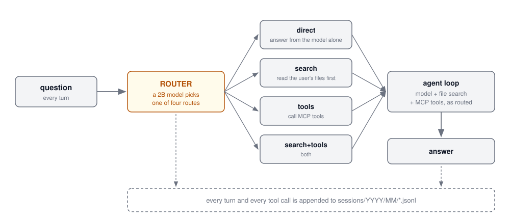
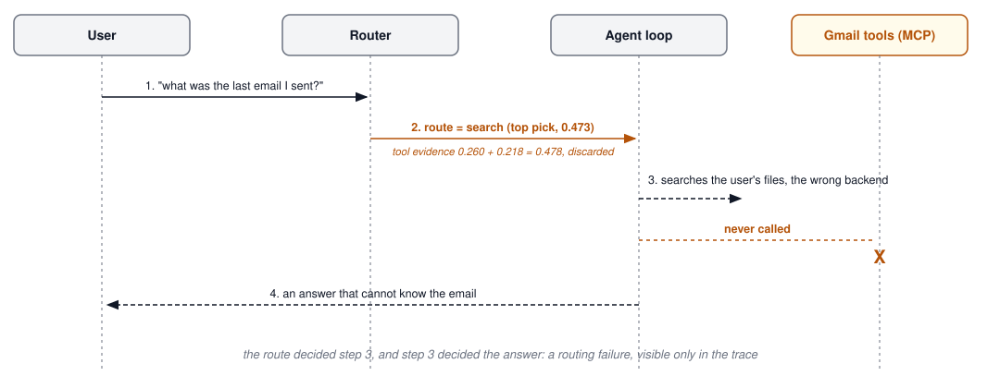
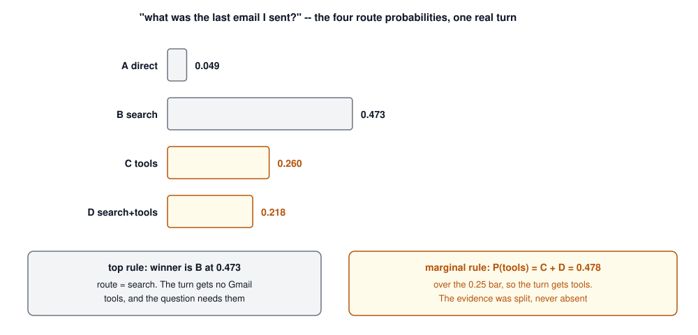
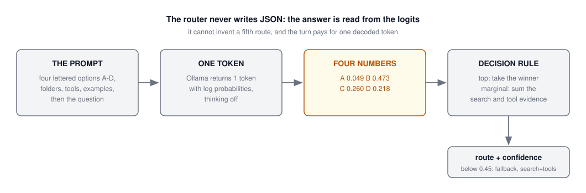
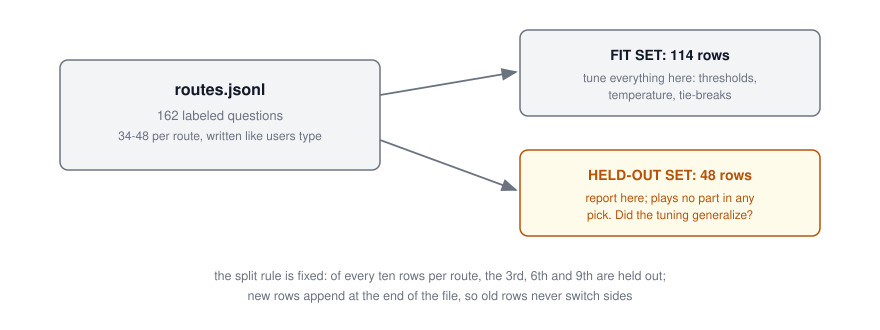
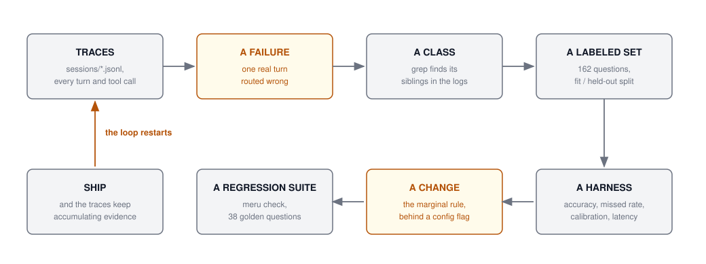

## Agenda {.smaller}

- Where week 7 left us: the eval loop, on paper
- A case study, end to end: a real agent, its real traces, a real failure,
  and the eval pipeline that turned the failure into a shipped improvement
- The artifacts up close: trace files, a labeled set with a held-out split,
  a measurement harness, a calibrated classifier, a regression suite
- What the whole thing cost, and why you can afford it
- Guest lecture: agent sandboxes
- Where the week 7 assignment picks this up

## Where Week 7 Left Us {.smaller}

{height=330 fig-align="center"}

Three eval layers, and agents as the open problem: outcomes, trajectories,
efficiency, pass^k. You built the machinery in the lab -- golden questions,
judges, metrics logged onto traces.

## The Loop, on Paper {.smaller}

Week 7 closed with a claim:

> Production traces become datasets, datasets become regressions,
> regressions block bad deploys, and production generates tomorrow's eval
> cases. Teams that ship reliable agents are running this loop.

Today tests that claim on a real agent: one failure pulled from its logs, and every artifact of the loop that fixed it: the
trace line, the labeled set, the harness, the calibration, the decision
table, the regression suite, and the honest footnotes.

- Everything shown today is in a public repo you can read:
  [github.com/aarora79/meru](https://github.com/aarora79/meru)
- The model making the failing decision is MiniCPM5-2B, the same 2B model
  you have used since week 2

# Case Study: Improving a Real Agent from Its Traces

## The Agent: Meru {.smaller}

[Meru](https://github.com/aarora79/meru) is a personal AI assistant that
runs entirely on one machine: local models through Ollama, the user's own
notes, mail, repos, and tools, with no path to a cloud model.

Its shape is the shape you built in weeks 5 and 6:

- An **agent loop**: a model, file search, and MCP tools
- A **router** in front of it: a 2B model picks one of four routes on
  every turn
- **Everything is logged** to plain JSONL files on disk

The router is today's case study: an LLM making a decision on every turn,
so it fails like an LLM and needs evals like everything else you built.

## One Turn Through Meru {.smaller}

{height=400 fig-align="center"}

The router's choice decides what the agent loop is allowed to touch. A
wrong route starves the turn before the first tool call.

## Where the Traces Live {.smaller}

No Phoenix here: one JSONL file per conversation, under
`~/.meru/sessions/YYYY/MM/`. Two real lines from one turn:

```json
{"ts": "2026-09-25T11:44:26Z", "type": "user",
 "text": "What is the capital of Australia?",
 "trace_id": "968049e88113be8209bc5553859b3227"}

{"ts": "2026-09-25T11:44:28Z", "type": "assistant",
 "text": "The capital of Australia is Canberra. ...",
 "tokens_in": 899, "tokens_out": 159,
 "route": "direct", "ms": 1526,
 "trace_id": "968049e88113be8209bc5553859b3227"}
```

- The week 7 vocabulary maps straight on: the file is a session, the
  `trace_id` ties a turn's records together, and tool calls land as their
  own lines with args, outcome, and duration
- A flat file the owner can `grep` is a legitimate trace store

## Mining Traces Is Ten Lines {.smaller}

The entire "observability stack" needed to study this agent's decisions:

```python
import json, glob, collections

routes = collections.Counter()
slow, failures = [], []
for path in glob.glob("sessions/2026/*/*.jsonl"):
    for line in open(path):
        rec = json.loads(line)
        if rec.get("type") == "assistant":
            routes[rec.get("route")] += 1
            if rec.get("ms", 0) > 20000:
                slow.append((rec["ms"], rec["trace_id"]))
print(routes, sorted(slow)[-5:])
```

- Route distribution, latency outliers, and (with one more branch) every
  turn whose tool calls errored -- from files that were being written
  anyway
- Failure hunting starts here, with a loop over your own logs

## A Real Failure, as a Sequence {.smaller}

From a real turn in the logs: *"what was the last email I sent?"*

{height=400 fig-align="center"}

## The Same Turn, in Numbers {.smaller}

Why did the router say `search`? Its four probabilities for that turn:

{height=420 fig-align="center"}

## Classify Before You Fix {.smaller}

One trace is an anecdote. The first move is to ask whether it is a class:

- In week 7's taxonomy this is a **wrong route** failure, the agent-level
  cousin of wrong tool
- A `grep` over the transcripts found siblings: *"text alex that I'm on my
  way"* also routed to search. Tool questions were being starved whenever
  the probability mass split between `tools` and `search+tools`
- The failure now has a name, and the name is a measurable claim: **the
  top-pick rule wastes summed evidence**

Nobody edited the prompt and eyeballed two answers. The class earns an
eval before any patch.

## The Design Constraint: a 2B Router {.smaller}

Asking a 2B model for JSON (`{"route": "search"}`) fails three ways:
malformed JSON, an invented fifth route, and a confident wrong answer that
looks like a right one. Meru's router asks for one token instead:

{height=350 fig-align="center"}

The decision rule receives a *distribution* over the four routes, and the
failing turn needed that distribution.

## The Fix: Read the Same Numbers Differently {.smaller}

::: {.idea-callout}
**What was wrong:** the `top` rule looked only at the single most likely
route, so when the model's evidence split between `tools` (0.260) and
`search+tools` (0.218), both lost to `search` (0.473) and the turn ran
without the Gmail tools it needed.
**What fixed it:** a new decision rule, `marginal`, that sums the
evidence: P(tools) = P(C) + P(D) = **0.478**, over a 0.25 threshold, so
the turn gets its tools. Shipped behind `decision = "marginal"` in config.
:::

How `marginal` reads the same four probabilities:

- B (`search`) and D (`search+tools`) both mean *search*, so
  **P(search) = P(B) + P(D)**; C and D both mean *tools*, so
  **P(tools) = P(C) + P(D)**
- Two yes/no questions against two thresholds: two yeses give
  `search+tools`, one gives that half, none gives `direct`

Before that rule could ship, the week 7 question applied: **how would you
know it is better?** The next five slides are that answer.

## Measure First: the Labeled Set {.smaller}

`internal/router/testdata/routes.jsonl`: 162 questions written the way a
user types them, 34 to 48 per route, each with its label and a reason.
Real rows:

```json
{"q": "what's the capital of australia", "route": "direct",
 "why": "general knowledge"}

{"q": "can you give me a tiny example of the first one?",
 "route": "direct",
 "why": "follow-up about general knowledge already in the conversation",
 "history": [{"q": "what's the difference between a mutex and a channel?",
              "a": "A mutex guards shared memory ..."}]}
```

- Follow-ups carry their history; 18 rows ask about connected servers; 9
  ask about images. Small, real, labeled, and the hard tiers are in

## Golden-Set Discipline: the Split {.smaller}

{height=320 fig-align="center"}

- Tune on the fit set; **held-out numbers play no part in any pick**. They
  answer one question: did the tuning generalize?
- This is "version your golden set like code," enforced by a convention a
  reviewer can check

## The Harness {.smaller}

`make router-eval` runs every question through the real router against the
local Ollama and reports, per set:

| What it reports | Why |
|-----------------|-----|
| accuracy, per-route precision and recall, confusion matrix | the headline, and where it hides |
| **missed rate** | the route lacks a search or tool the question needs: the failure that started all this, promoted to a metric |
| two **over-offer rates** | extra tools cost more than extra search, so they are counted apart |
| calibration error, latency p50/p95 | can the confidence be trusted, and is the router fast enough to run every turn |

- No LLM judge anywhere: labels exist, so every metric is **code**, and the
  whole harness reruns in minutes on a laptop

## Calibration, for a Classifier {.smaller}

**Calibrated** means the confidence number is honest: of all the turns
where the router says 0.9, about nine in ten should actually be right. An
overconfident router says 0.9 and is right six times in ten.

Why it matters here: the confidence **gates the fallback**. If the number
lies, the gate opens and closes at the wrong times.

- The raw probabilities come out overconfident, a common trait of small
  models. The fix is one number: divide every logit by a **temperature**
  before normalizing, which softens the distribution without ever changing
  which route is on top
- The temperature is fitted by a sweep: try values from 0.5 to 5, measure
  the gap between stated confidence and actual accuracy (calibration
  error), keep the value with the smallest gap. Shipped: **1.25**
- With confidence now meaningful, the floor works: below
  `min_confidence = 0.45` the router stops guessing and takes
  `search+tools`, the one route that cannot fail for want of context. It
  costs more, deliberately: an unsure router should spend tokens, never
  guess

## The Results {.smaller}

The real table from the design doc: old rule (`top`) against new rule
(`marginal`), each scored on both halves of the labeled set:

| rule | set | accuracy | missed | extra search | extra tools |
|------|-----|----------|--------|--------------|-------------|
| `top`, floor 0.45 | fit | 0.850 | 0.103 | 0.084 | 0.019 |
| `marginal` 0.30/0.25 | fit | 0.841 | **0.065** | 0.112 | 0.019 |
| `top`, floor 0.45 | held-out | 0.761 | 0.196 | 0.130 | 0.000 |
| `marginal` 0.30/0.25 | held-out | 0.739 | **0.152** | 0.174 | 0.022 |

Column by column: **accuracy** is exact route matches against the labels.
**missed** is the share of turns denied a search or tool they needed, the
failure from the email turn. **extra search / extra tools** are the
over-offers: the turn got something it did not need and paid for it.

The headline metric and the harm metric disagree, and the next slide is
about which one to believe.

## How to Read That Table {.smaller}

- Accuracy went **down**, 0.761 to 0.739 held-out. On accuracy alone, the
  change is rejected
- **missed** dropped on both sets, 0.196 to 0.152 held-out. These are the
  turns that got no chance: a missed turn lacks the tool or search it
  needs, so it **cannot** succeed no matter how good the model is
- The two failures are not symmetric, and that is the whole argument. An
  over-offered turn still succeeds, at extra cost in tokens and latency. A
  missed turn fails, period. `marginal` trades a few exact matches and some
  cheap over-offers for fewer unwinnable turns
- The guardrail on the trade: the expensive over-offer (**extra tools**)
  stayed within 3 points, so the cost side stayed bounded

The eval is only as good as the metric that matches the harm. Defining
"missed" was the real work; the arithmetic after it is bookkeeping.

## Read the Rows, Not Just the Means {.smaller}

Aggregates summarize; rows explain. The new rule routes 14 of 153
questions differently, and the doc reads every one of them:

| Question | `top` sent it to | `marginal` sends it to | Verdict |
|----------|------------------|------------------------|---------|
| "text alex that I'm on my way" | search (no tools) | search+tools | fixed |
| "look up reviews for the books on my reading list" | search | search+tools | fixed |
| "what documents do you have indexed" | its route | gains unneeded tools | worse |
| "what's changed in upstream ollama since..." | fallback (had tools) | loses its tools | worse |

Overall: **seven improve, six get worse, one fails differently**. The
aggregate says ship; the row reading names the regression risk question by
question, so the next failure report is already half-diagnosed.

This is week 7's "honest middling numbers with sharp explanations," as
practiced in a real design doc.

## The Decision, and Its Honesty {.smaller}

How it shipped: as a **config choice**, `decision = "marginal"`, with the
old rule one line away. A reversible ship means a wrong call costs an edit,
and both rules stay measurable side by side forever.

The deciding sentence, worth copying in your EVALS.md:

> `marginal` lowers the missed rate on both sets and keeps tool over-offer
> within 3 points, so it ships. On 46 held-out rows the gain is 2 turns,
> it costs one exact match -- **and the email question that prompted it
> already gets Gmail tools from a rule after the router.**

Read that last clause again. By ship time, a different change had already
fixed the original motivating turn. A dishonest doc hides that; this one
states it, because the eval justified the change on the **class** of
failures, and the class is still real.

- Why the footnote matters: the next maintainer needs to know what evidence
  the decision rests on, or they cannot tell when it has expired
- The doc names its own expiry condition: *"revisit with labelled turns
  from real transcripts."* Decisions age; write down what reopens them

## Guarding It: the Regression Suite {.smaller}

`meru check` is the lab's replay slide, running in real life: golden
questions in `~/.meru/checks.jsonl`, each with assertions the harness can
grade with code:

```json
{"id": "direct-capital", "category": "direct",
 "question": "What is the capital of Australia?",
 "want": {"route": ["direct"], "no_tools": true,
          "answer_any": ["Canberra"]}}
```

Each question carries assertions code can grade: the expected **route**,
whether tools should fire (`no_tools`), and strings the answer must contain
(`answer_any`). One dated results file per run. A real run, 2026-09-25:
**36 of 38 passed**, and both failures share a name, `web-go`, so the
morning after a change starts with a specific question instead of a
feeling.

Two regression layers now guard the router, and they test different things:

- **`routes.jsonl` + the harness** test the router *in isolation*: given
  this question, is the route right? Fast, surgical, runs on router changes
- **`meru check`** tests the *whole agent* end to end: route, tools, and
  final answer together, 38 questions across nine categories. Runs after
  any change, because a prompt edit or a model upgrade can break a turn
  without touching the router

## What Cheap Checks Do Not Catch {.smaller}

Look again at the passing check from the trace slide. The assertion wanted
`"Canberra"` in the answer. The answer said:

> "...Canberra was chosen as the capital **in 1980** to spread the
> country's administrative institutions..."

Canberra was selected in 1908 and became the seat of government in 1927.
The check **passed** while the answer hallucinated a date.

- Substring checks catch regressions: the route broke, the tool vanished,
  the answer no longer names the right thing
- They do not catch untruth. That is what week 7's judge layer and human
  layer are for, and why a real eval stack keeps all three: code checks on
  every change, judges on a schedule, humans to calibrate the judges
- Know which layer each metric lives in, and never let a green suite stand
  in for a layer it does not implement

## The Pipeline, Generalized {.smaller}

{height=360 fig-align="center"}

Every box exists in the repo you can read: the sessions folder, the email
turn, the grep, `routes.jsonl`, `make router-eval`, the `marginal` rule
behind its flag, and `meru check`. Running this loop is the recurring work of shipping agents.

## What It Cost {.smaller}

The whole pipeline, itemized:

- **162 labeled questions**, written and tagged by one person -- the
  single most valuable artifact, and the slowest to make
- **One harness** (`make router-eval`) that reruns in minutes on a laptop
  against a free local model
- **38 regression questions** with code-checkable assertions
- **Zero LLM-judge spend**: labels made every metric deterministic
- **Zero infrastructure**: traces are files; the eval store is a JSONL per
  day

Evals are not a big-company luxury. The deciding factors were a failure
worth naming, labels worth writing, and the discipline to tune on one set
and report on another. Every one of those is available to a class project
-- which is what your week 7 assignment asks for in miniature.

# Guest Lecture: Agent Sandboxes

## Agent Sandboxes (Guest Lecture) {.smaller}

**Placeholder -- speaker and details to be announced.**

The thread it continues: everything today assumed the agent's tools were
safe to run while we studied it. Once agents write and execute code, that
assumption needs engineering of its own.

What to expect:

- Why agents that execute code need isolation: the blast radius of a
  hallucinated `rm`, a prompt-injected shell command, a package install
- The isolation toolbox: processes, containers, microVMs, and what each
  costs in startup time and fidelity
- What sandboxes change for evals: reproducible environments make
  trajectories replayable, and replayable trajectories are exactly what
  this lecture's loop feeds on

*Slides for this segment arrive with the guest.*

## Key Takeaways {.smaller}

1. The week 7 eval loop ran in full on one laptop: one person and a free
   2B model covered all of it -- traces, labeled set, harness,
   calibrated decision, regression suite
2. One failing trace is an anecdote; grep makes it a class; a class earns
   an eval before it earns a fix
3. Define the metric that encodes the harm (here: **missed**), or accuracy
   will vote against the right change
4. Tune on the fit set, report on held-out, append-only golden sets, and
   write the honest footnote -- including when the motivating bug got fixed
   elsewhere
5. Cheap code checks guard every change; they pass hallucinated dates. Keep
   the judge and human layers, and know which layer each claim lives in
6. Ship behind a flag, write down what would reopen the decision, and let
   the traces keep accumulating evidence

## References {.smaller}

**The case study (all public):**

- [Meru](https://github.com/aarora79/meru) -- the agent; traces, router,
  checks all in-repo
- [The fast router design note](https://github.com/aarora79/meru/blob/main/docs/fast-router.md)
  -- the labeled set, harness, calibration, decision tables quoted today
- [Meru architecture](https://github.com/aarora79/meru/blob/main/ARCHITECTURE.md)
  -- the session store and audit log schemas

**The week 7 foundations:**

- [τ-bench (Yao et al. 2024)](https://arxiv.org/abs/2406.12045) -- pass^k
- [Zheng et al. 2023](https://arxiv.org/abs/2306.05685) -- judges and their
  calibration
- Week 7 lab: [evals-and-observability](https://github.com/gu-dsan6725/evals-and-observability)
  -- your own version of this loop, in miniature
