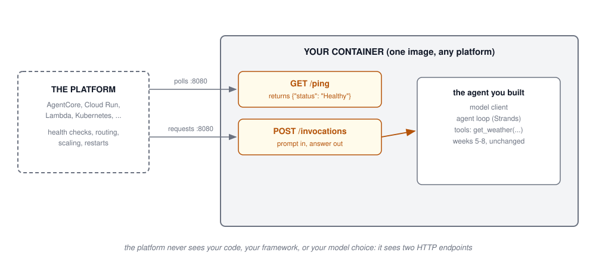
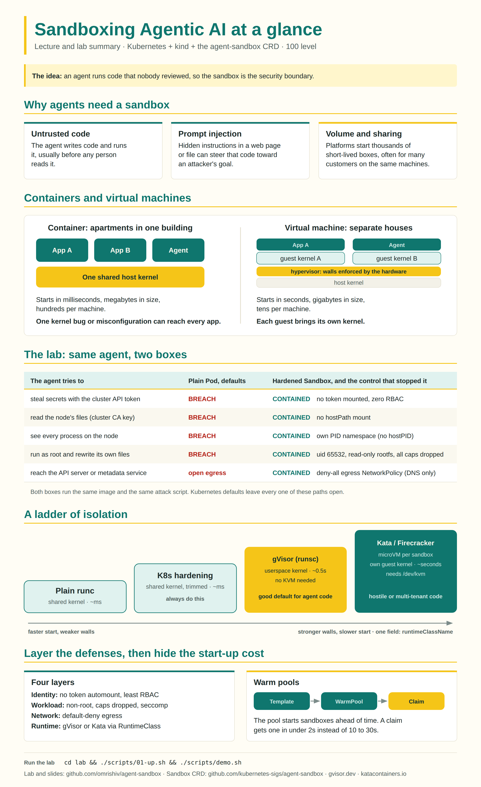

## Agenda {.smaller}

- From a terminal to a service: what deployment adds to the agents you built
- The one concept under every platform: **containerization**
- The container contract: a `/ping` and an `/invocations` endpoint
- The code: a weather agent, its HTTP wrapper, and its Dockerfile
- The platform landscape: AWS, Google, Microsoft, and LangSmith, cited
- This week's lab: build it and containerize it
- Second half: **agent sandboxes**, how strong the box around a deployed
  agent needs to be, with material from the guest lecture

# Part 1: From Your Terminal to a Service

## Everything So Far Ran in a Terminal {.smaller}

Every agent you have built dies when you close the lid: weeks 5 and 6 ran
in a shell against a local model; week 7's agent ran as a script with
Phoenix watching.

A deployed agent is the same loop with a different lifecycle, and the
lifecycle is what deployment adds:

- **It is always on**: something must start it, restart it when it crashes,
  and replace it when its machine dies
- **It serves many users**: concurrent sessions that must not see each
  other's state
- **It scales**: one copy at 9am, forty at noon
- **It answers over HTTP**: no terminal, so health, input, and output all
  become endpoints
- **Someone else's machine runs it**: your laptop's Python environment
  proves nothing about the host it lands on

That last point is the whole case for the next slide.

## The Concept Under Everything: Containerization {.smaller}

A container packages your agent, its exact dependency versions, and its
runtime into one image that runs the same everywhere.

Why agents in particular want this:

- **Dependency pinning survives the trip**: the `uv.lock` discipline from
  the labs, extended to the OS libraries underneath
- **One artifact, every environment**: the image you test on your laptop is
  bit-for-bit what production runs
- **Isolation by default**: the agent sees its own filesystem and process
  space, which Part 2 turns from a convenience into a security boundary
- **Density and speed**: containers start in milliseconds and pack by the
  hundred per machine, which is what per-session agent isolation needs

Every platform on the landscape slides accepts the same thing: a container
image. Build one artifact and the platform choice becomes a configuration
decision rather than a rewrite.

## The Contract: Two Endpoints {.smaller}

{height=400 fig-align="center"}

A common convention, and the exact contract of Amazon Bedrock AgentCore
Runtime: serve **`GET /ping`** (health) and **`POST /invocations`** (work)
on port 8080, and the platform handles everything else.

## The Contract, Specifically {.smaller}

What each endpoint owes the platform, using
[AgentCore Runtime's contract](https://docs.aws.amazon.com/bedrock-agentcore/latest/devguide/runtime-troubleshooting.html)
as the reference:

- **`GET /ping`**: respond 200 with `{"status": "Healthy"}`. The platform
  polls it; a container that stops answering gets replaced. A busy variant
  (`HealthyBusy`) tells the platform a long turn is still alive
- **`POST /invocations`**: the request body carries the user's input, the
  response carries the agent's answer. Streaming responses go out as
  server-sent events, the same mechanism MCP used in week 6
- **Port 8080**, and for AgentCore specifically, an **arm64 Linux image**
- Session identity arrives in a header
  (`X-Amzn-Bedrock-AgentCore-Runtime-Session-Id`), and AgentCore runs **one
  container per session, each in its own microVM**, a design choice Part 2
  explains

The shape generalizes: Cloud Run, Lambda, and Kubernetes each have their
own health and invoke conventions, but a container exposing these two
endpoints adapts to any of them with configuration.

## The Agent: One Tool, Real Data {.smaller}

The lab's agent answers weather questions with the free, keyless
[Open-Meteo](https://open-meteo.com/) API. The tool is week 5's pattern:

```python
@tool
def get_weather(place: str) -> str:
    """Current weather for a place name, for example 'Georgetown, DC'."""
    geo = httpx.get(
        "https://geocoding-api.open-meteo.com/v1/search",
        params={"name": place, "count": 1},
    ).json()
    if not geo.get("results"):
        return f"ERROR: no place named {place}"
    spot = geo["results"][0]
    wx = httpx.get(
        "https://api.open-meteo.com/v1/forecast",
        params={"latitude": spot["latitude"], "longitude": spot["longitude"],
                "current": "temperature_2m,weather_code,wind_speed_10m"},
    ).json()["current"]
    return json.dumps({"place": spot["name"], **wx})
```

Two HTTP calls: a geocoder turns the place name into coordinates, the
forecast endpoint returns current conditions. Errors come back as values,
the week 5 rule.

## The Wrapper: main.py {.smaller}

FastAPI turns the agent into the two-endpoint contract. This is the entire
file structure:

```python
from fastapi import FastAPI
from pydantic import BaseModel
from strands import Agent

app = FastAPI()

class Invocation(BaseModel):
    prompt: str

@app.get("/ping")
def ping() -> dict:
    return {"status": "Healthy"}

@app.post("/invocations")
def invoke(request: Invocation) -> dict:
    agent = Agent(model=make_model(), tools=[get_weather],
                  system_prompt=SYSTEM_PROMPT, callback_handler=None)
    return {"answer": str(agent(request.prompt))}
```

- A fresh `Agent` per invocation keeps requests independent, the same
  per-question discipline as the labs
- Nothing about the agent changed; the loop gained an HTTP skin

## The Box: Dockerfile {.smaller}

```dockerfile
FROM python:3.12-slim

WORKDIR /app
COPY pyproject.toml uv.lock ./
RUN pip install uv && uv sync --frozen

COPY main.py weather.py ./

EXPOSE 8080
CMD ["uv", "run", "uvicorn", "main:app", "--host", "0.0.0.0", "--port", "8080"]
```

Build it, run it, and the contract answers:

```bash
docker build -t weather-agent .
docker run -p 8080:8080 --env-file .env weather-agent

curl localhost:8080/ping
# {"status":"Healthy"}
curl -X POST localhost:8080/invocations \
  -H 'Content-Type: application/json' \
  -d '{"prompt": "Is it raining in Georgetown?"}'
```

One note for the graders of week 6: binding `0.0.0.0` is correct **inside**
a container; the container boundary is the exposure control now.

## Where to Run It: AWS {.smaller}

| Offering | What it is |
|----------|------------|
| [Amazon Bedrock AgentCore Runtime](https://docs.aws.amazon.com/bedrock-agentcore/latest/devguide/) | A managed runtime built for agents: you hand it the container, it runs one per session in its own microVM, with identity, memory, and observability services around it |
| [AWS Lambda](https://docs.aws.amazon.com/lambda/latest/dg/images-create.html) | Serverless functions that accept container images; fits short, stateless invocations; 15-minute ceiling per invocation |
| [Amazon ECS / EKS with Fargate](https://docs.aws.amazon.com/eks/latest/userguide/fargate.html) | You run the containers yourself on managed orchestration; most control, most operational surface |

- The spectrum runs from "managed agent runtime" to "general compute you
  operate." AgentCore knows what an agent is; EKS knows what a container is
- Course note: AgentCore appears here as a deployment target you should
  know; the course's labs stay on local and keyless services

## Where to Run It: Google, Microsoft, LangSmith {.smaller}

| Offering | What it is |
|----------|------------|
| [Vertex AI Agent Engine](https://cloud.google.com/vertex-ai/generative-ai/docs/agent-engine/overview) | Google's managed agent runtime: sessions, memory, and scaling around your agent code |
| [Google Cloud Run](https://cloud.google.com/run/docs) | Serverless containers: hand it the image, it scales from zero; the general-purpose sibling |
| [Microsoft Foundry Agent Service](https://learn.microsoft.com/en-us/azure/ai-foundry/agents/) | The managed agent service in Microsoft Foundry (the renamed Azure AI Foundry), generally available since 2025 |
| [Azure Container Apps](https://learn.microsoft.com/en-us/azure/container-apps/) | Azure's serverless container platform, the Cloud Run analogue |
| [LangSmith Deployment](https://www.langchain.com/langsmith/deployment) | Yes, LangSmith deploys agents: the SaaS formerly named LangGraph Platform, renamed in late 2025. Managed, stateful, long-running agent infrastructure; framework-agnostic, Strands included |

Every row takes the same input: the container you build in the lab runs,
with configuration, on all of them.

## Choosing Among Them {.smaller}

Three questions sort the landscape faster than any feature table:

1. **How long do turns run?** Sub-minute, stateless: serverless functions
   are cheap and simple. Minutes to hours, stateful sessions: a managed
   agent runtime (AgentCore, Agent Engine, Foundry, LangSmith Deployment)
   exists precisely for this
2. **Who operates the fleet?** Managed runtimes trade control for zero
   operations; Kubernetes trades operations for total control. Most teams
   earn Kubernetes later than they adopt it
3. **How much isolation does a session need?** If every user session must
   be a separate box, per-session microVMs (AgentCore's model) or your own
   sandbox tier matter, which is Part 2's whole subject

The portable decision: build to the two-endpoint container contract, and
changing your answer later is a redeploy rather than a rewrite.

## This Week's Lab {.smaller}

Build the agent from these slides, end to end:

1. **The agent**: Strands, one `get_weather` tool against Open-Meteo
   (keyless, free), any OpenAI-compatible model via the week 7 `.env`
   pattern
2. **The wrapper**: FastAPI serving `GET /ping` and `POST /invocations` on
   8080
3. **The box**: a Dockerfile; build and run locally
4. **Prove the contract**: `curl` both endpoints, commit the transcript
5. The deployment itself stays local (Docker on your machine); the
   container you produce is the artifact every platform on the landscape
   slides accepts

Repo details land with the lab.

# Part 2: Agent Sandboxes

## The Box Around the Box {.smaller}

Part 1 put your agent in a container because deployment wants an artifact.
Part 2 asks the security question: when the agent misbehaves, what does the
container actually stop?

This material follows the guest lecture,
[Sandboxing Agentic AI](https://github.com/aarora79/agent-sandbox)
([slides](https://github.com/aarora79/agent-sandbox/blob/main/slides/slides-100.html),
[hands-on lab](https://github.com/aarora79/agent-sandbox/tree/main/lab)),
and connects it to the course:

- Week 6 taught **prompt injection**: retrieved text and tool output can
  carry instructions. An agent that executes code turns those instructions
  into system calls
- So the question changes from "will the agent misbehave?" (assume yes,
  eventually) to "**what is the blast radius when it does?**"
- A sandbox is the engineered answer: a fenced place to run code that keeps
  the damage inside the fence, thrown away after the work

## Sandboxes: 100, 200, 300 {.smaller}

:::: {.columns}
::: {.column width="33%"}
**100**

A sandbox is a fenced-off place to run code. The code does its job inside
and cannot reach anything outside. When the work is done, you throw the
box away.
:::
::: {.column width="33%"}
::: {.fragment}
**200**

In practice: a container or virtual machine **plus its settings**. Which
credentials it holds, which files it sees, which user it runs as, where it
can connect.
:::
:::
::: {.column width="33%"}
::: {.fragment}
**300**

Design for hostile code. Assume a kernel bug exists, then count the walls
still standing: the runtime boundary, the network policy, the identity the
box carries.
:::
:::
::::

The 300 column is the threat model for everything that follows: assume the
worst about the code, then count the walls.

## Containers and Virtual Machines {.smaller}

The guest lecture's picture: a container is an **apartment**, with its own
walls and front door but a shared foundation; a virtual machine is a
**house** with its own foundation. In a computer, the shared foundation is
the kernel.

| | Container | Virtual machine |
|---|-----------|-----------------|
| Start time | milliseconds | seconds |
| Size | megabytes | gigabytes |
| Per machine | hundreds | tens |
| Walls | shared kernel | own kernel, hardware-enforced |

Agent platforms want both columns at once: container speed and density for
thousands of session boxes, virtual-machine walls for the untrusted code
inside them. The next two slides are how the industry gets most of both.

## The Ladder of Isolation {.smaller}

Each rung buys stronger walls with longer start-up:

1. **A default container**: namespaces limit what the process sees, cgroups
   limit what it uses, and every system call still lands in the host kernel
2. **A hardened container**: drop root, drop capabilities, trim the
   system-call list with seccomp. Cheap, always worth it, still one kernel
   bug from escape
3. **gVisor**: a userspace kernel answers the agent's system calls, so the
   host kernel's surface nearly vanishes. About half a second of start-up;
   in Kubernetes it is a one-line change (`runtimeClassName`)
4. **microVMs (Firecracker, Kata)**: a real kernel per box, hardware
   enforced, a few seconds to boot, needs virtualization support

The guest lab's measurement makes rung 3 concrete: a hardened pod on the
default runtime can still see the host's 242 kernel modules; under gVisor
it sees none. For untrusted agent code, **gVisor is a good default**.

## Warm Pools: Strong Walls Without the Wait {.smaller}

The ladder's cost is latency, and users feel seconds. The platform answer
is the taxi rank:

- Start sandboxes **before anyone asks**: a pool of booted, empty boxes
  idles at the ready
- A session grabs a warm box in under two seconds instead of waiting 10 to
  30 for a cold microVM boot; the pool refills itself behind the demand
- This is how AgentCore can afford a microVM per session, and why the
  managed runtimes price per active session: the pool is their cost

The pattern to remember: when isolation is too slow, do not weaken the
isolation; move the waiting to before the request.

## The Whole Argument, One Image {.smaller}

{height=520 fig-align="center"}

Source: [agent-sandbox/infographic](https://github.com/aarora79/agent-sandbox/tree/main/infographic);
open the full-size version there, it rewards a slow read.

## Five Questions for Any Agent Platform {.smaller}

From the guest lecture's close, the questions to ask any vendor (or your
own platform team) before trusting them with agent code:

1. What **runtime** does untrusted code get: default container, gVisor, or
   a microVM?
2. What **identity and credentials** does the box carry, and what is the
   smallest set it could carry?
3. Where can the box **connect**? Deny-by-default egress, or open internet?
4. What happens to the box **after the session**: reused, or destroyed?
5. How long does a **fresh box** take, and is there a warm pool hiding
   that number?

The guest repo's lab runs the same agent in a default box and a secured box
and attacks both; the diff is the lecture in executable form.

## Key Takeaways {.smaller}

1. Deployment adds a lifecycle to the loop you already built: always on,
   many users, scaled, health-checked, on someone else's machine
2. Containerization is the one concept under every platform; the image is
   the artifact, and the platform choice becomes configuration
3. The minimal contract is two endpoints, `GET /ping` and
   `POST /invocations` on 8080, and it is AgentCore Runtime's contract
   verbatim
4. The landscape: managed agent runtimes (AgentCore, Vertex AI Agent
   Engine, Microsoft Foundry Agent Service, LangSmith Deployment) against
   general compute (Lambda, Cloud Run, Container Apps, Kubernetes); sort
   them with three questions about turns, operations, and isolation
5. A sandbox is a container or VM plus its settings, designed for hostile
   code; climb the isolation ladder as trust falls, and hide the cost with
   warm pools
6. Ask the five platform questions before handing anyone your agent's code

## References {.smaller}

**Deployment:**

- [Amazon Bedrock AgentCore Runtime](https://docs.aws.amazon.com/bedrock-agentcore/latest/devguide/) · [Lambda container images](https://docs.aws.amazon.com/lambda/latest/dg/images-create.html) · [EKS Fargate](https://docs.aws.amazon.com/eks/latest/userguide/fargate.html)
- [Vertex AI Agent Engine](https://cloud.google.com/vertex-ai/generative-ai/docs/agent-engine/overview) · [Cloud Run](https://cloud.google.com/run/docs)
- [Microsoft Foundry Agent Service](https://learn.microsoft.com/en-us/azure/ai-foundry/agents/) · [Azure Container Apps](https://learn.microsoft.com/en-us/azure/container-apps/)
- [LangSmith Deployment](https://www.langchain.com/langsmith/deployment)
- [Open-Meteo API](https://open-meteo.com/) (the lab's weather source)

**Sandboxes (the guest lecture's material):**

- [Sandboxing Agentic AI: slides](https://github.com/aarora79/agent-sandbox/blob/main/slides/slides-100.html)
- [The infographic](https://github.com/aarora79/agent-sandbox/tree/main/infographic)
- [The lab: same agent, two boxes](https://github.com/aarora79/agent-sandbox/tree/main/lab)
- [gVisor](https://gvisor.dev/) · [Firecracker](https://firecracker-microvm.github.io/) · [Kata Containers](https://katacontainers.io/)
