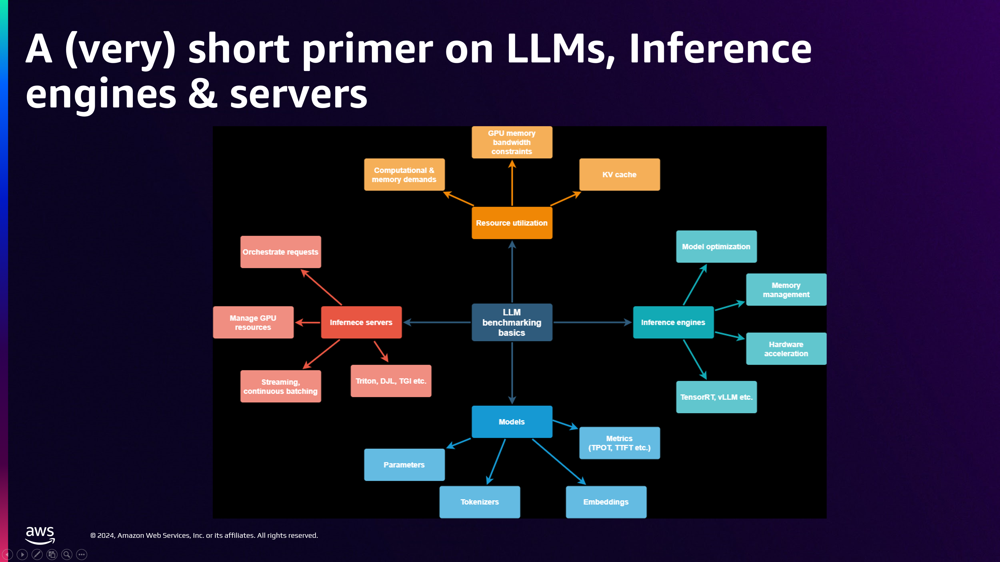
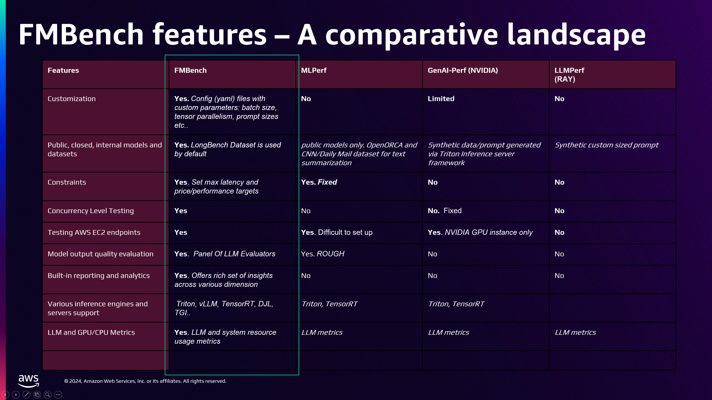
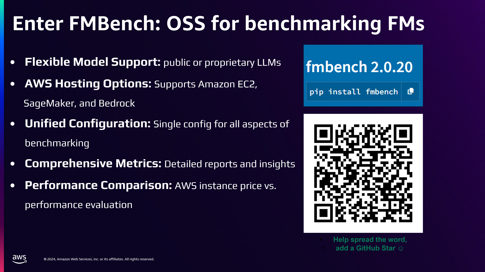

## Agenda {.smaller}

- What is tokenomics?
- Token pricing: input, output, cached
- Cost drivers in LLM applications
- Cost levers: caching, batching, routing
- Cost-per-task vs. cost-per-token
- Build vs. buy economics
- **Open-weight vs. frontier models**: licenses, selection, self-hosting
- **Distillation** and right-sizing with small models
- Benchmarking: price, performance, accuracy
- Latency percentiles, throughput, and benchmarking tools
- Hands-on lab

---

## What is Tokenomics?

::: {.incremental}
- **Tokenomics**: the economics of building on token-metered models
- Every LLM call is a purchase: you pay per **token in** and per **token out**
- Small design decisions (prompt length, model choice, retry policy) compound into the largest line item of a GenAI product
- The developer's job: deliver **required quality at the lowest cost-per-task**, not the lowest cost-per-token
:::

---

## How API Pricing Works

- Providers price per **million tokens**, split three ways:

| Meter | What it covers | Typical relative price |
|-------|----------------|------------------------|
| **Input tokens** | Prompt: system, context, history, tools | Baseline |
| **Output tokens** | Generated completion | ~3–5× input |
| **Cached input tokens** | Previously-seen prompt prefix | ~0.1–0.25× input |

- Consequence: **verbose outputs are the most expensive thing you can ask for**
- Batch/asynchronous tiers typically offer ~50% discounts for non-interactive work

---

## Cost Drivers in Real Applications

::: {.incremental}
- **Context stuffing**: RAG chunks, long system prompts, full conversation history resent every turn
- **Tool schemas**: every tool definition rides along in *every* request
- **Agent loops**: one user request → many model calls (plan, act, reflect, retry)
- **Reasoning tokens**: extended-thinking modes bill hidden intermediate tokens as output
- **Retries and fallbacks**: failures you pay for twice
- **Fan-out**: multi-agent systems multiply all of the above
:::

---

## Anatomy of a Request's Cost

```
cost = (input_tokens   × input_price)
     + (cached_tokens  × cached_price)
     + (output_tokens  × output_price)

task_cost = Σ requests per task   ← the number that matters
```

- Instrument **per-task token accounting** from day one
- An agent that makes 25 calls at $0.01 each is a $0.25 agent — price it like one

---

## Lever 1: Prompt Caching

::: {.incremental}
- Providers cache **stable prompt prefixes** (system prompt, tool schemas, few-shot examples, large documents)
- Cache hits are billed at a fraction of input price (and are faster)
- Design rule: **stable content first, volatile content last** — any change invalidates everything after it
- Biggest wins: agents (same system prompt + tools every call), long-document Q&A, chat with long history
:::

---

## Lever 2: Batching

- **Batch APIs**: submit jobs asynchronously, get results within hours, pay ~50% less
- Ideal for: evaluation runs, document pipelines, embedding generation, nightly enrichment
- Self-hosted equivalent: **continuous batching** in vLLM/SGLang raises GPU utilization → more tokens per dollar of compute
- Ask of every workload: *does anyone need this answer in real time?*

---

## Lever 3: Model Routing and Cascades

::: {.incremental}
- **Routing**: classify the request, send it to the cheapest model that can handle it
  - Small/fast model (e.g., Haiku-class, Flash-class, small open models) for extraction and classification
  - Frontier model (e.g., Claude Opus-class, GPT-5-class) for hard reasoning
- **Cascade**: try cheap first; escalate only on low confidence or failed validation
- **Model gateways** (LiteLLM, OpenRouter, Bedrock) centralize routing, fallback, and spend tracking
- Routing typically cuts spend far more than prompt tweaking — most traffic is easy traffic
:::

---

## More Cost Levers {.smaller}

- **Output discipline**: max-token limits, terse formats (JSON, not prose), "answer only" instructions
- **Context management**: summarize or truncate history; retrieve less but better
- **Distillation / fine-tuning**: move a high-volume narrow task from a frontier model to a small tuned model (Week 12)
- **Quantization** (self-hosted): more throughput per GPU (Week 2)
- **Semantic response caching**: identical/near-identical questions answered from cache, zero tokens

---

## Cost-per-Task vs. Cost-per-Token

::: {.incremental}
- Cost-per-token comparisons across models are **misleading**:
  - A cheaper model that needs 3 attempts and a human review costs more
  - A pricier model that one-shots the task may be the bargain
- Define the task, measure **end-to-end**: tokens × calls × success rate
- `effective cost = task_cost / success_rate`
- This is why **evaluation (Week 7) and tokenomics are inseparable**: you can't optimize cost without measuring quality
:::

---

## Build vs. Buy Economics {.smaller}

| | **API (buy)** | **Self-hosted (build)** |
|---|--------------|------------------------|
| Cost shape | Pure variable (per token) | Fixed (GPUs) + ops |
| Utilization risk | None | You pay for idle GPUs |
| Breakeven | Low or spiky volume | High, steady volume |
| Capability ceiling | Highest | High and rising |
| Version control | Provider-controlled | You pin the weights |
| Time to first call | Minutes | Days to weeks |
| Also consider | Data egress, rate limits | Talent, upgrades, model refresh cadence |

- Hidden costs run both ways: migration effort, prompt re-tuning when you swap models, egress
- Which means the cost question is really a **model choice** question, and that is the rest of this section

---

# Open-Weight vs. Frontier Models

## The Two Worlds of LLMs

### A Working Taxonomy

- **Frontier / proprietary models**: weights never leave the lab; access by API only
- **Open-weight models**: weights are downloadable; run them anywhere
- The capability gap has narrowed, so the choice is now an engineering decision rather than a foregone conclusion
- Most real organizations end up with a **portfolio** of both

---

## Frontier Labs: The Landscape

### API-Only Model Families

- **OpenAI**: the GPT line, plus reasoning-focused, realtime, and multimodal variants
- **Anthropic**: the Claude line, in Opus, Sonnet, and Haiku tiers
- **Google DeepMind**: the Gemini line, with deep Workspace and Cloud integration
- Common traits: strongest raw capability, managed safety, rapid iteration, per-token pricing

::: {.hot-callout}
Model names and version numbers in this slide go stale within months. Check the provider's own model page before you quote a number in a design review.
:::

---

## Open-Weight Families

### Downloadable Model Lines

- **Meta Llama**: mixture-of-experts and multimodal releases, under a community license
- **DeepSeek**: strong MoE base models plus open reasoning models, permissive licensing
- **Qwen** (Alibaba): broad size range, strong multilingual and coding variants
- **Mistral**: efficient dense and MoE models, a mix of Apache-2.0 and research licenses
- **gpt-oss** (OpenAI): open-weight reasoning models under Apache-2.0
- Hugging Face Hub is the distribution channel in practice

---

## Open Weights Are Not Open Source {.smaller}

### The Distinction That Matters

- **Open weights**: you get the trained parameters, which is enough to run, fine-tune, and deploy
- **Open source**, in the strict sense: also the training code, the data recipe, and an OSI-approved license
- Most "open" LLMs release weights and inference code, **not** training data
- The [OSI Open Source AI Definition](https://opensource.org/ai) formalizes what qualifies

::: {.def-callout}
This matters for reproducibility, for auditability, and above all for what your license actually permits you to ship.
:::

---

## Licenses: Read Before You Ship {.smaller}

- **Apache-2.0 and MIT** (many Mistral and Qwen releases, gpt-oss): permissive, commercial use, few strings
- **Community licenses** (Llama, for one): custom terms, acceptable-use policies, redistribution rules, and thresholds that kick in at very large deployments
- **Research-only licenses**: no commercial use at all
- Check the derivative rules: what applies to your fine-tunes and your distilled models?

::: {.hot-callout}
Legal review belongs in model selection, not after it. A license problem found at launch is a rebuild.
:::

---

## What Frontier Buys You

### Strengths of Proprietary APIs

- Highest capability on the hardest tasks: long-horizon reasoning, agentic coding
- Zero infrastructure. No GPUs to run, patch, or scale
- Fast access to new capabilities: multimodal, computer use, longer context
- Managed safety systems and abuse monitoring
- Enterprise contracts: SLAs and data-processing agreements

---

## What Open Weights Buy You

### Strengths of Self-Managed Models

- **Control**: pin a version forever, with no silent updates or deprecations
- **Privacy**: data never leaves your VPC or your datacenter
- **Customization**: full fine-tuning freedom (Week 12)
- **Cost at scale**: sustained high volume can undercut per-token pricing
- **Latency**: co-locate the model with the application
- **Portability**: no lock-in across clouds and serving stacks

---

## Model Selection Criteria

### A Practical Checklist

::: {.incremental}
- **Task fit**: measured quality on *your* evals, not leaderboard rank
- **Modality and context**: text, vision, audio, and how much window you need
- **Latency budget**: interactive or batch
- **Cost model**: per-token API against amortized GPU spend
- **Data constraints**: residency, confidentiality, compliance regime
- **License**: permitted use, redistribution, derivatives
- **Ecosystem**: tooling, serving support, community fine-tunes
:::

---

## Self-Hosting: The Serving Stack {.smaller}

### What Running Your Own Model Takes

- **Inference engines**: vLLM, SGLang, TensorRT-LLM -- all from Week 2
- **Quantization**: FP8 or INT4 to fit the model on the GPUs you can get
- **Autoscaling and batching**: utilization is what determines your real cost
- **The middle path**: Amazon Bedrock, Azure AI Foundry, Together, and Fireworks serve open-weight models as APIs

::: {.idea-callout}
You can adopt open weights without owning a single GPU. Managed open-weight endpoints get you the license and portability benefits without the ops bill.
:::

---

## Distillation: Frontier to Open {.smaller}

### How Capability Flows Downstream

- **Knowledge distillation**: train a smaller student model on a stronger teacher's outputs
- Synthetic data generated by frontier models is now a standard training ingredient
- **Reasoning distillation**: distilled DeepSeek-R1 variants brought chain-of-thought behaviour to small open models
- Result: the open ecosystem trails the frontier by months rather than years

::: {.hot-callout}
Most frontier API terms restrict using their outputs to train a competing model. Licenses, again.
:::

---

## Small Models, Big Roles

### Right-Sizing

- Not every task needs a frontier model
- Small open models in the 1B to 14B range do well at classification, extraction, routing, and drafting
- A fine-tuned small model on a narrow task can match a general frontier model at a fraction of the cost
- This is the supply side of the routing and cascade levers from earlier in this deck

---

## Strategic Considerations {.smaller}

### The Organizational View

- **Portfolio strategy**: frontier API for hard reasoning, open weights for volume and for sensitive data
- **Abstraction layer**: route through a gateway so models stay swappable
- **Exit planning**: what happens when a provider deprecates the model you shipped on?
- **Sovereignty**: national or sector rules may require on-prem open weights
- Re-evaluate quarterly, because this landscape moves faster than your procurement cycle

---

## Case Discussion

### You Are the Architect

- A healthcare startup summarizing patient notes under HIPAA. Which way, and why?
- A consumer app doing 50M simple classifications a day. Which way, and why?
- An internal coding agent on a bank's proprietary codebase. Which way, and why?

Defend your choice on capability, privacy, cost, and license grounds.

---

## From Cost to Benchmarking

- You cannot reason about tokenomics without **measured** performance
- Benchmarking answers, for *your* workload:
  - What does a request **cost**?
  - How **fast** is it (latency)?
  - How **much** can the system handle (throughput)?
  - Is the output **good enough** (accuracy)?
- Enables **fair comparisons** across models, providers, instance types, and serving stacks

---

## Back to Basics: Inference Performance



---

## The Metrics That Matter

| Metric | Definition | Who cares |
|--------|-----------|-----------|
| **TTFT** | Time to first token | Interactive UX |
| **TPOT / ITL** | Time per output token | Streaming smoothness |
| **E2E latency** | Full request round-trip | Batch & agent steps |
| **Throughput** | Tokens/sec or requests/min | Capacity planning |
| **Cost per 1M tokens** | $ normalized to volume | Finance |
| **Accuracy** | Task-specific quality score | Everyone |

---

## Latency Percentiles

::: {.incremental}
- **Never report averages alone** — LLM latency is long-tailed
- Report **p50 / p90 / p99**:
  - p50: typical experience
  - p99: what your angriest users see; what your SLA is written against
- Tail latency worsens under load (queueing, batching effects) — measure at realistic **concurrency**, not with one sequential client
- Agent pipelines compound tails: 5 sequential calls at p90 each ≈ a coin flip of at least one slow step
:::

---

## Public Benchmarks and Their Limits {.smaller}

### Evaluate for Yourself

- Public leaderboards (LMArena, the Hugging Face leaderboards) are a starting point, not a decision
- **Contamination**: benchmark data leaks into training sets
- **Saturation**: many classic benchmarks no longer separate the top models
- **Goodhart's law**: labs optimize for what gets measured

::: {.idea-callout}
The Week 7 lesson applies here: build a private eval set from your own traffic. A model that tops a leaderboard and fails your evals is the wrong model.
:::

---

## Benchmarking Methodology

1. **Fix the workload**: real prompt/response length distributions from your app — not synthetic short prompts
2. **Sweep concurrency**: 1 → N clients; find where latency degrades
3. **Measure everything per run**: TTFT, TPOT, E2E, throughput, errors, $
4. **Hold accuracy constant**: a faster config that degrades quality isn't faster, it's worse
5. **Repeat runs**; report percentiles with configs pinned (model version, quantization, instance)

---

## Key Benchmarking Tools

| Tool | Scope | Focus areas |
|------|-------|-------------|
| **MLCommons MLPerf** | Training & inference benchmarks across ML tasks | Standardized comparisons of GPUs, CPUs, accelerators |
| **Ray LLMPerf** | LLM-specific load testing | Scalability, latency, output correctness |
| **FMBench** | Foundation-model benchmarking on AWS | Cost, latency, throughput, LLM-judge evaluations |

---

## MLPerf

- **Industry standard** from MLCommons, backed by NVIDIA and other hardware vendors
- Benchmarks AI **training and inference** performance across GPUs, TPUs, CPUs
- Key suites:
  - **MLPerf Training**: time-to-accuracy on standard tasks
  - **MLPerf Inference**: latency and throughput
  - **MLPerf Edge**: efficiency on edge devices
- Use it for **hardware selection**: comparing accelerator generations for cloud or on-prem

---

## Ray LLMPerf

- Purpose-built for benchmarking **LLM serving endpoints**
- Key features:
  - **Load testing**: simulates concurrent user requests, measures TTFT/ITL under load
  - **Correctness testing**: sanity-checks model outputs
  - **Multi-node benchmarking**: for distributed inference
- Use it to **tune serving stacks** (vLLM, SGLang, managed endpoints) before production traffic

---

## FMBench: Foundation Model Benchmarking on AWS

- Benchmarks models deployed on **SageMaker, Bedrock, EKS, and EC2**
- Works with open-source, proprietary, and third-party models
- Key capabilities:
  1. **Performance metrics**: latency, throughput, and **cost per request**
  2. **LLM-based evaluation**: a panel of LLM judges scores response quality
  3. **Bring your own dataset**: benchmark on your domain data
  4. **Flexible serving**: mirrors your real deployment options

---

## FMBench: LLM Judges and BYOD

- **Why LLM judges?** Automates quality scoring at benchmark scale; reduces manual annotation
- Panel of judge models scores **relevance, correctness, coherence**
- **Bring Your Own Dataset**: upload domain-specific data (legal, medical, finance) so price/performance numbers reflect *your* task — not a leaderboard's
- Directly supports the **cost-per-task** view: quality and cost measured on the same run

---

## Comparing MLPerf, LLMPerf, and FMBench



---

## Case Study: Instance-Type Benchmarking {.smaller}

- **Objective**: pick the best price/performance instance type for a mid-size open-weight model on a Q&A workload
- **Methodology** (FMBench):
  - Long-context Q&A dataset (~3000–4000 tokens per request)
  - Measured latency per request, throughput (requests/min), **cost per 1M tokens** per instance type
- **Findings pattern**:
  - Larger instances → lower latency, but cost per 1M tokens varies **non-monotonically**
  - The cheapest instance per hour is rarely the cheapest per token
- Takeaway: the price/performance frontier must be **measured, not assumed**

---

## How to Get Started with FMBench



---

## Hands-on Lab

### Measuring Cost and Performance

*Practical exercise and demonstration*

1. **Instrument**: log input/output/cached tokens per request in a small agent app
2. **Price it**: compute cost-per-task from provider price sheets
3. **Cache**: enable prompt caching; measure the cost delta
4. **Route**: add a cheap-model route for easy requests; compare effective cost at equal quality
5. **Load test**: run LLMPerf against an endpoint; plot p50/p90/p99 vs. concurrency
6. **Compare frontier and open weight**: run one task from your project against a frontier API and a self-served open-weight model, then write a one-page model-selection recommendation on quality, latency, and cost per 1K requests

---

## Key Takeaways

::: {.incremental}
1. Tokens are the unit of spend, and output costs far more than input, which costs far more than cached -- design prompts accordingly
2. The biggest levers are architectural: **caching, batching, routing and cascades**, not prompt micro-tuning
3. Optimize **cost-per-task at target quality**, never cost-per-token
4. Build vs. buy is a utilization question: APIs for variable load, self-hosting for sustained volume
5. **Open weights are not open source**, and the license decides what you can ship
6. Pick models on **your** evals, not on a leaderboard, and re-evaluate quarterly
7. Benchmark with **your workload**, report **percentiles under concurrency**, and keep accuracy in the loop
:::

---

## References {.smaller .scrollable}

**Pricing and caching**

- [OpenAI API Pricing](https://platform.openai.com/pricing) · [Anthropic Pricing](https://www.anthropic.com/pricing) · [Amazon Bedrock Pricing](https://aws.amazon.com/bedrock/pricing/)
- [Prompt caching on the Claude API](https://platform.claude.com/docs/en/build-with-claude/prompt-caching)

**Benchmarking**

- [MLCommons MLPerf](https://mlcommons.org/benchmarks/)
- [Ray LLMPerf](https://github.com/ray-project/llmperf)
- [FMBench](https://github.com/aws-samples/foundation-model-benchmarking-tool)
- [Netflix talk on FMBench at re:Invent 2024](https://www.youtube.com/watch?v=zUjWhiRrp0Y)

**Model landscape and licenses**

- [Hugging Face Model Hub](https://huggingface.co/models)
- [Meta Llama: models and license](https://www.llama.com/)
- [DeepSeek on Hugging Face](https://huggingface.co/deepseek-ai) · [Qwen docs](https://qwen.readthedocs.io/) · [Mistral models](https://docs.mistral.ai/getting-started/models/)
- [OpenAI gpt-oss](https://openai.com/open-models/)
- [OSI Open Source AI Definition](https://opensource.org/ai)

**Serving**

- [vLLM Documentation](https://docs.vllm.ai/)
