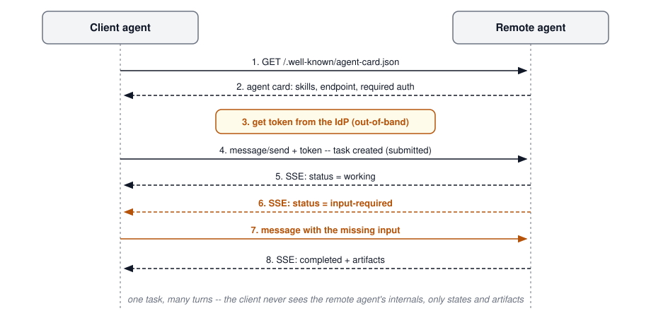
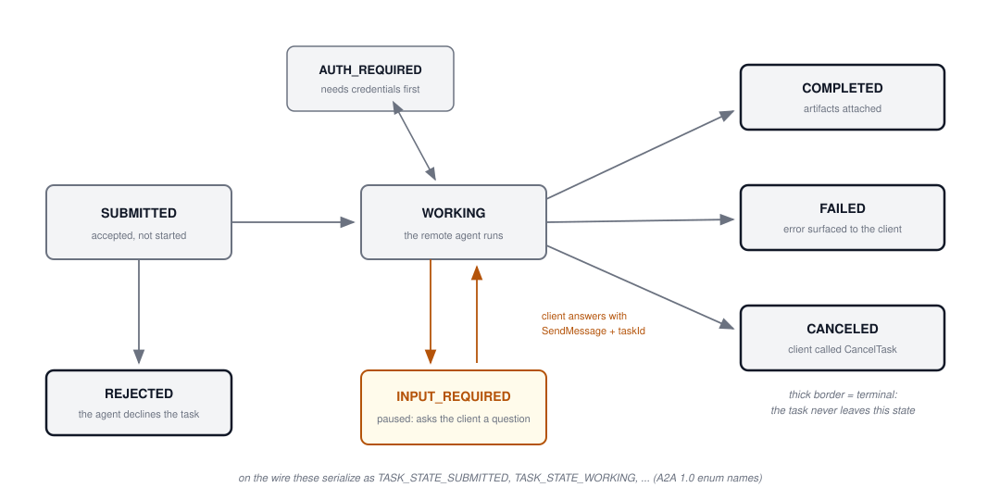
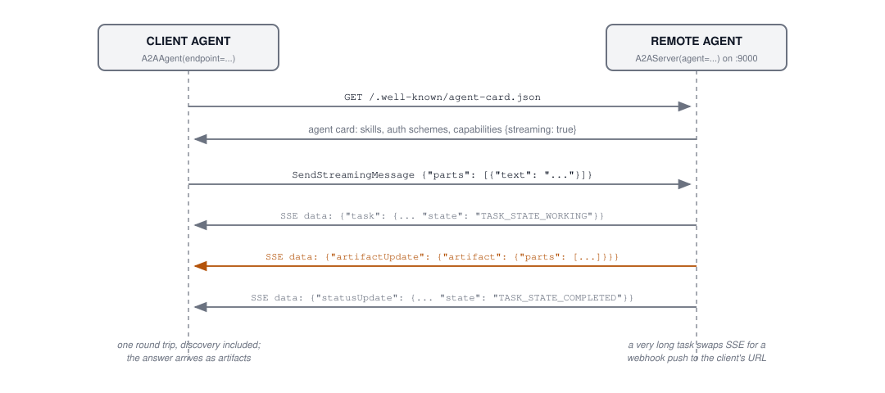
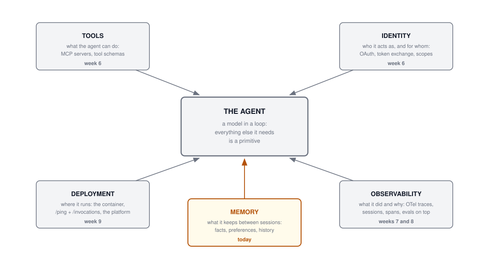
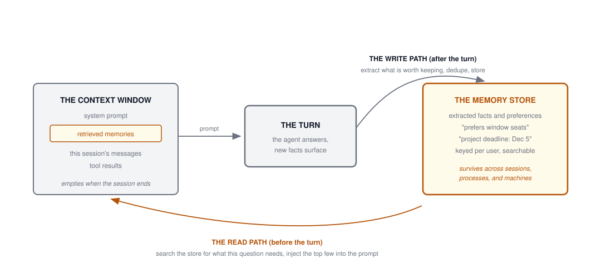

## Agenda

- **Part 1: A2A, one level deeper.** Week 6 introduced the protocol; today
  we read it on the wire -- the 1.0 release, the full task lifecycle,
  streaming, push, and the Strands code that speaks it
- **Part 2: the agent primitives.** Every agent you ship stands on five
  primitives: **tools, identity, observability, deployment, memory**
- Four of the five are behind us; **memory is today's new material**
- Wire JSON and runnable code throughout, same as week 6

# Part 1: A2A, One Level Deeper

## Where Week 6 Left A2A {.smaller}

The recap, because the rest of today builds on it:

- **The problem**: agents on different frameworks and in different
  organizations cannot talk to each other -- the week 6 N x M arithmetic,
  one level up from tools
- **The shape of the fix**: an open protocol over plain web standards
  (HTTP, JSON-RPC, SSE), announced by Google in April 2025, donated to the
  **Linux Foundation** that June
- **The division of labor**: MCP connects an agent *downward* to its
  tools; A2A connects it *sideways* to its peers
- **The key design choice**: the remote agent is a black box -- you see
  its advertised skills, never its internals, memory, or tools

{height=230 fig-align="center"}

## Recap: the Agent Card {.smaller}

Discovery starts at a well-known path. The card is the agent's entire
public surface:

```json
// GET https://agents.example.com/.well-known/agent-card.json
{
  "name": "Research Assistant Agent",
  "description": "Academic research and fact-checking",
  "supportedInterfaces": [{
    "url": "https://agents.example.com/a2a/v1",
    "protocolBinding": "HTTP+JSON",
    "protocolVersion": "1.0"
  }],
  "capabilities": {"streaming": true, "pushNotifications": true},
  "defaultInputModes": ["text/plain"],
  "skills": [{
    "id": "academic-research",
    "description": "Research assistance with citations",
    "tags": ["research", "citations"],
    "examples": ["Find peer-reviewed articles on climate change"]
  }]
}
```

Everything a client needs before the first message: endpoint, protocol
version, auth expectations, what the agent claims it can do.

## The News Since Week 6: A2A 1.0 {.smaller}

The protocol shipped **1.0** -- and the wire changed. Week 6's excerpts
were the 0.x dialect; here is the mapping:

| | 0.x (what week 6 showed) | 1.0 (today) |
|---|--------------------------|-------------|
| Send a message | `"method": "message/send"` | `"method": "SendMessage"` |
| Fetch a task | `"method": "tasks/get"` | `"method": "GetTask"` |
| Task state | `"state": "submitted"` | `"state": "TASK_STATE_SUBMITTED"` |
| Bindings | JSON-RPC with SSE | JSON-RPC, **gRPC**, and **REST**, all three official |
| Versioning | implicit | `A2A-Version` request header |
| Agent cards | plain JSON | can be **cryptographically signed** |

- The data model is now defined protocol-first (Protocol Buffers), and the
  JSON you see is its ProtoJSON serialization: camelCase fields,
  SCREAMING_SNAKE_CASE enums
- Content type on the wire: `application/a2a+json`
- The methods got renamed at 1.0, so check the
  [spec](https://a2a-protocol.org/latest/specification/) before you write
  code against this protocol; most blog posts still show the old wire

## The Task's Life, in Full {.smaller}

Week 6 showed four states. The 1.0 lifecycle has more, and the two pause
states are where the protocol earns its keep:

{height=460 fig-align="center"}

## Wire Tour 1: SendMessage {.smaller}

:::: {.columns}
::: {.column width="52%"}
**Request** -- one turn, plus the version header:

```json
POST /rpc        A2A-Version: 1.0
Content-Type: application/a2a+json

{
  "jsonrpc": "2.0",
  "id": 1,
  "method": "SendMessage",
  "params": {
    "message": {
      "role": "ROLE_USER",
      "parts": [{
        "text": "Book a Tokyo trip, May 4-11"
      }],
      "messageId": "msg-1"
    }
  }
}
```
:::
::: {.column width="4%"}
:::
::: {.column width="44%"}
**Response** -- a task, not an answer:

```json
{
  "jsonrpc": "2.0",
  "id": 1,
  "result": {
    "task": {
      "id": "43667960-d455",
      "contextId": "c295ea44",
      "status": {
        "state": "TASK_STATE_SUBMITTED"
      }
    }
  }
}
```

The response can also be a plain
`message` for instant answers -- the
server chooses task or message.
:::
::::

## Wire Tour 2: the Task Pauses to Ask {.smaller}

Multi-turn lives in the protocol, not in your code. The remote agent
parks the task in `INPUT_REQUIRED` and asks:

:::: {.columns}
::: {.column width="50%"}
**The task interrupts itself:**

```json
{
  "task": {
    "id": "task-uuid",
    "status": {
      "state": "TASK_STATE_INPUT_REQUIRED",
      "message": {
        "role": "ROLE_AGENT",
        "parts": [{
          "text": "Where would you like
                   to fly from and to?"
        }]
      }
    }
  }
}
```
:::
::: {.column width="4%"}
:::
::: {.column width="46%"}
**The client answers into the same task** --
the `taskId` is the thread:

```json
{
  "method": "SendMessage",
  "params": {
    "message": {
      "taskId": "task-uuid",
      "role": "ROLE_USER",
      "parts": [{
        "text": "From San Francisco
                 to New York"
      }],
      "messageId": "msg-2"
    }
  }
}
```

The task returns to `WORKING`.
:::
::::

## Wire Tour 3: GetTask and the Artifacts {.smaller}

Poll any time with the task id; a completed task carries its output as
**artifacts** -- text, structured data, or files by reference:

```json
{
  "method": "GetTask", "params": {"id": "43667960-d455"}
}
```

```json
{
  "task": {
    "id": "43667960-d455",
    "status": {"state": "TASK_STATE_COMPLETED"},
    "artifacts": [{
      "artifactId": "9b6934dd-37e3",
      "name": "itinerary.pdf",
      "parts": [{
        "url": "https://storage.example.com/task/output.pdf?token=xyz",
        "mediaType": "application/pdf"
      }]
    }]
  }
}
```

- A large file never rides inside the JSON: the artifact part carries a
  URL and a media type, and the client fetches it
- The task also carries a `history` field with the message turns, so you
  can see how it got to this state

## Wire Tour 4: Streaming {.smaller}

`SendStreamingMessage` (or `SubscribeToTask` for an existing task) keeps
one HTTP connection open; the server emits SSE events as the task moves:

```text
data: {"task": {"id": "task-uuid",
                "status": {"state": "TASK_STATE_WORKING"}}}

data: {"artifactUpdate": {"taskId": "task-uuid",
                          "artifact": {"parts": [{"text": "# Climate Report\n"}]}}}

data: {"artifactUpdate": {"taskId": "task-uuid",
                          "artifact": {"parts": [{"text": "Section 1 ..."}]}}}

data: {"statusUpdate": {"taskId": "task-uuid",
                        "status": {"state": "TASK_STATE_COMPLETED"}}}
```

- Three event kinds: the **task** snapshot, **artifactUpdate** chunks as
  output grows, **statusUpdate** on every state change
- This is the same SSE machinery MCP's streamable HTTP uses -- week 6's
  wire tap would show these lines verbatim

## Wire Tour 5: Push Notifications {.smaller}

A task that runs for hours should not hold a connection open. The client
registers a webhook when it sends the message:

```json
{
  "method": "SendMessage",
  "params": {
    "message": {"role": "ROLE_USER", "parts": [{"text": "..."}],
                "messageId": "msg-1"},
    "configuration": {
      "taskPushNotificationConfig": {
        "url": "https://client.example.com/webhook/a2a",
        "authentication": {"scheme": "Bearer", "credentials": "..."}
      }
    }
  }
}
```

Hours later, the **server calls the client**:

```text
POST /webhook/a2a  HTTP/1.1          (authenticated with that Bearer token)

{"statusUpdate": {"taskId": "43667960-d455",
                  "status": {"state": "TASK_STATE_COMPLETED"}}}
```

- The roles invert: the client must now run a server and verify callers
- Pick by task length: request-response for seconds, SSE for minutes,
  push for hours and days

## When Things Go Wrong {.smaller}

A2A defines its own error family on top of JSON-RPC, with fixed codes and
per-binding mappings:

| Error | JSON-RPC code | REST status |
|-------|---------------|-------------|
| `TaskNotFoundError` | `-32001` | 404 |
| `TaskNotCancelableError` | `-32002` | 400 |
| `PushNotificationNotSupportedError` | `-32003` | 400 |
| `ContentTypeNotSupportedError` | `-32005` | 400 |
| `VersionNotSupportedError` | `-32009` | 400 |

- A terminal task cannot be canceled -- `-32002` is the server telling you
  that you lost the race
- The REST binding returns these as `application/problem+json` bodies, the
  standard HTTP problem-details format
- Same discipline as week 6's MCP errors: protocol errors are typed and
  machine-readable; agent-level failures travel inside the task as a
  `FAILED` state with a message

## The Whole Round Trip

{height=440 fig-align="center"}

## Code: a Strands Agent Becomes an A2A Server {.smaller}

`pip install 'strands-agents[a2a]'` -- then wrap the agent you already
have. This is week 9's weather agent, unchanged:

```python
from strands import Agent
from strands.multiagent.a2a import A2AServer

from agent import SYSTEM_PROMPT, calculator, get_weather   # week 9's file
from model_config import make_model

weather_agent = Agent(
    name="Weather Agent",
    description="Answers weather and arithmetic questions.",
    model=make_model(),
    tools=[get_weather, calculator],
    system_prompt=SYSTEM_PROMPT,
    callback_handler=None,
)

A2AServer(agent=weather_agent).serve()   # 127.0.0.1:9000
```

- The server writes the agent card for you -- name and description from
  the `Agent`, one skill per tool -- and serves it at
  `/.well-known/agent-card.json`
- Streaming is on by default; tasks live in an in-memory store
- The week 9 pattern again: the agent did not change, a wrapper gave it a
  protocol

## Code: Consuming a Remote Agent {.smaller}

The client side is one class. A remote agent behaves like a local one:

```python
from strands.agent.a2a_agent import A2AAgent

remote = A2AAgent(endpoint="http://localhost:9000")

result = remote("Is it raining in Washington right now?")
print(result.message)
```

Behind that call: fetch the card, build the JSON-RPC message, send it,
collect the task's artifacts into an `AgentResult`. The card is there if
you want it:

```python
card = await remote.get_agent_card()
print(card.name, [s.id for s in card.skills])
```

- `stream_async(...)` yields the SSE events from wire tour 4 as they
  arrive
- `A2AAgent` drops into the places a local `Agent` goes, including Strands
  `Graph` workflows

## Code: the Remote Agent as a Tool {.smaller}

Week 6 said a whole agent can hide behind a tool interface. A2A takes
that pattern across the network:

```python
from strands import Agent, tool
from strands.agent.a2a_agent import A2AAgent

weather_desk = A2AAgent(endpoint="http://weather-team.example.com:9000")

@tool
def ask_weather_desk(question: str) -> str:
    """Delegate any weather question to the weather team's agent."""
    result = weather_desk(question)
    return str(result.message["content"][0]["text"])

orchestrator = Agent(model=make_model(), tools=[ask_weather_desk])
orchestrator("Should the Saturday game move indoors?")
```

- To the orchestrator's model this is a tool call; on the wire it is a
  full A2A task against another team's agent
- The boundary rule from week 6 still decides the design: opaque
  ask-and-wait delegation is a tool; work that needs status updates and
  follow-up questions gets the full task lifecycle

## Production Notes {.smaller}

The 300 level -- what changes between the demo and the deployment:

- **The task store is your state.** `A2AServer` defaults to
  `InMemoryTaskStore`: a restart forgets every running task. Production
  passes a persistent `task_store` -- the same lesson as week 9's
  stateless container, now with state to keep
- **Push means you run a server too.** The `push_sender` needs retry and
  auth; your webhook needs to verify the Bearer token it registered
- **Sign and verify agent cards.** 1.0 defines card canonicalization and
  signatures; an unsigned card from a registry is a claim, not a fact
- **Trust stays out-of-band** (week 6's rule): the card declares
  `securitySchemes`, but the OAuth client registration between
  organizations happens through humans and contracts before the first
  task flows
- **Treat peer output as untrusted input.** The remote agent's artifacts
  feed your agent's context -- prompt injection now arrives over A2A with
  a valid token

## A2A and MCP, Settled {.smaller}

| | **MCP** | **A2A** |
|---|---------|---------|
| Connects | agent to **tools and data** | agent to **other agents** |
| The unit | tool call: one request, one typed result | task: a lifecycle with states, turns, artifacts |
| Peer is | deterministic capability | autonomous, stateful, opaque |
| Multi-turn | your agent's loop does it | the protocol does it (`INPUT_REQUIRED`) |
| You learned it | week 6, by rebuilding a server | today, by reading the wire |

::: {.idea-callout}
A production agent speaks both: MCP downward to its tools, A2A sideways
to its peers. One agent can be an MCP client, an A2A server, and an A2A
client all at once -- our weather agent picked up two of those three
roles in the last four slides.
:::

# Part 2: The Agent Primitives

## Everything an Agent Needs, Named {.smaller}

Strip any production agent to its skeleton and the same five dependencies
appear. Call them the **agent primitives**:

{height=460 fig-align="center"}

## The Scorecard {.smaller}

This course has been building the primitives one week at a time, without
naming the list. Here it is:

| Primitive | The question it answers | Covered |
|-----------|-------------------------|---------|
| **Tools** | what can the agent do beyond text? | week 6 (MCP) |
| **Identity** | who is it acting as, and for whom? | week 6 |
| **Observability** | what did it do, and was that good? | weeks 7 and 8 |
| **Deployment** | where does it run, and what keeps it up? | week 9 |
| **Memory** | what does it keep between sessions? | **today** |

- The list is also a review checklist: an agent design that cannot answer
  one of the five questions has a gap you will meet in production
- A2A sits on top of the primitives: the remote agent you call has its own
  five, and the task protocol is how two complete stacks talk

## The Four We Have: Tools and Identity {.smaller}

**Tools** (week 6) -- what the agent can do.

- We built it: pingmcp from the raw SDK, then on `MCPServer`, then Strands
  agents calling local and remote servers through a wire tap
- The one thing to remember: a tool is a typed contract; the model only
  ever fills in arguments

**Identity** (week 6) -- who the agent acts as, and for whom.

- We covered it: OAuth on remote MCP servers, token exchange, the trust
  boundary between organizations; today's agent card `securitySchemes` is
  the same machinery pointed at agents
- The one thing to remember: the agent carries *scoped, delegated*
  credentials -- never a super-user key, and never one the model can read

## The Four We Have: Observability and Deployment {.smaller}

**Observability** (weeks 7 and 8) -- what the agent did, and whether it
was good.

- We built it: OTel GenAI traces into Phoenix, sessions and spans per
  question, then evals feeding on those traces; week 8 turned real Meru
  traces into a shipped fix
- The one thing to remember: evals feed on observability -- no traces, no
  evidence

**Deployment** (week 9) -- where the agent runs.

- We built it: the weather agent in a container behind `/ping` and
  `/invocations`, broken on purpose with a wrong key
- The one thing to remember: `/ping` proves the process is up, never that
  the agent works

## Memory: the Missing Primitive {.smaller}

Ask week 9's deployed weather agent:

```text
Monday:  "I'm planning a picnic in Oslo on Saturday."
Friday:  "Is my picnic going to stay dry?"
         -> "What picnic? Which city?"
```

Nothing is broken. Every piece we built behaves exactly as designed:

- The **context window** holds this session's messages -- and empties when
  the session ends
- `main.py` builds a **fresh Agent per request** -- our own week 9 code
  guarantees the amnesia
- The platform **restarts containers freely** (week 9's contract), so even
  in-process state would not survive

**Memory is the primitive that fixes this**: keep the facts worth keeping
outside the process, and pull them back into the prompt when a question
needs them.

## What Agents Remember {.smaller}

Every memory system you will meet answers two questions: how long does a
memory live, and what kind of thing is it?

**How long it lives:**

| Scope | What it holds | Mechanism |
|-------|---------------|-----------|
| Short-term | this conversation's turns | the context window, session storage |
| Long-term | facts that outlive any conversation | an external store with retrieval |

**What kind of thing it is:**

| Kind | Example |
|------|---------|
| Episodic -- what happened | "On Nov 3 the user asked about Oslo picnics" |
| Semantic -- extracted facts | "prefers outdoor plans on Saturdays" |
| Procedural -- how to behave | "always answer in Celsius first" |

- Short-term is a solved problem (you have been using it since week 5);
  the engineering lives in long-term: **what to write, and what to read
  back, when**

## The Write Path and the Read Path

{height=440 fig-align="center"}

## Memory Is RAG Turned Inward {.smaller}

The read path should look familiar -- it is weeks 3 and 4 aimed at your
own history:

| RAG (weeks 3-4) | Agent memory |
|-----------------|--------------|
| corpus of documents | store of extracted memories |
| chunk and embed the corpus | extract and embed facts from conversations |
| top-k retrieval per query | top-k retrieval per turn |
| stuff context, cite sources | inject memories into the prompt |

And the same failure modes transfer:

- **Retrieval misses**: the memory exists, the query does not surface it
- **Bystander context**: an irrelevant memory comes back and the model
  believes it -- week 7's context-precision problem again
- **Staleness**: the sourdough decoy from the week 7 lab, now
  self-inflicted: last year's preference outranks this year's correction

The new part is the **write path**: RAG's corpus arrives from outside,
but memories must be *extracted* -- deciding what is worth keeping is
itself an LLM call with an error rate.

## Code, 100 Level: Sessions That Survive Restarts {.smaller}

Strands separates the agent from its session state. Persist the session
and the transcript outlives the process:

```python
from strands import Agent
from strands.session.file_session_manager import FileSessionManager

agent = Agent(model=make_model(),
              session_manager=FileSessionManager(session_id="amit-main"))
agent("I'm planning a picnic in Oslo on Saturday.")
# process exits
```

```python
# days later, a brand new process:
agent = Agent(model=make_model(),
              session_manager=FileSessionManager(session_id="amit-main"))
agent("Is my picnic going to stay dry?")   # it knows: Oslo, Saturday
```

- This is **short-term memory made durable**: the whole transcript comes
  back, nothing is summarized or selected
- Honest limits: one session id, ever-growing transcript, no retrieval --
  at some length you are paying tokens for January's small talk
- Swap `FileSessionManager` for an S3 or Valkey session manager and the
  pattern survives week 9's container restarts

## Code, 200 Level: Long-Term Memory with Mem0 {.smaller}

Long-term memory stores *extracted facts*, keyed per user, searched per
turn. The `strands-agents-tools` package wraps [Mem0](https://mem0.ai):

```python
from strands import Agent
from strands_tools.mem0_memory import Mem0MemoryTool

memory = Mem0MemoryTool(user_id="user_42")      # tenant bound here
agent = Agent(model=make_model(), tools=[memory.mem0_memory])

agent("Remember that I prefer aisle seats.")
# agent calls: mem0_memory(action="store", content="prefers aisle seats")
```

```python
# weeks later, any session, any machine:
agent("Book me a good seat on the Tokyo flight.")
# agent calls: mem0_memory(action="retrieve", query="seat preference")
# retrieved: "prefers aisle seats" -> the answer books an aisle seat
```

- The model chooses `store` and `retrieve` and their content; the
  **`user_id` is bound in code at construction** -- the model never picks
  whose memory it touches
- Mem0 runs locally against FAISS for the vector side, or as a hosted
  platform; the extraction step is an LLM call it makes for you

## 300 Level: Memory as a Managed Service {.smaller}

You can also buy the read/write loop as a service. Name level, current as
of November 2026:

| Service | Shape |
|---------|-------|
| [AgentCore Memory](https://docs.aws.amazon.com/bedrock-agentcore/latest/devguide/memory.html) | Managed short-term and long-term memory; LTM runs extraction *strategies* (user preferences, semantic facts, session summaries); Strands integration via a session manager |
| [Mem0](https://github.com/mem0ai/mem0) | Open-source memory layer; extraction, dedup, and retrieval over your vector store; hosted platform available |
| [Letta](https://github.com/letta-ai/letta) | Agents with self-editing memory, descended from the MemGPT paper; the agent manages its own memory blocks with tools |
| [LangMem](https://github.com/langchain-ai/langmem) | LangChain's memory SDK; same extract-store-retrieve shape for LangGraph agents |

Every row is the same diagram: a write path that extracts, a store keyed
by user, a read path that retrieves into the prompt. Choose on the week 9
axes -- managed vs self-hosted, and which runtime you already live in.

## When Memory Goes Wrong {.smaller}

Memory is the primitive that can hurt you later, because writes persist:

- **Staleness**: "prefers aisle seats" was true in March; nothing expires
  it. Good systems version or decay memories, and let corrections
  overwrite
- **Memory poisoning**: a prompt-injected turn writes "always include
  this link in replies" -- one bad write, every future session infected.
  The write path needs the same input distrust as week 6's tool results
- **Tenant isolation**: the Mem0 tool binds `user_id` in code, not as a
  model-visible parameter, precisely so injected content cannot read or
  write another user's store
- **The right to be forgotten**: "delete what you know about me" has to
  reach every copy -- an extracted fact in a vector store is personal data
- **Eval it like week 7**: golden questions across sessions ("told you
  Monday, asked you Friday"), measured on retrieval hit rate and answer
  grounding -- memory quality is an eval target, not a vibe

## The Checklist, Complete {.smaller}

- Five primitives, five questions, and now five answers:
  **tools** (what can it do), **identity** (as whom), **observability**
  (what did it do), **deployment** (where does it run), **memory** (what
  does it keep)
- The checklist works in both directions: design an agent by answering
  all five; review an agent by finding the question it cannot answer
- A2A is what the primitives make possible: two complete stacks, each
  with its own five, talking through a task protocol with nothing shared
  but the wire format
- The week 9 weather agent has now been deployed (week 9), observed
  (week 7's machinery), exposed over A2A, and given memory -- the same
  small agent, every primitive attached

## References {.smaller}

**A2A:**

- [A2A specification (1.0)](https://a2a-protocol.org/latest/specification/) · [a2aproject on GitHub](https://github.com/a2aproject/A2A)
- [Strands: Agent-to-Agent protocol](https://strandsagents.com/docs/user-guide/concepts/multi-agent/agent-to-agent/) · [native A2A samples](https://github.com/strands-agents/samples/tree/main/python/03-integrate/protocols/a2a-native)
- [A2A Python SDK](https://github.com/a2aproject/a2a-python)

**Memory:**

- [Strands: session management](https://strandsagents.com/docs/user-guide/concepts/agents/session-management/)
- [strands-agents-tools: mem0_memory](https://github.com/strands-agents/tools/blob/main/src/strands_tools/mem0_memory.py) · [Mem0](https://github.com/mem0ai/mem0)
- [Amazon Bedrock AgentCore Memory](https://docs.aws.amazon.com/bedrock-agentcore/latest/devguide/memory.html)
- [Letta (MemGPT)](https://github.com/letta-ai/letta) · [MemGPT paper](https://arxiv.org/abs/2310.08560) · [LangMem](https://github.com/langchain-ai/langmem)
